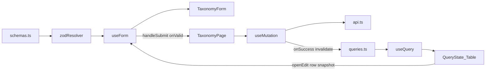

# Step 7 引导式开发：教材分类（无删除变体）

> 本文对应 [03-开发计划](./03-开发计划.md) 的 Step 7。  
> 它是一份任务引导，不提供可以整段复制的最终页面。请先自己完成每个检查点，卡住后再展开提示。  
> 质量要求以 [01-工程契约](./01-工程契约.md) 为准。

本步 **没有** 测试检查点。Vitest 仍延后到 Step 16。验收以「手动验证矩阵」+ `pnpm verify`（lint + type-check）为准。

Step 6 已经把「筛选 + Table + Dialog + 删」跑通。本步 **不再重讲** `useQuery` / `invalidateQueries` / `Controller` 的 API。同样逻辑直接打开历史文件；本文只写 taxonomy 增量，以及 **zodResolver、TanStack Query、useForm 混用时谁拥有什么**。

## 1. 本步目标

把占位页收成第二条垂直切片：`features/taxonomy` 自包含，范式跟标签页相同，产品规则不同。

```text
和 Tag 相同（不要再发明一套）
  api.ts / queries.ts / schemas.ts / pages / 本域 Form
  筛选 state → queryKey → useQuery → QueryState + Table
  一份 useForm + 一个 Dialog + 创建/编辑 mutation
  写成功只靠 invalidateQueries，没有第二份 list

和 Tag 不同（抄 Tag 会错）
  无 DELETE；操作列只有「编辑」
  筛选全是离散 Select（grade / semester / status），没有 keywordDraft
  表单字段更多；唯一约束是「版本+年级+册次+单元」四元组，不是名称
```

完成后必须满足：

- 年级 / 册次 / 状态筛选可用；改筛选时 `page` 回到 1。
- 创建 / 编辑可用；源码与 UI **都没有**删除入口。
- 写字段与后端 DTO 一致；`queryKeys` + zod；无 `useEffect` 拉数。
- 能口头画出 zod / RHF / Query 的文件边界，指出混用只发生在 Page。
- `pnpm verify` 通过（lint + type-check）。

关于 03 验收里的「年级/册次/单元/标题筛选」：

- **列表 query** 以后端 [`ListTaxonomyUnits`](../../course_server/internal/handler/admin_taxonomy.go) 为准，只有 `grade` / `semester` / `status` + 分页。
- **单元 / 标题** 是表单字段（`unit` / `unitTitle`），不是 list 参数。不要为了贴 03 字面去发后端会忽略的 query。

## 2. 本步边界

本步只做 `features/taxonomy`。路由 `/taxonomy` 已在 [`src/app/router/index.ts`](../src/app/router/index.ts) 挂好，不要改壳。

本步允许：

- 使用已有 `AppFormDialog` / `QueryState` / `PageHeader` / `App.useApp()`。
- 使用已有 `GRADE_OPTIONS` / `SEMESTER_OPTIONS` / `UNIT_OPTIONS` / `STATUS_OPTIONS` / `statusLabel` / `TaxonomyUnit` / `PageData`。
- 对照 Tag 的文件职责和接线，**复制范式、改字段**。
- 检查点 9 做一次复制量体检；默认 **不抽** hook。仅当 `queryStatus` 派生几乎逐字相同时，才允许极薄 list hook。

本步禁止：

- 抽万能 `useCrud` / `useListPage`。表单 + mutation + columns 仍留在本域。
- `useEffect` 拉列表，或 `const [list, setList]`。
- 抄 Tag 的启用 / 禁用 / 删除 / `Popconfirm` / `keywordDraft`。
- 在 axios 或 Query 全局回调里 `message`。
- 给其它域写真页面（OSS 是 Step 8）。
- 安装测试依赖、改 `verify`、补 schema 单测。
- 修改只读对照项目 `Admin/`。
- 把 [05](./05-learn-zod-rhf.md) / [08](./08-learn-tanstack-query.md) 的 API 清单再抄进本页。

## 3. 开始状态与文件范围

开始前应保持 Step 6 已通过：

- [`TagPage.tsx`](../src/features/tag/pages/TagPage.tsx) 是可对照的完整范式。
- QueryClient 已挂；登录真调可用；端口 **5174**。
- 后端 `course_server` 已启动（默认账号 `admin / admin123`）。
- [`TaxonomyPage.tsx`](../src/features/taxonomy/pages/TaxonomyPage.tsx) 目前只是 `Empty` 占位。

本步预计新增或修改：

```text
src/features/taxonomy/
├── api.ts                              # 新建：HTTP + 本域 query / write 类型
├── queries.ts                          # 新建：taxonomyKeys + queryOptions
├── schemas.ts                          # 新建：写表单 zod
├── pages/
│   ├── TaxonomyPage.tsx                # 替换 Empty
│   └── TaxonomyPage.module.css         # 本步直接给出，见检查点 7
└── components/
    └── TaxonomyForm.tsx                # 只渲染字段，不发请求
```

本步 **不要** 安装新依赖，**不要** 改 `shared/`（选项和 `TaxonomyUnit` 已经在）。

## 4. 使用方式

每个检查点按下面顺序完成：

1. 只看「任务」和「完成信号」，先自己设计。
2. 卡住时再看「提示一」。
3. 仍无法推进再看「提示二」。
4. 完成后回答「自检问题」。
5. 每个检查点结束都跑最小验证，不要最后一次性排错。

### 同样逻辑去哪看（不要在本文找 API 解释）

| 要做的事 | 打开这个，不要重写一遍 |
|---|---|
| `queryKeys` 三层 + `queryOptions` + `signal` | [`tag/queries.ts`](../src/features/tag/queries.ts) |
| `toListParams` 把 UI 的 `''` 翻译成「不传」 | [`tag/api.ts`](../src/features/tag/api.ts) 的 `toTagListParams` |
| `useForm<Input, unknown, Output>` + `zodResolver` | [`TagPage.tsx`](../src/features/tag/pages/TagPage.tsx) 第 35–43 行；更简的无 Dialog 版见 [`LoginPage.tsx`](../src/features/auth/pages/LoginPage.tsx) 第 16–26 行 |
| `useQuery` + `keepPreviousData` | TagPage 第 44–47 行 |
| 三个（本步两个）`useMutation` + `invalidateQueries(lists())` | TagPage 第 52–71 行 |
| 打开创建 / 编辑时 `reset` | TagPage 第 75–89 行 |
| `onValid` 里 `mutateAsync` + toast + 关窗 | TagPage 第 91–104 行 |
| 四态派生 + Table 受控分页 | TagPage 第 184–256 行 |
| 字段组件只吃 `control` / `errors` | [`TagForm.tsx`](../src/features/tag/components/TagForm.tsx) |
| Dialog 点确定如何接到 `handleSubmit` | TagPage 第 260–268 行 |
| Query 二维状态、`mutate` vs `mutateAsync`、RHF `reset` | [13-疑问点记录.md](./13-疑问点记录.md) §3、§4 |

### 本步增量去哪看

| 要确认的事实 | 去哪看 |
|---|---|
| `GET/POST /taxonomy-units`、`PUT /taxonomy-units/:id`；**无 DELETE** | [api-reference.md](../../course_server/docs/api-reference.md) §3.4；路由见 `course_server/internal/router/router.go` |
| 列表 query 只有 grade / semester / status | `ListTaxonomyUnits` |
| 写字段与默认 `统编版` | `internal/dto/admin/taxonomy_unit.go` |
| 四元组重复拒绝 | `CheckTaxonomyUnitDuplicate`；英文 message 原样 toast |
| 年级 / 册次 / 单元选项 | [`shared/constants/options.ts`](../src/shared/constants/options.ts) |
| 实体类型 | [`shared/types`](../src/shared/types/index.ts) 的 `TaxonomyUnit` |

本步不要去翻 `Admin/src`。Vue 的 `load()`、`list ref`、「查询 / 重置」按钮、pageSize 切换，落在 01 的禁止照搬清单里。

---

## 5. 架构主课：三件套分离（混用只发生在页面）

Step 6 已经分别用过这三套。Step 7 要锁住的是：**它们不是三个可以互相 import 的工具箱，而是三条不许交叉的所有权线。** 页面是唯一合法的接线层。

```text
schemas.ts          zod：这份输入合不合法
                    不 import RHF / Query / antd

zodResolver         适配器：把 schema.parse 的结果翻成 RHF errors
                    不是第三套状态

useForm             表单状态机：值、脏、提交、字段错误
                    不发 HTTP，不进 Query cache

TaxonomyForm        只渲染字段；只吃 control / errors
                    禁止 useMutation / useQueryClient

queries.ts          只放读：key 工厂 + queryFn
                    不放 create/update，不 import zod / RHF

useQuery            服务端列表的订阅
useMutation         服务端写的状态机
                    不拥有输入框里的值

api.ts              只描述 path / params / body
                    不校验表单，不弹 toast

TaxonomyPage        唯一允许同时 import 三套的地方
```



页面上只发生四次跨界，多一次就是分层破了：

| 时机 | 从 | 到 | 正确写法 | 错误写法 |
|---|---|---|---|---|
| 改筛选 | 页面 `useState` | Query | `setQuery` 换 key | `refetch(newParams)`；Effect 同步 draft |
| 点确定 | RHF | Mutation | `handleSubmit(onValid)` → `mutateAsync(input)` | Dialog 自己 `createXxx()`；`onValid` 里再 `schema.parse` |
| 写成功 | Mutation | Query | hook 级 `invalidateQueries(lists())` | `setList`；只 invalidate 当前 `list(query)` |
| 点编辑 | Query `data` 的一行 | RHF | 点击里 `reset(行字段)` | `useEffect(() => reset(row))`；把行对象塞进 Query cache 当表单 |

### 接线只看这几处（不要展开库百科）

`useForm` 的 generic 与 resolver，照 TagPage 第 35–43 行：

```ts
useForm<TaxonomyWriteInput, unknown, TaxonomyWriteOutput>({
  resolver: zodResolver(taxonomyWriteSchema),
  defaultValues: createDefaults,
})
```

Dialog 不会帮你跑 resolver。照 TagPage 第 265 行：

```ts
onSubmit={() => void handleSubmit(onValid)()}
confirmLoading={editing ? updateMutation.isPending : createMutation.isPending}
```

`onValid` 收到的已经是 Output，不要在 `mutationFn` 里再 parse。校验失败 RHF 不调 `onValid`，窗不关，`confirmLoading` 仍是 false——前提是你没有手写一份 `confirmLoading` state。

Ant `Form` 只当 `layout` + `Form.Item` 外壳，与 [`TagForm.tsx`](../src/features/tag/components/TagForm.tsx) 相同。不要再写 `onFinish`。LoginPage 把 `onFinish={handleSubmit(onSubmit)}` 写在页内 Form 上，是因为登录没有 Dialog；本步有 Dialog，提交入口在壳上。

`useForm` 放在 Page，不要放进随 `destroyOnHidden` 卸载的 Dialog 子树。否则 resolver 和当前模式（创建 / 编辑）会跟着卸掉。Tag 已经这么放了。

### 常见跨层错误（本步审查会盯）

- `schemas.ts` import `useForm` 或 antd。zod 不管 UI。
- `queries.ts` 里写 `createTaxonomyUnit`。写不是 query。
- `TaxonomyForm` 自己 `useMutation`。Dialog 确定按钮会变成摆设，或出现双提交。
- 表单值 `setQuery` 进列表 key。输入框不是列表。
- 列表 `data.list` 再 `useState` 一份。Query cache 就是 list。
- Ant Form 与 RHF 两套 `onFinish`。01 禁止项。

概念仍模糊时读 [13](./13-疑问点记录.md)，不要在 taxonomy 文件里用注释复述 Query API。

---

## 检查点 1：先写下产品契约，标出「不要抄 Tag 的」

### 当前问题

标签页是「名称 + 状态 + 删除规则」。教材分类看起来也是一张表 + 一个弹窗，字段和禁区却不一样。先把契约写在纸上，再碰文件。

### 任务

填完下面三张表。数值以后端为准。

**1. 列表查询（`GET /taxonomy-units`）**

| 参数 | 类型 | 规则 |
|---|---|---|
| `grade` | `Grade \| ''` | 不传 = 全部；不要传空串 |
| `semester` | `Semester \| ''` | 同上 |
| `status` | `'' \| EnableStatus` | 同上 |
| `page` | number | 从 1 起 |
| `pageSize` | number | 本页 UI 锁 **10**，`showSizeChanger: false`（跟 Tag，不跟 Vue 的 20 + 条数切换） |

没有 `keyword`，没有 `unit` / `unitTitle` 筛选。响应是 `PageData<TaxonomyUnit>`。排序由后端做：`grade ASC, semester ASC, unit ASC, sort_order DESC`。前端不要本地 sort。

**2. 实体与写入口**

| 字段 | 列表 | 创建/编辑 | 规则 |
|---|---|---|---|
| `id` | 不用展示 | 不出现在表单 | 路径参数 |
| `textbookVersion` | 要 | 要 | trim；最长 40；缺省 **统编版** |
| `grade` | 要 | 要 | `GRADE_OPTIONS`：1–6 |
| `semester` | 要 | 要 | `上册` / `下册` |
| `unit` | 要 | 要 | `UNIT_OPTIONS`：1–8 |
| `unitTitle` | 要 | 要 | 可选；trim；最长 120 |
| `sortOrder` | 要 | 要 | 整数；表单始终带上（不要靠后端「未传则自增」） |
| `status` | 要 | 要 | `1` / `0`；创建缺省启用 |
| `createdAt` / `updatedAt` | 至少展示一个 | 不出现 | 原样显示 |

`TaxonomyUnit` 已在 shared。本域不要再定义一份会漂移的类型。

**3. 写操作规则**

| 操作 | 接口 | 前端先拦住 | 后端仍可能拒绝 |
|---|---|---|---|
| 创建 | `POST /taxonomy-units` | zod：年级 / 册次 / 单元必选 | 四元组重复 |
| 更新 | `PUT /taxonomy-units/:id` | 同上；body 仍是完整写字段 | 四元组与其它行冲突 |
| 删除 | **不存在** | 不渲染按钮 | — |

重复时的后端 message（原样 toast，不要翻译）：

- `taxonomy unit with same textbook version, grade, semester and unit already exists`

### 提示一

状态分层仍然是 Tag 那张表，只是本步没有删除 mutation、没有 keyword 草稿：

| 数据 | 放哪 |
|---|---|
| 当前页的 `list` / `total` | Query cache |
| `grade` / `semester` / `status` / `page` / `pageSize` | 页面 `useState`（已生效的查询条件） |
| 弹窗开关、正在编辑的行 | 页面 `useState` |
| 表单值 | RHF |

三个筛选都是离散值，改了就是新的查询条件，**不必**再做一份 draft。

### 提示二

操作列不要从 TagPage 第 151–178 行抄。那里有启用 / 禁用 / 删除。本页只留「编辑」。状态只能通过打开编辑改。

### 完成信号

不写组件也能回答：列表有哪些 query；创建提交哪几个字段；为什么没有删除按钮。

### 自检问题

- 为什么 03 写了「单元/标题筛选」，本步却不做成 list query？
  - handler 不读这两个参数。做成筛选只会给用户假反馈，或误导后面的文章页去抄一套后端没有的 API。
- 为什么不抄 Tag 的行内启用 / 禁用？
  - Vue 产品也没有。本步验收是创建 / 编辑 / 无删除，不是把 Tag 的操作列换皮。

---

## 检查点 2：画出本域依赖，先不写页面

### 当前问题

第二份 CRUD 最容易把三套库摊在同一个文件里「先跑起来」。本检查点只画边界，让后面每个文件都有明确禁止项。

### 任务

在纸上或注释里画出 `features/taxonomy` 的 import 方向，必须满足：

```text
schemas.ts  ──► Page（zodResolver）──► TaxonomyForm（类型）
api.ts      ──► queries.ts（listXxx）
api.ts      ──► Page（create / update）
queries.ts  ──► Page（keys + queryOptions）
TaxonomyForm 只被 Page import
```

禁止箭头：

- `schemas.ts` → `react-hook-form` / `@tanstack/react-query` / `antd`
- `queries.ts` → `zod` / `react-hook-form` / `antd`
- `TaxonomyForm` → `api.ts` / `queries.ts` / `useMutation`
- `features/taxonomy` → `features/tag` 的页面或内部组件（跨域只经 shared，或将来的 `invalidateQueries(otherKeys.all)`）

本检查点可以还没有能编译的新文件，但你要能指着 Tag 的对应文件说「taxonomy 这份抄它的职责，不抄它的字段」。

### 提示一

对照 Tag 现成拆法：

| 职责 | Tag 文件 | taxonomy 应对 |
|---|---|---|
| HTTP | [`tag/api.ts`](../src/features/tag/api.ts) | `api.ts`，无 `delete` |
| 读缓存身份 | [`tag/queries.ts`](../src/features/tag/queries.ts) | `queries.ts` |
| 写校验 | [`tag/schemas.ts`](../src/features/tag/schemas.ts) | `schemas.ts` |
| 字段 UI | [`TagForm.tsx`](../src/features/tag/components/TagForm.tsx) | `TaxonomyForm.tsx` |
| 编排 | [`TagPage.tsx`](../src/features/tag/pages/TagPage.tsx) | `TaxonomyPage.tsx` |

「编排」的意思：筛选 state、`useQuery`、mutation、Dialog `open`、`useForm` 都在 Page。这不是「Page 可以随便写」，而是 **只有 Page 有权把三套接起来**。

### 提示二

`put` / `get` / `post` 从 `@/shared/api/http` 引，与 Tag 相同。不要为了入口好看去改 `shared/api/index.ts`。

### 完成信号

你能回答：list 的所有者是谁、输入框的所有者是谁、谁在 `invalidateQueries`。三个答案必须是三个不同层。

### 自检问题

- 为什么 Form 组件不能 `invalidateQueries`？
  - 失效的是「本域所有列表缓存」，属于页面流程。字段组件一旦碰 QueryClient，它就不再是字段。
- 为什么 `queries.ts` 不 import schema？
  - 读路径的响应形状来自 `shared/types` 的 `TaxonomyUnit`。zod 管的是写表单出口，不是 GET 解包。

---

## 检查点 3：文件骨架能编译

### 当前问题

占位页只有 `Empty`。先把五个文件立住，页面可以先很丑，但 `pnpm verify` 必须绿。

### 任务

1. 新建 `api.ts` / `queries.ts` / `schemas.ts` / `TaxonomyForm.tsx` / `TaxonomyPage.module.css`。
2. 替换 `TaxonomyPage.tsx` 的 `Empty`，至少能 `return null` 或一个空 `div`，并接上将要用的 import（没有未使用项；Oxlint 会报）。
3. 不要在这一步画完整 Table。职责对了即可。

### 提示一

`TaxonomyForm` 的 props 形状直接抄 TagForm：`control` + `errors`，generic 换成本域 Input / Output。控件可以先只放一个 `Input`，检查点 8 再补全。

### 提示二

CSS 本步一次性写死，见检查点 7。不要先写 inline `style={{ width: 160 }}` 回头再抽。

### 完成信号

- 源码搜不到本域的 `Empty description="暂无数据"`（占位已替换）。
- `pnpm verify` 绿。

最小验证：

```bash
# 工作目录：Admin-React/
pnpm verify
```

### 自检问题

- 为什么现在抽 `TaxonomyForm` 不算 `useCrud`？
  - 它没有列表、没有 queryKey、没有 mutation。CRUD 流程仍在 Page。Tag 检查点 2 问过同一句。

---

## 检查点 4：`api.ts` —— 无 delete，空值丢掉

### 当前问题

路径不是 `/taxonomy`。筛选项比 Tag 多，但「`''` 不能进 HTTP」是同一条规则。

### 任务

1. `listTaxonomyUnits(query, signal)` → `GET /taxonomy-units`。`toListParams`：`grade` / `semester` / `status` 为 `''` 则 `undefined`。
2. `createTaxonomyUnit(input)` → `POST /taxonomy-units`。
3. `updateTaxonomyUnit({ id, input })` → `PUT /taxonomy-units/:id`。body 与创建相同，不要 `Partial`。
4. **不要**写 `deleteTaxonomyUnit`。后端没有这条路由。
5. `queryFn` 把 Query 给的 `signal` 传给 `get`。对照 [`listTags`](../src/features/tag/api.ts)。
6. `TaxonomyUnit`、`PageData` 从 `@/shared/types` 来。`TaxonomyListQuery`、写类型留在本域（写类型从 schema 推，与 Tag 的 `TagWriteOutput` 相同）。

本检查点不要 `useQuery`。

### 提示一

`TaxonomyListQuery` 建议：

```ts
{
  grade: Grade | ''
  semester: Semester | ''
  status: '' | EnableStatus
  page: number
  pageSize: number
}
```

`Grade` / `Semester` 从 `@/shared/constants/options` 引。不要再写 `number | string`。

### 提示二

更新必须带上当前的 `textbookVersion` / `grade` / `semester` / `unit` / `unitTitle` / `sortOrder` / `status`。从行数据 `reset` 进表单再提交，不要设计「只改标题」的假 API。

### 完成信号

你能指着三个函数说出 method、path，以及 Network 里**不会**出现的第四个方法。

### 自检问题

- 为什么三个「全部」都要用 `''` 而不是 `undefined` 做 UI 值？
  - Select 的受控值需要一个明确的「全部」option。HTTP 层再丢掉。Tag 的 `status: ''` 就是这个分法。
- 列表函数为什么要收 `signal`？
  - 见 Tag 检查点 3。切筛选时取消过期请求。

---

## 检查点 5：`queryKeys` 必须含三个筛选 + 分页

### 当前问题

`queryKey: ['taxonomy']` 能出第一页，换年级时地址不变，缓存会串。本步筛选比 Tag 多一维，漏任何一个都会让「三年级」和「全部」共享同一条缓存。

### 任务

[`tag/queries.ts`](../src/features/tag/queries.ts) 整文件照结构换前缀，不要再简化：

```text
taxonomyKeys.all           ['taxonomy-units']
taxonomyKeys.lists()       ['taxonomy-units', 'list']     ← 写操作失效用这个
taxonomyKeys.list(query)   ['taxonomy-units', 'list', query]  ← useQuery 订阅
```

页面只写：

```ts
useQuery({
  ...taxonomyQueries.list(query),
  placeholderData: keepPreviousData,
})
```

`keepPreviousData` 写在页面这一次调用上，不要写进 `taxonomyQueries` 默认值。

### 提示一

失效用 `taxonomyKeys.lists()`，不要 `list(query)`。原因见 Tag 检查点 4 / [13 §3.3](./13-疑问点记录.md)：新行可能落在另一页。

前缀用 `taxonomy-units`（与 HTTP path 对齐），不要用 `'taxonomy'` 这种会和以后细节查询口吻不清的短名。

### 提示二

翻页四态判断照 TagPage 第 184–196 行：`isPending && !isPlaceholderData` 才是整页 Skeleton。不要在本文重写那套 if/else，打开文件抄判断条件。

### 完成信号

Devtools 中，改年级或翻页会出现不同的 `['taxonomy-units','list',{...}]`；创建成功后这些 list 会变成 stale 并重打。

### 自检问题

- 为什么 `semester` 也要进 key？
  - 和 Tag 漏掉 `status` 是同一类 bug。「上册」和「全部」会串。
- 为什么本步仍不把 `keepPreviousData` 写进 QueryClient 默认？
  - 不是所有将来的 taxonomy 查询都要占位。Tag 检查点 4 写过。

---

## 检查点 6：`schemas.ts` —— 枚举对齐 options，唯一约束不要写进来

### 当前问题

表单字段比 Tag 多，但职责没变：只校验**这一份输入的形状**。四元组是否与库里其它行冲突，zod 看不见。

### 任务

新建 `src/features/taxonomy/schemas.ts`：

- `textbookVersion`：`trim` → `max(40)`。允许空串（后端会填统编版），但默认值仍给 `'统编版'`。
- `grade`：对准 `Grade`（1–6 的字面量联合），不要 `z.number()` 再碰运气。
- `semester`：`'上册' | '下册'`。
- `unit`：对准 `Unit`（1–8）。
- `unitTitle`：`trim` → `max(120)`，允许空。
- `sortOrder`：与 [`tag/schemas.ts`](../src/features/tag/schemas.ts) 同一套整数约束即可。
- `status`：`z.union([z.literal(0), z.literal(1)])`。
- 导出 schema，以及 `TaxonomyWriteInput` / `TaxonomyWriteOutput`（`z.input` / `z.output`）。

不要把「四元组重复」写进 zod。

页面 `useForm` 的 generic 与 Tag / LoginPage 同一套。

### 提示一

Select 的 option value 必须是 number / 中文册次本身，不能是 `"1"` / `"上册"` 之外的编码。`Controller` 交回 RHF 的类型要和 literal 对上，否则 zod 会在表单项报错——这正是你要的。

创建默认值：

```ts
{
  textbookVersion: '统编版',
  grade: 1,
  semester: '上册',
  unit: 1,
  unitTitle: '',
  sortOrder: 0,
  status: 1,
}
```

打开编辑时在**点击事件**里 `reset` 这七个字段。不要 Effect 同步。见 TagPage 第 81–88 行。

### 提示二

`grade` / `unit` 不要 `coerce`。空值应在表单项报错，而不是被悄悄变成 0 再被后端 `grade must be greater than 0` 用 toast 骂回来。

### 完成信号

不选年级（若你允许清空）或名称为空这类本地错误出现在对应 Form.Item，不出现在 toast，Dialog 不关闭。四元组冲突则是 toast 后端英文，窗不关。

### 自检问题

- 为什么重复不放进 zod？
  - 和 Tag 的重名相同：那是服务器唯一约束。本地 schema 看不到其它行，写了会和后端分叉。
- 为什么 `textbookVersion` 允许空，默认值却是统编版？
  - 默认值管的是打开创建时输入框里有什么。zod 允许空是为了不和后端「空则统编版」打架。产品上创建时不应让用户看到空白再靠服务端补。

---

## 检查点 7：筛选接到 `query` + Table 壳（样式直接用）

### 当前问题

三个筛选都是 Select。若做成「改完点查询才发请求」，是在搬 Vue，不是在复用 Tag 已经定下的 React 后台分法：离散值立刻生效。

### 任务

1. 页面保留一份已生效的 `query: TaxonomyListQuery`。初始：

```ts
{ grade: '', semester: '', status: '', page: 1, pageSize: 10 }
```

2. `PageHeader`：title「教材分类」，`extra` 放「新建单元」。三个 Select 放进 `children`，不要自己做 toolbar。
3. 每个 Select：立刻 `setQuery`，同时 `page: 1`。选项来自 shared constants，外加「全部」值为 `''`。
4. **没有** `keywordDraft`，没有搜索按钮，没有重置按钮（不是验收项）。
5. `QueryState` 四态派生 **打开 TagPage 第 184–196 行照抄判断**，只换变量名。有数据时的 `isRefetchError` 用 `Alert`，对照 TagPage 第 198 行、第 232–240 行。
6. 成功分支 `Table`：
   - `rowKey="id"`。
   - 列：教材版本、年级、册次、单元、单元标题、排序、状态、操作。
   - 年级展示用 `GRADE_OPTIONS` 的 label 或 `` `${grade}年级` ``，不要只丢一个数字。
   - 状态用 `statusLabel`。
   - 操作列只有「编辑」。
   - 受控分页：`current` / `pageSize` / `total` / `onChange`；`showSizeChanger: false`。
   - `loading` 对照 TagPage 第 245 行（`spinning: isFetching, delay: 200`）。首次加载交给 QueryState。
7. **样式不要自己发明。** 新建 `src/features/taxonomy/pages/TaxonomyPage.module.css`，整文件如下：

```css
.page {
  display: flex;
  flex-direction: column;
  gap: 16px;
}

.grade,
.semester,
.status {
  width: 160px;
}

.tableBlock {
  display: flex;
  flex-direction: column;
  gap: 12px;
}

.rowActions {
  display: flex;
  flex-wrap: wrap;
  align-items: center;
  gap: 8px;
}
```

页面骨架（class 名必须对上；控件和列自己接）：

```tsx
<div className={styles.page}>
  <PageHeader title="教材分类" extra={/* 新建按钮 */}>
    {/* 三个 Select：styles.grade / styles.semester / styles.status */}
  </PageHeader>

  <QueryState
    status={queryStatus}
    errorText={listQuery.error ?? '加载失败'}
    emptyText="暂无教材分类"
  >
    <div className={styles.tableBlock}>
      {/* refetch error 的 Alert，对照 TagPage */}
      <Table /* ... */ />
    </div>
  </QueryState>
</div>
```

不要在 TSX 里写 `color: '#xxx'`。不要再套 Card。

### 提示一

`columns` 写在组件里。01 禁止预防性 `useMemo`。年级列不要用下标当 `rowKey`——Vue 那列 `type="index"` 不要搬。

`errorText` 记得判断 `ApiError`，对照 TagPage 第 228 行。上面骨架里的 `listQuery.error ?? '加载失败'` 是示意，不要把 Axios 对象直接当字符串。

### 提示二

三个 Select 的 `value` 绑 `query.grade` 等已生效条件，不要另做一份 draft。改年级立刻换 key，这是本步和 Tag 关键字筛选的差别，不是缺陷。

### 常见错误

- 为「更像 Vue」加查询 / 重置。审查会问你为什么丢掉 Tag 已经定的离散筛选分法。
- 把 `unit` / `unitTitle` 做成筛选。handler 不读。
- 四态写成嵌套三元。Query 的 discriminated union 会把 `||` 右侧收成 `never`。用 if/else，照 TagPage。
- 操作列顺手贴了删除。

### 完成信号

- `/taxonomy` 能看到三个筛选和表格，不再是 `Empty`。
- 切年级：立刻重打，`page=1`；Network 无 `grade=` 空串。
- 翻页不闪整页 Skeleton。
- 启用中的行没有删除按钮。

最小验证：浏览器进 `/taxonomy`；再 `pnpm verify`。

### 自检问题

- 为什么本步没有 `keywordDraft`？
  - 三个筛选都没有「输入过程」。draft 是给文本框用的，Tag 检查点 6 只对关键字有意义。
- 为什么 pageSize 锁 10，不跟 Vue 的 20？
  - 对等的是字段和业务规则。分页 UX 跟本仓库已通过的 Tag 范式，避免 React 后台两套条数。

---

## 检查点 8：创建 / 编辑共用 Dialog，Form 只渲染字段

### 当前问题

字段变多，接线不变。两套表单会立刻分叉。仍然是**一个** `AppFormDialog` + 一份 `useForm` + `editing: TaxonomyUnit | null`。

### 任务

1. 点「新建单元」：`reset(createDefaults)`，`editing = null`，`open = true`。
2. 点行内「编辑」：`reset` 该行七个写字段，`editing = row`，`open = true`。
3. `AppFormDialog` 接线对照 TagPage 第 260–268 行。字段多，可设 `width={640}`。
4. `onValid`：创建走 `createTaxonomyUnit`，编辑走 `updateTaxonomyUnit({ id, input })`。成功：`message.success`、关窗。失败：`message.error(ApiError.message)`，**不关窗**。invalidate 放在 mutation 的 hook 级 `onSuccess`，key 用 `taxonomyKeys.lists()`。
5. `TaxonomyForm` 接收 `control` 和 `errors`，`Form layout` 与 TagForm 相同（horizontal + labelCol），用 `Controller` 接 Input / Select / InputNumber / Radio。选项只从 shared constants 来。
6. 不要在 `onValid` 成功后再 `setList`。
7. 不要做行内启用 / 禁用 mutation。

### 提示一

`confirmLoading` 直接绑当前模式那个 mutation 的 `isPending`。不要本地再包一层 loading state。

`TaxonomyForm` 里不要放提交按钮。提交入口是 Dialog 的确定。

年级 / 册次 / 单元用 `Select`，状态用 `Radio.Group` + `STATUS_OPTIONS`，与 TagForm 的状态控件同一思路。

### 提示二

`handleSubmit(onValid)` 的 `onValid` 参数类型是 Output。`createTaxonomyUnit` 的入参应对准 Output，与 Tag 的 `createTag(input: TagWriteOutput)` 相同。

四元组重复：窗保持打开，toast 后端原文。不要尝试在前端扫当前页 list 做预检——当前页不是全量。

### 常见错误

- 编辑只传了改过的字段。
- `invalidateQueries({ queryKey: taxonomyKeys.list(query) })` 只打当前筛选。
- Form 里再写 `onFinish`。
- 从 TagForm 抄了 `name` 字段忘了改。

### 完成信号

- 创建一条「三年级 / 上册 / 第 1 单元」成功，列表出现（注意后端按年级排序，不一定在第 1 页最前）。
- 再编辑改 `unitTitle`，表格变，不必 F5。
- 再创建同一四元组：toast 为后端英文，窗不关。
- 单元标题为空可以提交（可选字段）。

### 自检问题

- 为什么打开编辑必须 `reset`，不能靠 `defaultValues` 换引用？
  - 见 [13 §4](./13-疑问点记录.md)。`defaultValues` 只在 `useForm` 创建时吃一次。本页 Form 实例留在 Page 上。
- 为什么本步只有两个 mutation？
  - 没有删除。不要为了「和 Tag 对称」硬补第三个。

---

## 检查点 9：Rule of Three 体检（默认不抽）

### 当前问题

03 写过：若与 tag 页出现大段复制，本步起 **允许** 抽薄层 list hook。允许不是必须。抽错层会把三件套边界再搅浑。

### 任务

把 `TaxonomyPage.tsx` 和 `TagPage.tsx` 并排，只回答下面三个问题，再决定抽不抽：

1. 重复的是不是 **只** 有 `queryStatus` 派生 + `keepPreviousData` 这一段？
2. 筛选字段、columns、mutation、`onValid` 是否已经明显不同？
3. 若抽 hook，调用方是否仍能从函数名看出「这不管表单、不管写操作」？

默认结论：**不抽**。把体检结果写在验收备注里一句即可。

仅当第 1 题为「是」，才允许抽极薄 hook，例如 `usePagedListQuery(options)`：

- 入参：已经绑好的 `queryOptions`（来自本域 `taxonomyQueries.list(query)`）。
- 出参：`query` 对象 + `queryStatus` + `showFetchError`。
- **禁止** 装进：`useForm`、mutation、`open` / `editing`、columns、toast。

不要抽 `useTaxonomyPage`。不要抽 `useCrud`。不要把 hook 放到 `shared/`——现在只有两页，第三页再考虑搬家。

### 提示一

[13 §2](./13-疑问点记录.md) 已经说过：`columns` 闭包了行内动作，抽出去还要把回调当 props 传回来，文件变多、心智不变少。本页操作列更短，更没理由抽 `TaxonomyTable`。

Rule of Three 的「三」还没到。两份相同结构是「允许抽」的门槛，不是「必须抽」的命令。

### 提示二

若你抽了 hook，审查会看它的 import。出现 `zodResolver` / `useForm` / `message.success` 就说明越界了，拆掉比改名更省事。

### 完成信号

- 要么：页面里仍能指着四态 if/else，备注写「未抽，重复仅四态，暂留」。
- 要么：存在一个不超过几十行、只包 Query 读路径的 hook，Page 仍拥有 Form 与 mutation。

### 自检问题

- 为什么薄层 hook 不能叫 `useListPage`？
  - 名字会诱使人下次把筛选、Dialog、删除都塞进去，变成 01 禁止的万能 CRUD。
- 为什么本步不抽 Form Dialog 壳？
  - `AppFormDialog` 已经是壳。再包一层只会把 `handleSubmit` 藏起来，检查点 8 的接线反而难看清。

---

## 检查点 10：完整验收

### 自动验证

在 `Admin-React/` 目录执行：

```bash
pnpm verify
pnpm build
```

预期：Oxlint 通过；TypeScript 严格检查通过；Vite 生产构建完成。本步不要求 `pnpm test`。

### 手动验证矩阵

前置：后端已启动；前端 `pnpm dev` 在 **5174**；用 `admin / admin123` 登录。

- 列表
  - 进入 `/taxonomy` 首次为 pending，随后是表或空态。
  - 无 `useEffect` 拉列表。
  - Devtools 的 key 含 `grade`、`semester`、`status`、`page`、`pageSize`。
  - 切年级 / 册次 / 状态立刻重打，且 `page=1`；「全部」不出现空 query 参数。
  - 没有关键字输入框，没有删除按钮。
  - 翻页不闪整页 Skeleton；`pageSize` 固定 10。
- 创建
  - 合法创建成功，列表刷新，无手动 F5。
  - 缺省教材版本为统编版。
  - 同一四元组再创建：toast 后端原文，窗不关。
- 编辑
  - 打开时字段是当前行；提交后与服务器一致。
  - 只改 `unitTitle` 也要带上其它写字段（Network 里能看见完整 body）。
- 状态分层
  - 列表只在 Query cache。
  - toast 来自 `App.useApp()`。
  - Dialog 点遮罩不关；提交中确定按钮不可点。
  - zod 失败在 Form.Item；服务器拒绝在 toast。
- 边界
  - 无 `any`、无 `useCrud`、无 `deleteTaxonomy`。
  - `features/taxonomy` 没有 import `features/tag` 的页面或内部组件。
  - 若抽了 hook：它不碰 Form / mutation。

### 代码审查时自搜

```text
useEffect
setList
queryKey: ['taxonomy'
deleteTaxonomy
useCrud
keywordDraft
Popconfirm
register(
from 'antd' 的静态 message
```

预期：`useEffect` 不为拉数出现；`queryKey` 只来自 `taxonomyKeys`；没有删除；`register` 不应出现在 Ant 控件上；`message` 只来自 `App.useApp()`。

按 [03 验收协议](./03-开发计划.md) 发审查时，把本矩阵勾过去。03 字面「单元/标题筛选」在备注里写清：已落在表单字段，list query 以后端为准。

---

## 6. 失败时的最短排查路径

### 进入 `/taxonomy` 仍是「暂无数据」Empty，且没有筛选条

占位页没替换，或 `Component` 没导出导致懒加载还是旧文件。确认 `pages/TaxonomyPage.tsx` 导出的仍是 `Component`。

### Network 打到了 `/taxonomy` 而不是 `/taxonomy-units`

path 写错。列表是 `taxonomy-units`，路由才是 `/taxonomy`。

### 筛选「全部」却变成只看某一年级

`grade` 把 `''` 收成了 `0` 或 `undefined` 又被你写成 `1`。对照 `toListParams`：全部 = 不传该参数。

### 翻页闪白

缺少 `keepPreviousData`，或首次判断没用 `!isPlaceholderData`。打开 TagPage 第 184–188 行对照。

### 点 Dialog 确定没反应

`onSubmit` 没有调用 `handleSubmit(...)()`。壳只负责点确定。

### 校验失败也转圈

不要手写 `confirmLoading` state。用 `mutation.isPending`。

### 创建成功了表格没有新行

`invalidateQueries` 是否为 `taxonomyKeys.lists()`。当前筛选是否把新年级滤掉了。

### 创建重复四元组没有 toast

错误被吞了，或 `catch` 没有判断 `ApiError`。对照 TagPage 第 101–103 行。

### 操作列出现了删除

从 TagPage 整段 `columns` 复制后没删。本页没有 `deleteMutation`。

### `pnpm verify` 报 `TaxonomyUnit` 重复定义

`api.ts` 和 `shared/types` 各写了一份。删本域那份。

### 工作目录不对

所有 pnpm 命令在 `Admin-React/`。

---

## 7. 完成后应能口头回答

1. zod、RHF、Query 各自拥有什么？混用允许发生在哪一层？
2. 为什么 `TaxonomyForm` 不能 `useMutation`？
3. 为什么 `queries.ts` 不放 create / update？
4. 点编辑时，数据从哪一层交到哪一层？为什么不能用 Effect 同步？
5. 为什么本步没有 `keywordDraft`，Tag 却有？
6. 为什么 03 的「单元/标题筛选」不能做成 list query？
7. 为什么没有删除入口，也不能「先做上禁用再删」？
8. 四元组重复为什么不写进 zod？
9. `taxonomyKeys.list(query)` 和 `lists()` 各给谁用？
10. 本步为什么默认不抽 `useListPage`？若抽，天花板在哪？

---

## 8. 快速上手总结

### 必须掌握

- **所有权**：zod 管形状，RHF 管输入框，Query 管服务器列表；只有 Page 接线。
- **四次跨界**：改筛选 → 换 key；点确定 → `mutateAsync`；写成功 → `invalidateQueries(lists())`；点编辑 → `reset(行快照)`。
- **无删除变体**：后端没有的入口，前端不要补。
- **离散筛选立刻生效**：三个 Select 都进 `queryKey`；空值在 HTTP 层丢掉。
- **复合唯一在服务器**：zod 不预检四元组。

### 按需了解

- `keepPreviousData` 与四态 if/else：本步照抄 TagPage，细节见 13 §3。
- 极薄 `usePagedListQuery`：仅四态派生重复时才考虑；不是验收项。
- 后端创建时 `sortOrder` 未传会自增：本页表单始终传数字，不走这条分支。
- Vue 的查询 / 重置 / pageSize 切换：不搬。
- schema 单测：Step 16。

### 下一步

Step 7 验收通过后再进入 Step 8：

- OSS 上传基础设施，后续文章 / 下载 / 运营页复用。
- 本步不要提前写 `OssUploadButton`。

## 9. 未验证项

- 本文没有替你实现 TaxonomyPage 源码，因此不能声称「按本文复制即可运行」。
- CSS 已给出完整文件；表格列、mutation 接线、schema 需你按检查点自己写。
- 未在隔离空目录复现本步（本步是累计项目，依赖 Step 1–6 的仓库状态）。
- 完成实现后，请以 `pnpm verify`、`pnpm build` 和「手动验证矩阵」为最终验收依据。
