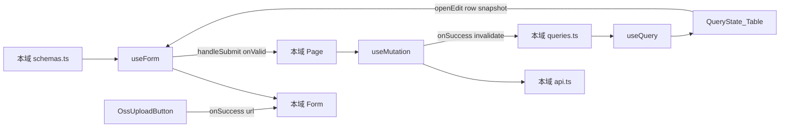

# Step 9 引导式开发：运营配置三页

> 本文对应 [03-开发计划](./03-开发计划.md) 的 Step 9。  
> 它是一份任务引导，不提供可以整段复制的最终页面。请先自己完成每个检查点，卡住后再展开提示。  
> 质量要求以 [01-工程契约](./01-工程契约.md) 为准。

本步 **没有** 测试检查点。Vitest 仍延后到 Step 16。验收以「手动验证矩阵」+ `pnpm verify`（lint + type-check）为准。

Step 6 / 7 已经把「筛选 + Table + Dialog + mutation」跑通。Step 8 已经有 `OssUploadButton`。本步 **不再重讲** `useQuery` / `invalidateQueries` / `Controller` / STS。同样逻辑打开历史文件；本文只写运营三页的增量：**无分页数组列表、CRUD vs Upsert、OSS 第一次进表单、跨字段校验**。

## 1. 本步目标

把三个 Empty 占位页收成三个自包含 feature。范式跟标签页相同，产品规则三套都不同。

```text
和 Tag / Taxonomy 相同（不要再发明一套）
  每域 api.ts / queries.ts / schemas.ts / pages / 本域 Form
  useQuery → QueryState + Table
  一份 useForm + 一个 Dialog
  写成功只靠 invalidateQueries，没有第二份 list

和 Tag / Taxonomy 不同（整页复制会错）
  三个列表都是数组，不是 PageData；handler 无筛选、无分页
  首页入口：标准 CRUD（POST + PUT /:id + DELETE）+ 图标走 OSS
  广告位 / 公众号：POST upsert（按唯一键匹配），没有 PUT /:id
  广告位有一条跨字段规则：rewarded_video 的 page 必须是 download
```

完成后必须满足：

- 首页入口：图标可上传（`subdir=icons`、公开 ACL），`navType` 可选，`switchTab` 时有明确提示。
- 广告位：按 `slotKey` upsert；激励视频身份可一键填进表单；`page` 与 `adType` 的约束在提交前拦住。
- 公众号：按 `scene` upsert；可删（须已禁用）。
- 每页 `queryKeys` + zod；无 `useEffect` 拉数；无 `any`。
- `pnpm verify` 通过。

03 写「与 Vue **业务行为**一致」：指同一账号、同一次写操作打到同一个后端后的数据结果（列表能看见、upsert 覆盖同一 `slotKey`、启用中删除被拒）。那是可选的黑盒对照。**不是**把另一端的 `load()`、查询按钮、表格列宽、模板按钮样式搬过来。

## 2. 本步边界

本步只做 `features/home-block`、`features/ad-slot`、`features/official-account`。三条路由已在 [`src/app/router/index.ts`](../src/app/router/index.ts) 挂好，不要改壳。

本步允许：

- 使用已有 `AppFormDialog` / `QueryState` / `PageHeader` / `App.useApp()`。
- 使用已有 `OssUploadButton`（Step 8；`subdir: 'icons'`、`access: 'public'`）。
- 使用已有 `NAV_TYPE_OPTIONS` / `AD_TYPE_OPTIONS` / `AD_PAGE_OPTIONS` / `STATUS_OPTIONS` / `HomeBlock` / `AdSlot` / `OfficialAccountConfig`。
- 对照 Tag 的文件职责和接线，**复制范式、改字段和写入口**。
- 检查点 8 做一次复制量体检；默认 **不抽** `useCrud` / `useConfigPage`。

本步禁止：

- 抽万能 `useCrud` / `useListPage` / `useUpsertPage`。表单 + mutation + columns 仍留在本域。
- `useEffect` 拉列表，或 `const [list, setList]`。
- 给广告位 / 公众号发明 `PUT /:id`（后端没有）。
- 给列表发明 keyword / 分页 query（handler 不读）。
- 给公众号加「二维码上传」或 `sortOrder`（表结构没有这两列；PRD 字面有、DTO 没有，以后端为准）。
- 三个 feature 互相 import 页面或内部组件。
- 在 axios 或 Query 全局回调里 `message`。
- 给 article / essay / download 写真页面。
- 安装测试依赖、改 `verify`。
- 修改只读对照项目 `Admin/`。
- 把另一端的列表页、`config.ts`、Element 表单规则翻译进本仓库。

03 里「对照 `Admin/src/views/home-block` 等」对本步过宽。业务规则已经写在后端文档、PRD、小程序跳转约束和本文产品契约里。

## 3. 开始状态与文件范围

开始前应保持：

- Step 6 已通过：[`TagPage.tsx`](../src/features/tag/pages/TagPage.tsx) 是可对照的完整范式。
- Step 8 已通过：`shared/oss` 能公开上传，placeholder 能手填 URL。本步 **正式**把按钮接到 RHF 字段。
- 计划顺序上建议 Step 7 已通过；本步 **不依赖** taxonomy 源码。
- QueryClient 已挂；登录真调可用；端口 **5174**。
- 后端 `course_server` 已启动（默认账号 `admin / admin123`）。
- 三页目前都是 `Empty description="暂无数据"`。

本步预计新增或修改：

```text
src/features/home-block/
├── api.ts
├── queries.ts
├── schemas.ts
├── pages/
│   ├── HomeBlockPage.tsx
│   └── HomeBlockPage.module.css
└── components/
    └── HomeBlockForm.tsx

src/features/ad-slot/
├── api.ts
├── queries.ts
├── schemas.ts
├── pages/
│   ├── AdSlotPage.tsx
│   └── AdSlotPage.module.css
└── components/
    └── AdSlotForm.tsx

src/features/official-account/
├── api.ts
├── queries.ts
├── schemas.ts
├── pages/
│   ├── OfficialAccountPage.tsx
│   └── OfficialAccountPage.module.css
└── components/
    └── OfficialAccountForm.tsx
```

本步 **不要** 安装新依赖，**不要** 改 `shared/types`（三套实体已经在），**不要** 把 STS 再包进 Query。

## 4. 使用方式

每个检查点按下面顺序完成：

1. 只看「任务」和「完成信号」，先自己设计。
2. 卡住时再看「提示一」。
3. 仍无法推进再看「提示二」。
4. 完成后回答「自检问题」。
5. 每个检查点结束都跑最小验证，不要最后一次性排错。

### 同样逻辑去哪看（不要在本文找 API 解释）

| 要做的事 | 打开这个，不要重写一遍 |
|---|---|
| `queryKeys` 三层 + `queryOptions` + `signal` | [`tag/queries.ts`](../src/features/tag/queries.ts) |
| `useForm<Input, unknown, Output>` + `zodResolver` | [`TagPage.tsx`](../src/features/tag/pages/TagPage.tsx) |
| 打开创建 / 编辑时 `reset` | TagPage 的 `openCreate` / `openEdit` |
| `onValid` 里 `mutateAsync` + toast + 关窗 | TagPage 的提交函数 |
| 四态派生 + Table | TagPage 后半；本步 **没有** `data.list` / 受控分页 |
| 字段组件只吃 `control` / `errors` | [`TagForm.tsx`](../src/features/tag/components/TagForm.tsx) |
| Dialog 点确定如何接到 `handleSubmit` | TagPage 底部 `AppFormDialog` |
| 删除须先禁用 + `Popconfirm` | TagPage 操作列（只抄「禁用才可删」，不要抄行内启用/禁用） |
| Query 二维状态、`mutateAsync`、RHF `reset` | [13-疑问点记录.md](./13-疑问点记录.md) §3、§4 |
| `OssUploadButton` 的 props / `onSuccess` 不写字段名 | [15-step8-oss引导式开发.md](./15-step8-oss引导式开发.md) 检查点 5 |

### 对照源（本步不读 `Admin/src`）

**删掉 `Admin/src` 这份检查点仍能做完。**

Step 9 要对等的是：三条路由、接口 path、请求/响应字段、upsert 身份键、删除须已禁用、图标公开上传、`navType` 枚举、激励视频的固定身份、`rewarded_video` 与 `page` 的约束。这些都可以从后端契约、PRD、小程序跳转实现和本仓库已有常量推出。

另一端的 `load()`、`list ref`、拦截器 toast、Element 表单、「查询 / 重置」、pageSize 切换，落在 01 的禁止照搬清单里。读了只会把实现锁成翻译。

03 里点名的 `Admin/src/views/*` 和 `Admin/src/api/config.ts` 对本步过宽。下面这张表已经覆盖验收所需事实。

| 要确认的事实 | 去哪看 |
|---|---|
| 路径：`/home-blocks` CRUD；`/ad-slots` GET + POST upsert + DELETE；`/official-account-configs` 同广告位 | [api-reference.md](../../course_server/docs/api-reference.md) §3.9–3.11；路由 [`router.go`](../../course_server/internal/router/router.go) |
| 写字段、trim、枚举、激励视频 `page` 必须是 `download` | [`dto/admin/config.go`](../../course_server/internal/dto/admin/config.go) |
| 列表是全量数组，排序 `sort_order DESC, id DESC`（公众号是 `id DESC`） | [`admin_config.go`](../../course_server/internal/handler/admin_config.go) |
| 删除须已禁用；英文/中文 message 原样 toast | [`Check*Deletable`](../../course_server/internal/model/model_write.go) |
| 预置广告位 6 条、默认禁用、`adUnitId` 空 | [`seed.go`](../../course_server/internal/database/seed.go) `SeedAdSlots` |
| 图标写入规范化、读出拼公开 URL | [`oss_media.go`](../../course_server/internal/handler/oss_media.go) `applyHomeBlockWriteMedia` / `resolveHomeBlockMedia` |
| `navType` / `adType` / `ad page` 选项 | [`shared/constants/options.ts`](../src/shared/constants/options.ts) |
| 实体类型 | [`shared/types`](../src/shared/types/index.ts) |
| `switchTab` 只能去 tabBar；path 须 `/pages/` 开头；switchTab 不带 query | [`miniApp/app.json`](../../miniApp/app.json) tabBar；[`miniApp/utils/nav.js`](../../miniApp/utils/nav.js) `goByBlock` |
| 小程序我的页读 `scene=mine` | [`miniApp/pages/mine/index.js`](../../miniApp/pages/mine/index.js) |
| 产品字段口径（表有的才做） | [prd/002](../../prd/002-后台管理系统（内容增长MVP版）.md) §6–8；缺列的以 DTO 为准 |
| Query / 表单 / 禁止项 | [01-工程契约.md](./01-工程契约.md) |

本步不要去翻其它端的运营页实现。你要做的是 React 后台的三份自包含 feature，不是翻译。

---

## 5. 架构主课：无分页列表 + Upsert 没有第三套 CRUD

Step 7 锁住的是 zod / RHF / Query 三条所有权线。本步要再锁两条：

```text
列表不是 PageData
  GET 解包后是 T[]
  queryKey 不需要 page / keyword
  Table pagination={false}
  空态看 data.length === 0，不是 data.list

写入口不是「都有 create + update」
  home-block     POST 创建、PUT /:id 更新、DELETE /:id
  ad-slot        POST 按 slotKey 找不到就建、找到就改；DELETE /:id
  official-account  POST 按 scene，同上

OSS 第一次进表单
  OssUploadButton 仍不知道字段名
  HomeBlockForm 用 Controller / setValue 把 result.url 写进 icon
  内核、按钮、RHF 还是三层，不要在 Button 里 import schema
```



Upsert 容易写错的三件事：

1. **编辑不是 `PUT /ad-slots/:id`。** 提交仍是 `POST /ad-slots`，body 带同一个 `slotKey`。后端 [`UpsertAdSlot`](../../course_server/internal/handler/admin_config.go) 按键查找。
2. **身份键在编辑时应只读。** 改 `slotKey` / `scene` 等于去写另一条记录：可能覆盖预置位，也可能新建一条而当前行纹丝不动。
3. **「新建」一个已存在的键是合法更新。** seed 已经插入了 `download_rewarded_video`。表单填同一 `slotKey` 再提交，列表刷新的是那一行，不是第二条。toast 用「已保存」比硬分创建/更新更贴 upsert。

页面上仍只允许四次跨界（与 Step 7 相同）：改查询条件（本步几乎没有）→ 换 key；点确定 → `mutateAsync`；写成功 → `invalidateQueries(lists())`；点编辑 → `reset(行快照)`。多一次就是分层破了。

### 常见跨层错误（本步审查会盯）

- 把 `T[]` 再 `useState` 一份，或当成 `PageData` 去读 `.list`。
- `queries.ts` 里写 `upsertAdSlot`。写不是 query。
- `AdSlotForm` 自己 `useMutation`。
- 为了「和 Tag 对称」给广告位写 `updateAdSlot(id)`。
- `OssUploadButton` 里 `setValue('icon')` 或 import `homeBlockWriteSchema`。
- 三个 feature 共享一个 `ConfigForm.tsx`。

---

## 检查点 1：先写下产品契约，不急着改 Table

### 当前问题

三页看起来都是「一张表 + 一个弹窗」，写入口和唯一键却不一样。字段写错，upsert 会覆盖错行；规则写在按钮 `disabled` 里却和后端不一致，用户会在 toast 里看到两套说法。

### 任务

先在纸面或注释里填完下面四张表，再碰文件。数值以**后端**为准。PRD 提到但 DTO / 表没有的字段（公众号二维码、公众号排序）**不要做**。

**1. 首页入口（`/home-blocks`）—— 标准 CRUD**

列表：`GET` 解包 `HomeBlock[]`。无 query。排序后端做。

| 字段 | 列表 | 创建/编辑 | 规则 |
|---|---|---|---|
| `id` | 不用展示 | 不出现在表单 | 路径参数 |
| `title` | 要 | 要 | trim 后非空，最长 120 |
| `icon` | 可预览 | 要 | trim 后非空，最长 500；公开 URL 或可被后端规范化的引用 |
| `navType` | 要 | 要 | `NAV_TYPE_OPTIONS` 四选一；缺省 `navigateTo` |
| `path` | 要 | 要 | trim；最长 500；**必须以 `/` 开头**（DTO）。小程序 `goByBlock` 还要求 `/pages/` 开头 |
| `sortOrder` | 要 | 要 | 整数；表单始终带数字（不要靠创建时 `0 → NextSortOrder`） |
| `status` | 要 | 要 | `1` / `0`；创建缺省启用 |
| `createdAt` / `updatedAt` | 至少展示一个 | 不出现 | 原样显示 |

| 操作 | 接口 | 前端先拦住 | 后端仍可能拒绝 |
|---|---|---|---|
| 创建 | `POST /home-blocks` | zod | 校验失败英文 message |
| 更新 | `PUT /home-blocks/:id` | 同上；body 仍是完整写字段 | 404 `home block not found` |
| 删除 | `DELETE /home-blocks/:id` | 启用中的行不给删 | `仅已禁用的首页入口可删除，请先将入口禁用` |

`switchTab` 提示（产品规则，不是另一端的组件模板）：

- 微信 `wx.switchTab` 只能打开 tabBar 页。当前小程序 tabBar 是：`/pages/home/index`、`/pages/category/index`、`/pages/mine/index`。
- `goByBlock`：`switchTab` **不能带 query**；其它 `navType` 可以。
- 后端 **不**校验 path 是不是 tabBar。前端用 Form 提示即可，不要发明一套后端没有的 400。

图标：`OssUploadButton` `subdir="icons"` `access="public"`。提交的是 `result.url`。读列表时 handler 已经 `ResolvePublicURL`，编辑 `reset` 拿到的是可展示 HTTPS。

**2. 广告位（`/ad-slots`）—— 按 `slotKey` upsert**

列表：`AdSlot[]`。无 query。seed 启动时会补齐缺失的 6 个预置键，默认禁用、`adUnitId` 为空。

| 字段 | 列表 | 表单 | 规则 |
|---|---|---|---|
| `slotKey` | 要 | 要；**编辑只读** | trim 后非空；唯一身份 |
| `slotName` | 要 | 要 | trim 后非空 |
| `page` | 要 | 要 | 用 `AD_PAGE_OPTIONS`（运营枚举；DTO 只要求非空） |
| `position` | 要 | 可选 | trim |
| `adType` | 要 | 要 | `banner` / `rewarded_video`；未传时后端默认 `banner` |
| `adUnitId` | 要 | 可选 | 流量主单元 ID；空表示还没配 |
| `sortOrder` / `status` | 要 | 要 | 与其它写表单相同 |
| `id` / 时间 | 按需 | 不出现 | — |

| 操作 | 接口 | 前端先拦住 | 后端仍可能拒绝 |
|---|---|---|---|
| 保存 | `POST /ad-slots` | zod + 跨字段：`adType === 'rewarded_video'` ⇒ `page === 'download'` | `rewarded_video ad slot page must be download`；`adType must be banner or rewarded_video` |
| 删除 | `DELETE /ad-slots/:id` | 启用中不给删 | `仅已禁用的广告位可删除，请先将广告位禁用` |

激励视频**身份**（来自 api-reference 示例 + seed，不是某一端页面上的文案）：

```text
slotKey    download_rewarded_video
slotName   资料下载激励视频
page       download
position   gate
adType     rewarded_video
```

「一键填充」的产品含义：新建时把上面 5 个字段 `setValue` / `reset` 进表单，避免手填错 `page` 后被后端 400。不要改 `adUnitId` / `status`（单元 ID 仍由运营从微信流量主后台粘贴；预置位默认禁用是 seed 的事）。

预置键删掉后，下次后端启动 seed 会按「仅补缺失」再建出来。这是后端行为，前端不必做「禁止删预置位」。

**3. 公众号导流（`/official-account-configs`）—— 按 `scene` upsert**

列表：`OfficialAccountConfig[]`。无 query。排序 `id DESC`。

| 字段 | 列表 | 表单 | 规则 |
|---|---|---|---|
| `scene` | 要 | 要；**编辑只读** | trim 后非空；小程序我的页读 `mine` |
| `title` | 要 | 可选 | trim |
| `description` | 要 | 可选 | trim |
| `username` | 要 | 要 | trim 后非空。model 注释是「公众号原始 ID，通常 `gh_` 开头」；DTO **只**校验非空，不要把 `gh_` 写成硬拦截 |
| `status` | 要 | 要 | 创建缺省启用 |
| 二维码 / `sortOrder` | **不要** | **不要** | 表没有这些列 |

删除须已禁用：`仅已禁用的公众号导流配置可删除，请先将配置禁用`。

**4. 三页共同的状态分层**

| 数据 | 放哪 |
|---|---|
| 当前页的数组 | Query cache |
| 弹窗开关、正在编辑的行 | 页面 `useState` |
| 表单值 | RHF |
| 图标 URL | RHF 的 `icon`；OSS 按钮只通过 `onSuccess` 写进去 |
| token | Zustand，已有 |

本步没有 keywordDraft，没有筛选 Select。不要为了「像后台列表」加一组前端过滤——那会让用户以为打了 query。

### 提示一

`navType` / `adType` / `page` 的字面量已经在 `shared/constants/options.ts`。本域 schema 用 `z.enum` 吃这些 value，不要再写一份 `'navigateTo' | ...`。

### 提示二

更新广告位时，若 body 里 `adType` 传空串，handler 会保留原值（避免误覆盖成 banner）。前端表单始终带上当前 `adType`，不要依赖这条「空则保留」。zod 输出里它必须是两个枚举之一。

### 完成信号

不写组件也能回答：哪一页有 PUT；哪一页提交永远是 POST；列表为什么没有 pageSize；公众号为什么没有二维码字段。

### 自检问题

- 为什么删掉 `Admin/src` 还能做完本步？
  - 要对等的是 path、字段、唯一键、删除规则、OSS 入库口径、小程序消费约束。它们已经在 handler / DTO / seed / miniApp。另一端的页面是实现，01 要求按 React 重写。
- 为什么 03 写了「激励视频模板一键填充」，却不能去抄另一端的按钮？
  - 要填的是 seed / api-reference 里那条固定身份。填充动作是 RHF `setValue`。按钮长什么样、放在 Dialog 里还是表格上方，由你按 antd 做。
- 为什么 upsert 的编辑要锁身份键？
  - 身份键是查找条件。改了就不是「更新当前行」。

---

## 检查点 2：画出三域依赖，先不写页面

### 当前问题

三页一起做时，最容易先摊一个 `features/ops/` 大文件，或从 TagPage 复制三份 250 行再改字段。本检查点只画边界。

### 任务

在纸上画出三个 feature 的 import 方向，每个都必须满足：

```text
schemas.ts  ──► Page（zodResolver）──► XxxForm（类型）
api.ts      ──► queries.ts（listXxx）
api.ts      ──► Page（create / update 或 upsert / delete）
queries.ts  ──► Page（keys + queryOptions）
XxxForm     只被本域 Page import
OssUploadButton 只被 HomeBlockForm（或 HomeBlockPage）import
```

禁止箭头：

- `schemas.ts` → `react-hook-form` / `@tanstack/react-query` / `antd` / `ali-oss`
- `queries.ts` → `zod` / `react-hook-form` / `antd`
- `XxxForm` → `api.ts` / `queries.ts` / `useMutation`
- `features/home-block` → `features/ad-slot` 或 `features/tag` 的页面 / 内部组件
- `OssUploadButton` → 任何 `features/*`

本检查点可以还没有能编译的新文件，但你要能指着 Tag 的对应文件说「home-block 这份抄它的职责；ad-slot 的写函数只有 upsert + delete」。

### 提示一

| 职责 | Tag | home-block | ad-slot / official-account |
|---|---|---|---|
| HTTP | create / update / delete | 同 Tag（path 不同） | **upsert + delete**，无 update(id) |
| 读缓存 | `list(query)` | `lists()` 即可，无 query 对象 | 同左 |
| 写校验 | name / status | 含 path / navType | 广告位要 `superRefine` |
| 字段 UI | TagForm | 多一个 OSS | 多一个「填激励视频身份」 |

「编排」仍只发生在 Page。

### 提示二

`get` / `post` / `put` / `del` 从 `@/shared/api/http` 引。不要为了入口好看去改 `shared/api/index.ts`。不要新建 `features/config/api.ts` 把三域接口揉在一起——后端 handler 写在同一个 `admin_config.go`，那是服务端文件组织，不是前端 feature 边界。

### 完成信号

你能回答：list 的所有者是谁、输入框的所有者是谁、谁在 `invalidateQueries`、OSS 成功后谁改 `icon`。四个答案必须落在不同层（按钮回调可以发生在 Form 里，但它改的是 RHF，不是 Query）。

### 自检问题

- 为什么三个列表的 `queryKey` 可以没有筛选对象？
  - handler 不读 query。key 里塞假的 `page: 1` 是噪音，还会诱人以后去「前端分页」却忘了数据其实已经全在 cache 里。
- 为什么不能做一个 `features/ops`？
  - 01 按路由域拆 feature。跨域只经 `shared` 或 `invalidateQueries`。三页没有互相失效的需求。

---

## 检查点 3：首页入口骨架 + 无分页 `api` / `queries`

### 当前问题

占位页只有 `Empty`。先把 home-block 五件套立住，并锁住「数组列表」的 HTTP 形状。另外两域本检查点可以先不动。

### 任务

1. 新建 `api.ts` / `queries.ts` / `schemas.ts` / `HomeBlockForm.tsx` / `HomeBlockPage.module.css`。
2. 替换 `HomeBlockPage.tsx` 的 `Empty`，至少能编译：导出仍是 `Component`。
3. `listHomeBlocks(signal)` → `get<HomeBlock[]>('/home-blocks', { signal })`。**不要**包 `PageData`。
4. `createHomeBlock` / `updateHomeBlock` / `deleteHomeBlock` 对上 §1 的 method/path。
5. keys：

```text
homeBlockKeys.all      ['home-blocks']
homeBlockKeys.lists()  ['home-blocks', 'list']
```

`queryOptions` 的 `queryFn` 把 `signal` 传下去。没有 `list(query)` 也可以；若你保留三层以和 Tag 对称，不要伪造一个空 query 对象。

6. 本检查点不要画完整 Table。职责对了即可。
7. CSS 本步一次性写死（与 Tag 相同的 layout token，没有筛选宽）：

```css
.page {
  display: flex;
  flex-direction: column;
  gap: 16px;
}

.tableBlock {
  display: flex;
  flex-direction: column;
  gap: 12px;
}

.rowActions {
  display: flex;
  flex-wrap: wrap;
  align-items: center;
  gap: 8px;
}

.iconPreview {
  width: 40px;
  height: 40px;
  object-fit: contain;
}
```

广告位 / 公众号的 CSS 可以复制这份。不要 inline `style={{ width: 160 }}` 回头再抽。

### 提示一

`HomeBlock` 从 `@/shared/types` 来。写类型从 schema 推，与 Tag 的 `TagWriteOutput` 相同。不要在 `api.ts` 再定义一份会漂移的 `HomeBlock`。

### 提示二

`get` 的解包要求 `data` 非 `null`。空列表是 `[]`，合法。不要把「没有入口」理解成 HTTP 失败。

### 完成信号

- 源码搜不到 home-block 页的 `Empty description="暂无数据"`。
- 你能指着 `listHomeBlocks` 的返回类型说「这不是 `PageData`」。
- `pnpm verify` 绿（允许 Form 还只有一个 Input）。

最小验证：

```bash
# 工作目录：Admin-React/
pnpm verify
```

### 自检问题

- 为什么本步不必 `keepPreviousData`？
  - 没有翻页换 key。`placeholderData` 是为了「新 key pending、旧 data 还在」。全量列表的 key 是稳定的。
- 现在抽 `HomeBlockForm` 为什么还不算 `useCrud`？
  - 它没有列表、没有 queryKey、没有 mutation。

---

## 检查点 4：首页入口 schema + OSS 进表单

### 当前问题

Step 8 的按钮还不知道 `icon` 这个字段名。本检查点把公开上传接到 RHF，并锁住 `navType` / `path`。

### 任务

1. `homeBlockWriteSchema`：按检查点 1 的规则写 zod。`navType` 用 `NAV_TYPE_OPTIONS` 的 value 做 enum。`path` 至少 `.startsWith('/')`（对齐 DTO）。`status` 为 `0 | 1`。
2. `HomeBlockForm` 只吃 `control` / `errors`。需要的话再加一个 `disabledNavHint` 之类的展示 props，**不要**自己 `useMutation`。
3. `icon` 字段：

- `Controller` 包一层：预览当前值（有 URL 才渲染 `img`）+ `OssUploadButton`。
- `onSuccess` 把 `result.url` 交给 `field.onChange`（或 Page 里 `setValue('icon', url, { shouldValidate: true, shouldDirty: true })`）。两种都可以，选一种，不要两处都写。
- `subdir="icons"`，`access="public"`，`accept="image/*"`。
- placeholder 手填已经在 Button 里，走同一份 `onSuccess`。Form 不要再做第二套 URL state。

4. `navType === 'switchTab'` 时，在该字段附近给出 tabBar 三条 path 的提示，并写明「不要带 query」。用 `useWatch({ control, name: 'navType' })` 即可。这是派生展示，不是第二份表单 state。

以下为接线示意，**不是**完整 Form，不可单独当文件用：

```tsx
<Controller
  control={control}
  name="icon"
  render={({ field }) => (
    <>
      {field.value ? (
        
      ) : null}
      <OssUploadButton
        subdir="icons"
        access="public"
        accept="image/*"
        onSuccess={(result) => field.onChange(result.url)}
      />
    </>
  )}
/>
```

### 提示一

Ant `Form` 只当 `layout` + `Form.Item` 外壳，与 TagForm 相同。不要写 `onFinish`。`icon` 校验失败要落到这个 Form.Item 的 `help`，不要只 toast「请上传图标」。

### 提示二

小程序比 DTO 更严：`goByBlock` 要求 `path.startsWith('/pages/')`。你可以：

- zod 只拦 `/`（后端口径），提示里写 `/pages/`；或
- zod 直接拦 `/pages/`（对齐真实消费方）。

选一种并在自检里能说出为什么。不要两种同时做两套错误文案。推荐与消费方对齐：`/pages/`。后端仍会接受 `/foo`，只是小程序会 toast「入口配置无效」。

### 完成信号

不打开 Network 也能说出：上传成功后哪一层拥有 `icon` 字符串；Button 为什么不能 `import homeBlockWriteSchema`。

### 自检问题

- 为什么提交 URL 而不是 objectKey？
  - 公开资源的调用方入库存可展示 URL。handler 写入时会 `NormalizeObjectRef`。私有 objectKey 是 Step 13 的口径。
- 为什么 `useWatch` 不算「用 Effect 同步表单」？
  - 它订阅的是 RHF 已有的值，用来切换提示。没有 `setState(navType)` 第二份。

---

## 检查点 5：首页入口页面——数组四态 + CRUD

### 当前问题

有了 api / schema / Form，还差 Page 把三套接起来。这里最容易把 TagPage 的 `data.list`、`keywordDraft`、受控分页一起粘过来。

### 任务

1. `useQuery({ ...homeBlockQueries.list })`。不要 `keepPreviousData`（除非你能解释本页换 key 的场景——没有）。
2. 四态：

| 条件 | `queryStatus` |
|---|---|
| `isPending` | `pending` |
| 无 `data` 且 `isError` | `error` |
| `data.length === 0` | `empty` |
| 其余 | `success` |

刷新失败时 `data` 还在，不要整页 error。需要的话用 Tag 同款的顶部 `Alert` 提示 `isRefetchError`。

3. `Table`：`dataSource={listQuery.data}`，`rowKey="id"`，`pagination={false}`。`loading.spinning` 仍可用 `isFetching`。
4. 操作列：编辑 + 删除。删除用 `Popconfirm`；`status === 1` 时禁用删除。不要抄 Tag 的行内启用/禁用——本页状态走编辑表单。
5. 三个 mutation：create / update / delete。`onSuccess` 一律 `invalidateQueries({ queryKey: homeBlockKeys.lists() })`。
6. `openCreate` / `openEdit` 里 `reset`。编辑提交走 `updateHomeBlock({ id: editing.id, input })`。
7. Dialog 接线与 Tag 相同：`onSubmit={() => void handleSubmit(onValid)()}`，`confirmLoading` 用 mutation `isPending`。
8. `useForm` 放在 Page，不要放进 `destroyOnHidden` 的 Dialog 子树。

### 提示一

`onValid` 收到的已经是 Output。不要在 `mutationFn` 里再 `schema.parse`。校验失败 RHF 不调 `onValid`，窗不关。

服务器拒绝（含删除启用中的行，若你没把按钮禁用严）toast `ApiError.message` 原文，窗保持打开。

### 提示二

创建时 `sortOrder` 表单给 `0` 会触发后端 `NextSortOrder`。检查点 1 要求表单始终带数字——可以默认 `0` 让后端自增，也可以默认一个正数。不要把字段做成「空 = 不传」又同时在类型里是 `number`。

### 完成信号

- 进入 `/home-blocks`：首次 pending，随后是表或空态。
- 上传图标 + 填标题 / `navigateTo` / `/pages/material/index` 能创建成功，不必 F5。
- 编辑改标题，表格变。
- 启用中删除按钮不可用；禁用后再删，行消失。
- Network 里没有 `/home-blocks?page=`。

### 自检问题

- 为什么 `data?.list.length` 会把本页写成永远 empty 或运行时炸掉？
  - 解包是数组。`list` 是 `PageData` 的字段。
- 为什么删除成功仍要 `invalidateQueries(lists())` 而不是 `setQueryData` 里 filter？
  - 01：写成功只失效。本地 splice 是第二份 list。

---

## 检查点 6：广告位 —— upsert + 跨字段 + 身份模板

### 当前问题

预置 6 条已经在库里。本页的主路径是「改 `adUnitId` 并启用」，不是从零建广告网络。写入口若做成 `PUT /:id`，请求会 404。

### 任务

1. 按检查点 3 的文件结构立 `features/ad-slot`。列表 `get<AdSlot[]>('/ad-slots')`。
2. 写函数只有：

```ts
upsertAdSlot(input: AdSlotWriteOutput): Promise<AdSlot>
deleteAdSlot(id: number): Promise<{ id: number }>
```

不要 `createAdSlot` + `updateAdSlot`。Page 上也可以只有 **一个** upsert mutation + 一个 delete mutation。Dialog 标题仍可以是「新建 / 编辑」，那只是 `reset` 的来源不同。

3. schema：必填 `slotKey` / `slotName` / `page` / `adType` / `sortOrder` / `status`。`position` / `adUnitId` 可选（空串 trim 成 `''` 即可）。然后：

```ts
.superRefine((value, ctx) => {
  if (value.adType === 'rewarded_video' && value.page !== 'download') {
    ctx.addIssue({
      code: 'custom',
      path: ['page'],
      message: '激励视频广告位的页面必须是 download',
    })
  }
})
```

文案可自定；后端原文是 `rewarded_video ad slot page must be download`。前端拦住是为了不到 Network 再失败。两端都要能解释。

4. 编辑时 `slotKey` 的 Input `disabled`。
5. **仅新建**提供「填入下载激励视频身份」：把检查点 1 的 5 个字段写入表单。不要动 `adUnitId`。实现用 `setValue` 多次，或 `reset({ ...getValues(), ...DOWNLOAD_GATE_IDENTITY })`。常量放本域（`api.ts` 或 `schemas.ts` 旁的 `constants.ts`），不要放进 `shared`——另外两页用不到。
6. Page 四态 / Table / 删除规则与 home-block 相同。upsert 成功 toast「已保存」即可。
7. `page` / `adType` 用已有 options 的 Select，不要自由输入。

### 提示一

新建时填 `download_rewarded_video` 再保存：若 seed 已有该键，这是更新那一行。列表不会多出第 7 条。这是正确行为，不要再 POST 一次「创建失败：重复」。后端 upsert **没有**唯一冲突 400。

### 提示二

`superRefine` 写在 schema，不要写在 `onValid` 里 `if (adType === ...) throw`。校验源只有一份。`AdSlotForm` 可以 `useWatch('adType')` 给 `page` 字段加提示，但仍以 schema 为准。

模板按钮放在 Form 里需要 `setValue`：把 `setValue` 当 props 传入 Form，或把按钮放在 Page 的 Dialog 标题区。不要让 Form `useFormContext` 再开一套，除非你真的包了 `FormProvider`（本项目 Tag 没有，不必为这个按钮新引入）。

### 完成信号

- `/ad-slots` 能看到 seed 的预置行（后端跑过 seed 的前提下）。
- 编辑某一 banner 行，改 `adUnitId`，保存后表格变，Network 是 `POST /ad-slots` 不是 PUT。
- 新建时点身份模板，`adType` 为激励视频且 `page` 不是 download 时应无法提交（改 page 也能验证 refine）。
- 把激励视频的 `page` 改成 `home`：表单项错误，或（若你绕过 UI）toast 后端英文。

### 自检问题

- 为什么身份模板不是「再调一个 API」？
  - 这 5 个字段是契约常量。没有 `GET /ad-slot-templates`。
- 为什么编辑模式要藏模板按钮？
  - 点了会改当前行的 `slotKey`。upsert 会写到激励视频那条，当前 banner 原封不动，看起来像「保存没生效」。
- 启用但 `adUnitId` 为空，要不要前端拦住？
  - 后端允许。小程序 Banner 会过滤空 unit；下载门槛 `IsDownloadGateActive` 也要求非空 unit。提示可以有，硬拦不是本步验收项。

---

## 检查点 7：公众号 —— 更薄的一份 upsert

### 当前问题

和广告位同一类写入口，字段更少。本检查点用来确认你是「复制 upsert 范式」，不是再发明第三种保存。

### 任务

1. 立 `features/official-account`，形状同广告位：`list` + `upsert` + `delete`。
2. schema：`scene` / `username` 必填；`title` / `description` 可选；`status` 要。没有 `sortOrder`。没有图片字段。
3. 编辑锁 `scene`。
4. `username` 的 Form.Item 给一句说明：用于小程序跳转公众号主页，通常 `gh_` 开头。不要 `z.string().startsWith('gh_')`，除非你愿意与后端不一致（后端纯空格才 400）。
5. 提示：小程序我的页请求 `?scene=mine`。其它 scene 允许存在，后台不必做成只能填 `mine` 的死 Select（DTO 是自由字符串）。用 Input 即可。
6. Page / Dialog / 四态 / 删除与广告位相同。

### 提示一

PRD §8 写过「二维码」。[`OfficialAccountConfig`](../../course_server/internal/model/model_shared.go) 没有对应列，公开接口也只回 `scene/title/description/username/status`。加上传是超范围，审查会打回。

### 提示二

不要为了「三页长得像」给公众号加 `sortOrder`。handler 按 `id DESC` 排。假字段会进 zod 然后进 POST body，后端会忽略，表单却显示一个无意义数字。

### 完成信号

- `/official-accounts` 可创建 `scene=mine` 的配置，再编辑文案，再禁用后删除。
- Network 只有 GET / POST / DELETE，没有 PUT。
- 源码搜不到 `qr` / `qrcode` / `sortOrder` 出现在本域 schema。

### 自检问题

- 为什么公众号和广告位不共享 `UpsertPage`？
  - 身份键、字段、模板、OSS 都不同。共享的只有「POST 一次、编辑锁键」。复制 80 行范式比抽一个只能用两次的泛型页更短。
- `scene` 为什么不做成枚举？
  - 后端没有 scene 白名单。小程序目前只读 `mine`。枚举会把以后其它场景挡在后台外面。

---

## 检查点 8：Rule of Three 体检（默认不抽）

### 当前问题

现在至少有 Tag、Taxonomy（若已做）、再加三页运营。01 禁止 11 页复制 200 行，也禁止第一页就 `useCrud`。本步是第三批相似页，允许抽，不是必须抽。

### 任务

把 `TagPage`、`HomeBlockPage`、`AdSlotPage` 并排，只回答：

1. 重复的是不是 **只** 有「`useQuery` + 四态 if/else + Dialog 接线」？
2. 列表形状（`PageData` vs `T[]`）、写入口（create/update vs upsert）、OSS、身份模板是否已经明显不同？
3. 若抽 hook，调用方是否仍能从函数名看出「这不管表单、不管 upsert」？

默认结论：**不抽**。把体检结果写在验收备注里一句即可。

仅当第 1 题为「是」，才允许极薄 hook，例如 `useArrayListQuery(options)`：

- 入参：已经绑好的 `queryOptions`。
- 出参：`query` 对象 + `queryStatus` + `showFetchError`。
- **禁止** 装进：`useForm`、upsert/create、`open` / `editing`、columns、OSS、toast、`slotKey` disabled。

不要抽 `useOpsPage`。不要抽 `useCrud`。这个 hook 若出现，先放在某一个 feature 里观察，不要一上来进 `shared/`。

### 提示一

三页 columns 闭包了不同的行内动作。抽 `OpsTable` 要把回调当 props 传回来，文件变多、心智不变少。Tag 检查点已经否过拆 columns。

### 提示二

若你抽了 hook，审查会看它的 import。出现 `zodResolver` / `OssUploadButton` / `message.success` 就说明越界了，拆掉比改名更省事。

### 完成信号

- 要么：三页里仍能指着四态 if/else，备注写「未抽；列表形状和写入口不同，暂留」。
- 要么：存在一个不超过几十行、只包 Query 读路径的 hook，Page 仍拥有 Form 与 mutation。

### 自检问题

- 为什么「三页」仍可能不够抽 `useCrud` 的「三」？
  - Rule of Three 数的是**相同结构**。无分页数组 + upsert 与 Tag 的 PageData + create/update 不是同一份。硬抽只会把差异藏进 options 对象。
- 为什么本步不抽 Form Dialog 壳？
  - `AppFormDialog` 已经是壳。

---

## 检查点 9：完整验收

### 自动验证

在 `Admin-React/` 目录执行：

```bash
pnpm verify
pnpm build
```

预期：Oxlint 通过；TypeScript 严格检查通过；Vite 生产构建完成。本步不要求 `pnpm test`。

### 手动验证矩阵

前置：后端已启动；前端 `pnpm dev` 在 **5174**；用 `admin / admin123` 登录。Step 8 的 STS 按本机配置：`mode=oss` 测真传，`placeholder` 测手填 URL。

**首页入口 `/home-blocks`**

- 首次 pending，随后是表或空态；无 `useEffect` 拉列表。
- 无筛选条、无分页、Network 无 `page` query。
- 上传图标（或手填 URL）后 `icon` 字段有值，校验失败落在 Form.Item。
- `navType` 切到 `switchTab` 能看到 tabBar 提示。
- 创建 / 编辑成功，列表刷新，无手动 F5。
- 启用中不能删；禁用后可删。失败文案以后端为准。

**广告位 `/ad-slots`**

- 能看到 seed 预置行（若库是干净启动）。
- 保存走 `POST /ad-slots`。
- 编辑时 `slotKey` 不能改。
- 新建时一键填入激励视频身份，5 个字段正确。
- `rewarded_video` + 非 `download` 的 page：提交被 zod 拦住。
- 删除规则同首页入口。

**公众号 `/official-accounts`**

- 按 `scene` upsert；编辑锁 scene。
- 无二维码、无排序字段。
- 删除须已禁用。

**共性**

- 每域 `queryKeys` 工厂；页面没有 `queryKey: ['ad-slots']` 这种魔法串。
- toast 来自 `App.useApp()`。
- Dialog 点遮罩不关；提交中确定按钮不可点。
- 无 `any`、无 `useCrud`、无三域互相 import。
- `OssUploadButton` 不出现在广告位 / 公众号。

### 代码审查时自搜

```text
useEffect
setList
queryKey: ['home-blocks'
queryKey: ['ad-slots'
queryKey: ['official-account
PUT /ad-slots/
PUT /official-account
useCrud
data.list
qrcode
keepPreviousData
from 'antd' 的静态 message
register(
```

预期：`useEffect` 不为拉数出现；`queryKey` 只来自本域 keys；广告位 / 公众号没有 PUT；`data.list` 不出现在这三页（那是 PageData）；`register` 不应出现在 Ant 控件上；`message` 只来自 `App.useApp()`。`keepPreviousData` 若出现，你要能解释换 key 的场景（本步默认没有）。

按 [03 验收协议](./03-开发计划.md) 发审查时，把本矩阵勾过去。备注写清：未读 `Admin/src`；业务对等以后端 + 小程序消费为准。

---

## 6. 失败时的最短排查路径

### 进入页面仍是「暂无数据」Empty，且没有新建按钮

占位页没替换，或懒加载的 `Component` 没导出。确认三个 `pages/*Page.tsx` 导出的仍是 `Component`。

### 表格空白但 Network 200、响应有数组

把 `T[]` 当成了 `PageData`，`dataSource={data.list}` 为 `undefined`。改成 `dataSource={data}`。

### 广告位保存 404

写成了 `PUT /ad-slots/:id`。改回 `POST /ad-slots`。

### 编辑 banner 后激励视频那条变了，当前行没变

改了 `slotKey`。编辑必须只读身份键。

### 首页入口创建 400 `path must start with /`

没带前导斜杠。小程序侧还要求 `/pages/`；只写 `pages/home/index` 会先被 DTO 拒。

### `switchTab` 配了 `/pages/search/index`，后台能存，小程序跳不过

后端不校验 tabBar。这是提示存在的原因，不是前端 bug。改成三条 tabBar path 之一。

### 上传成功但提交仍说请填写图标

`onSuccess` 没写进 RHF。Button 自己 toast 成功不等于 `icon` 有值。看 `field.onChange` / `setValue`。

### placeholder 模式点上传打到了 OSS 主机

Step 8 内核应在 `mode=placeholder` 时 throw，由 Button 走手填。不要在本步把 STS 塞进 Query「缓存 30 秒当可用」。

### 预置广告位删掉后又出现了

下次启动 seed「仅补缺失的 slotKey」。预期行为。

### 公众号提交带了 `sortOrder` 但列表顺序没变

字段不存在。按 `id DESC`。把假字段从 schema 拿掉。

### `pnpm verify` 报类型重复定义

本域 `api.ts` 又写了一份 `AdSlot`。删掉，用 `shared/types`。

### 工作目录不对

所有 pnpm 命令在 `Admin-React/`。

---

## 7. 完成后应能口头回答

1. 为什么本步不读 `Admin/src` 也能做完验收？
2. 三页列表为什么不是 `PageData`？`queryKey` 为什么没有 page？
3. 广告位为什么没有 `updateAdSlot(id)`？编辑提交的 method 是什么？
4. 为什么编辑要锁 `slotKey` / `scene`？
5. 激励视频身份模板的 5 个字段从哪来？为什么不是一个新 API？
6. `superRefine` 拦的是哪条后端规则？为什么还要前端拦？
7. `OssUploadButton` 为什么不能 import `homeBlockWriteSchema`？
8. `switchTab` 提示的依据是微信约束还是后端 400？
9. 为什么公众号没有二维码上传？
10. 本步为什么默认仍不抽 `useCrud`？若抽薄层，天花板在哪？

---

## 8. 快速上手总结

### 必须掌握

- **对照源在后端 + 小程序消费**：path、字段、upsert 键、删除文案、seed 身份、tabBar。不需要 `Admin/src`。
- **数组列表**：`get<T[]>`；空态看 `length`；Table 不分页。
- **Upsert**：同一 POST，按唯一键匹配；编辑锁键；toast 用「已保存」更贴切。
- **跨字段 zod**：激励视频 ⇒ `page=download`，与 DTO 同一条规则。
- **OSS 进表单**：按钮只回调 URL；RHF 拥有 `icon`。

### 按需了解

- 创建 home-block 且 `sortOrder === 0` 时后端 `NextSortOrder`：本页可以默认 0。
- 更新广告位时空 `adType` 会保留原值：表单不要走空串。
- seed 会补回被删的预置 `slotKey`。
- 启用但空 `adUnitId`：后端允许，小程序侧当未配置。
- Vue 的查询 / 重置 / pageSize / 列表 `load()`：不搬。
- schema 单测：Step 16。

### 下一步

Step 9 验收通过后再进入 Step 10：

- 意见反馈（回复、无新建/删除）+ 操作日志（只读筛选）。
- 本步不要提前写 feedback / operation-log 的真页面。

## 9. 未验证项

- 本文没有替你实现三页源码，因此不能声称「按本文复制即可运行」。
- CSS 已给出 home-block 完整小文件；表格列、mutation 接线、schema 需你按检查点自己写。
- 未在隔离空目录复现本步（本步是累计项目，依赖 Step 1–6 与 Step 8 的仓库状态）。
- 图标真传取决于本机 STS；`placeholder` 下只验收手填 URL。
- 完成实现后，请以 `pnpm verify`、`pnpm build` 和「手动验证矩阵」为最终验收依据。
