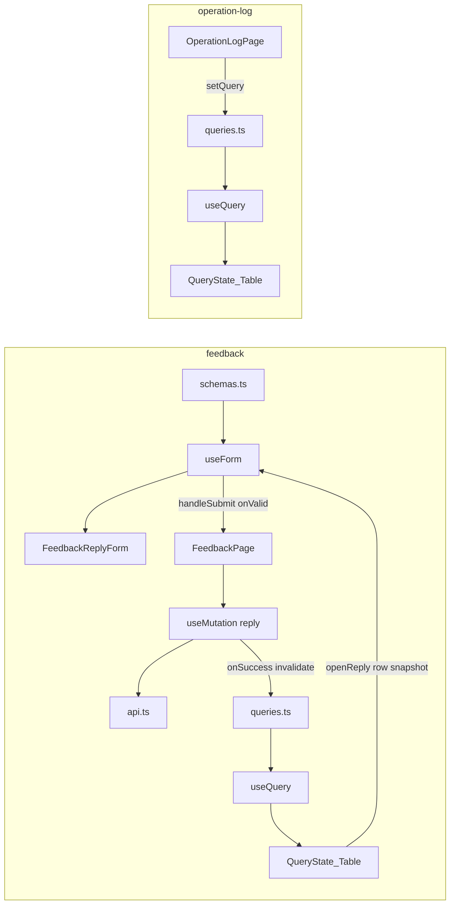

# Step 10 引导式开发：反馈回复 + 操作日志

> 本文对应 [03-开发计划](./03-开发计划.md) 的 Step 10。  
> 它是一份任务引导，不提供可以整段复制的最终页面。请先自己完成每个检查点，卡住后再展开提示。  
> 质量要求以 [01-工程契约](./01-工程契约.md) 为准。

本步 **没有** 测试检查点。测试策略已于 2026-10-11 改为随域交付（见 [04-验收记录](./04-验收记录.md)）。验收以「手动验证矩阵」+ `pnpm verify` 为准。

Step 6 / 7 已经把「筛选 + Table + Dialog + mutation」跑通。Step 9 是无分页数组 + upsert。本步 **不再重讲** `useQuery` / `invalidateQueries` / `Controller` / `keepPreviousData`。同样逻辑打开历史文件；本文只写增量：**半写（只有回复）与只读（没有任何写入口）**。

## 1. 本步目标

把两个 Empty 占位页收成两个自包含 feature。列表范式跟标签页相同，产品规则两套都更窄。

```text
和 Tag / Taxonomy 相同（不要再发明一套）
  筛选 state → queryKey → useQuery → QueryState + 受控分页 Table
  空值丢掉，不传空串
  写成功只靠 invalidateQueries，没有第二份 list

和 Tag / Taxonomy 不同（整页复制会错）
  反馈：没有 POST 创建、没有 DELETE、没有 PUT /:id
        唯一写入口是 PUT /feedbacks/:id/reply
        状态是 pending / replied，不是 0/1 启用禁用
  操作日志：连 mutation 都没有；没有 schemas.ts、没有 Dialog、没有操作列
            日志由后端 middleware 在写操作成功后旁路写入
```

完成后必须满足：

- 反馈可回复并改状态；源码与 UI **都没有**新建 / 删除入口。
- 操作日志只读筛选；源码里 **没有** `post` / `put` / `del`。
- 无多余写操作；每页 `queryKeys` + Query；无 `useEffect` 拉数。
- `pnpm verify` 通过。

03 写「与 Vue 业务行为一致」：指同一账号打同一个后端后的数据结果（回复后列表变成 `replied`，小程序能看见官方回复；写操作后日志多一行）。那是可选的黑盒对照。**不是**把另一端的 `load()`、查询按钮、pageSize 切换、表格列宽搬过来。

## 2. 本步边界

本步只做 `features/feedback`、`features/operation-log`。两条路由已在 [`src/app/router/index.ts`](../src/app/router/index.ts) 挂好，不要改壳。

本步允许：

- 使用已有 `AppFormDialog` / `QueryState` / `PageHeader` / `App.useApp()`。
- 使用已有 `Feedback` / `OperationLog` / `PageData` / `ADMIN_OPLOG_TARGET_TYPE_OPTIONS` / `adminOpLogTargetTypeLabel`。
- 对照 Tag 的文件职责和接线，**复制列表范式、改字段和写入口**。
- 反馈状态选项本仓库还没有：允许写本域常量，或补到 `shared/constants/options.ts`。不要复用 `STATUS_OPTIONS`。
- 检查点 8 做一次复制量体检；默认 **不抽** `useListPage`。

本步禁止：

- 抽万能 `useCrud` / `useListPage` / `useReadOnlyTable`。
- `useEffect` 拉列表，或 `const [list, setList]`。
- 给反馈发明 `POST /feedbacks`（那是小程序用户接口，不在 `/admin/api/v1`）。
- 给反馈发明 `PUT /feedbacks/:id` 或 `DELETE /feedbacks/:id`（后端没有）。
- 给操作日志发明任何写接口。
- 把反馈状态做成 `0 | 1`，或拿 `statusLabel` 显示「启用 / 禁用」。
- 两个 feature 互相 import 页面或内部组件。
- 在 axios 或 Query 全局回调里 `message`。
- 给 article / essay / download / dashboard 写真页面。
- 安装测试依赖、改 `verify`。
- 修改只读对照项目 `Admin/`，以及 `miniApp/`。
- 把另一端的列表页、`load()`、查询 / 重置、pageSize 切换翻译进本仓库。
- 为了 Dialog 字幕去改 `AppFormDialog`（用户原文预览放 children 即可）。

03 里「对照 `Admin/src/views/feedback` 等」对本步过宽。业务规则已经写在后端文档、DTO、middleware 和小程序消费里。

## 3. 开始状态与文件范围

开始前应保持：

- Step 6 已通过：[`TagPage.tsx`](../src/features/tag/pages/TagPage.tsx) 是可对照的完整列表范式。
- Step 9 建议已通过；本步 **不依赖** 运营三页源码。
- QueryClient 已挂；登录真调可用；端口 **5174**。
- 后端 `course_server` 已启动（默认账号 `admin / admin123`）。
- 两页目前都是 `Empty description="暂无数据"`。

本步预计新增或修改：

```text
src/features/operation-log/
├── api.ts
├── queries.ts
└── pages/
    ├── OperationLogPage.tsx          # 替换 Empty
    └── OperationLogPage.module.css   # 本步直接给出，见检查点 4

src/features/feedback/
├── api.ts
├── queries.ts
├── schemas.ts                        # 只有 reply，没有创建实体
├── pages/
│   ├── FeedbackPage.tsx              # 替换 Empty
│   └── FeedbackPage.module.css       # 本步直接给出，见检查点 7
└── components/
    └── FeedbackReplyForm.tsx         # 只渲染回复字段，不发请求
```

操作日志 **不要** 为了「和别的域长得像」建空的 `schemas.ts` / `components/`。没有写表单就没有 schema。

本步 **不要** 安装新依赖，**不要** 改 `shared/types`（两套实体已经在），**不要** 改 `AppFormDialog`。

## 4. 使用方式

每个检查点按下面顺序完成：

1. 只看「任务」和「完成信号」，先自己设计。
2. 卡住时再看「提示一」。
3. 仍无法推进再看「提示二」。
4. 完成后回答「自检问题」。
5. 每个检查点结束都跑最小验证，不要最后一次性排错。

### 同样逻辑去哪看（不要在本文找 API 解释）

| 要做的事 | 打开这个，不要重写一遍 |
|---|---|
| `queryKeys` 三层 + `queryOptions` + `signal` | [`tag/queries.ts`](../src/features/tag/queries.ts) |
| `toListParams` 把 UI 的 `''` 翻译成「不传」 | [`tag/api.ts`](../src/features/tag/api.ts) 的 `toTagListParams` |
| `keywordDraft` + `Input.Search`，不要每个字符打一次 | [`TagPage.tsx`](../src/features/tag/pages/TagPage.tsx) 的筛选条 |
| `useForm<Input, unknown, Output>` + `zodResolver` | TagPage 的 `useForm` |
| 打开弹窗时 `reset` | TagPage 的 `openEdit`（本步没有 openCreate） |
| `onValid` 里 `mutateAsync` + toast + 关窗 | TagPage 的提交函数 |
| 四态派生 + Table 受控分页 + `keepPreviousData` | TagPage 后半 |
| 字段组件只吃 `control` / `errors` | [`TagForm.tsx`](../src/features/tag/components/TagForm.tsx) |
| Dialog 点确定如何接到 `handleSubmit` | TagPage 底部 `AppFormDialog` |
| Query 二维状态、`mutateAsync`、RHF `reset` | [13-疑问点记录.md](./13-疑问点记录.md) §3、§4 |

### 对照源（本步不读 `Admin/src`）

**删掉 `Admin/src` 这份检查点仍能做完。**

Step 10 要对等的是：两条路由、接口 path、请求/响应字段、回复校验、状态枚举、日志由谁写入。这些都可以从后端契约、DTO、middleware 和小程序消费推出。

另一端的 `load()`、`list ref`、拦截器 toast、Element 表单、「查询 / 重置」、pageSize 切换，落在 01 的禁止照搬清单里。读了只会把实现锁成翻译。

03 里点名的 `Admin/src/views/feedback` 和 `operation-log` 对本步过宽。下面这张表已经覆盖验收所需事实。

| 要确认的事实 | 去哪看 |
|---|---|
| 路径：`GET /feedbacks`、`PUT /feedbacks/:id/reply`；`GET /operation-logs` | [api-reference.md](../../course_server/docs/api-reference.md) §3.2–3.3；路由 [`router.go`](../../course_server/internal/router/router.go) |
| 列表 query：反馈 `status` / `keyword` + 分页；日志 `adminId` / `targetType` + 分页 | [`ListFeedbacks`](../../course_server/internal/handler/feedback.go)、[`ListOperationLogs`](../../course_server/internal/handler/admin_oplog.go) |
| 回复 trim、非空、最长 1000 个 rune；空则 `reply is required` | [`dto/admin/feedback.go`](../../course_server/internal/dto/admin/feedback.go) |
| 回复成功把 `status` 写成 `replied`，写入 `reply` / `replied_at` / `replied_by` | `ReplyFeedback` |
| 后台 **没有** 创建反馈；用户走小程序 `POST /api/v1/feedbacks`（content 最长 300） | `CreateFeedback`；[`miniApp/pages/feedback`](../../miniApp/pages/feedback/index.wxml) |
| 日志只在 POST/PUT/DELETE 且 2xx 时由 middleware 写入；GET 不记 | [`middleware/oplog.go`](../../course_server/internal/middleware/oplog.go) |
| `targetType` 映射；未登记的资源会 fallback 成 path 首段 | [`model_admin.go`](../../course_server/internal/model/model_admin.go) `adminPathToTargetType` |
| 日志筛选项 | [`shared/constants/options.ts`](../src/shared/constants/options.ts) `ADMIN_OPLOG_TARGET_TYPE_OPTIONS` |
| 实体类型 | [`shared/types`](../src/shared/types/index.ts) 的 `Feedback` / `OperationLog` |
| 分页缺省 | `pageParams`：page 从 1，缺省 pageSize **20**，上限 100。本页 UI 锁 **10**，跟 Tag |
| Query / 表单 / 禁止项 | [01-工程契约.md](./01-工程契约.md) |

本步不要去翻其它端的列表页实现。你要做的是两条更窄的 feature，不是翻译。

---

## 5. 架构主课：半写和只读不是残缺的 CRUD

Step 6 的标签页有创建 / 编辑 / 删除。本步容易犯的错是「为了对称把缺的接口补上」。正确理解是：**写入口以后端为准，UI 只暴露真实存在的那一个（或零个）。**

```text
操作日志
  没有 schemas.ts          没有输入要校验
  没有 useMutation         没有写
  没有 Dialog / 操作列     没有入口可点
  queries.ts 仍然要三层 key
  筛选换 query 仍然走 setQuery，不是前端 filter(data.list)

反馈
  schemas.ts 只有 reply    不是 Feedback 实体的子集拼盘
  api.ts 只有 list + reply 不要 createFeedback / deleteFeedback
  用户原文不是表单字段     Dialog 里只读预览，reset 只带 reply
  已回复仍可再回           handler 不拦；覆盖原文案
```



页面上允许的跨界：

| 时机 | 反馈 | 操作日志 |
|---|---|---|
| 改筛选 | `setQuery` 换 key | 同左 |
| 点确定 | `handleSubmit` → `mutateAsync` | **没有** |
| 写成功 | `invalidateQueries(lists())` | **没有**（去日志页应能看见新行，那是另一条 query） |
| 点回复 | `reset({ reply })` + 行快照 | **没有** |

多一次就是分层破了。尤其不要：回复成功后 `setList`；日志页 `data.list.filter`；为日志写一个永远不会提交的 zod。

### 常见跨层错误（本步审查会盯）

- 反馈 `api.ts` 出现 `post('/feedbacks')` 或 `del('/feedbacks/${id}')`。
- `put('/feedbacks/${id}', …)` 漏掉 `/reply`。
- `FeedbackReplyForm` 自己 `useMutation`。
- 把 `content` / `userId` / `status` 放进 reply schema。
- 操作日志 `queries.ts` 里写 `createOperationLog`。
- 用 `STATUS_OPTIONS` 筛反馈。
- 两页互相 import，或把日志当反馈的「关联列表」嵌进同一页。
- `queryKey: ['feedbacks']` 魔法串，不含筛选 / 分页。

---

## 检查点 1：先写下产品契约，不急着改 Table

### 当前问题

两页看起来都是「一张表 + 筛选」。一张其实还能写半笔，另一张连按钮都不该有。字段写错，回复会 400；给日志加删除，Network 里会出现后端没有的请求。

### 任务

先在纸面或注释里填完下面三张表，再碰文件。数值以**后端**为准。

**1. 意见反馈（`GET /feedbacks` + `PUT /feedbacks/:id/reply`）**

列表：解包 `PageData<Feedback>`。排序后端做：`id DESC`。前端不要本地 sort。

| 参数 | 类型 | 规则 |
|---|---|---|
| `status` | `'' \| 'pending' \| 'replied'` | 不传 = 全部；不要传空串 |
| `keyword` | string，可选 | 按 **content 或 reply** 模糊搜；空串或纯空格不要传 |
| `page` | number | 从 1 起 |
| `pageSize` | number | 本页 UI 锁 **10**，`showSizeChanger: false`（跟 Tag，不跟 Vue 的 20） |

| 字段 | 列表 | 回复表单 | 规则 |
|---|---|---|---|
| `id` | 可展示 | 不出现在表单 | 路径参数 |
| `userId` | 要 | 不出现 | 只读 |
| `userNickname` | 要 | 不出现 | 可选；后端 JOIN 用户昵称 |
| `content` | 要 | **只读预览**，不是 RHF 字段 | 用户原文；后台不能改 |
| `status` | 要 | 不出现 | `pending` / `replied`；回复成功由后端改 |
| `reply` | 要 | 要 | trim 后非空，最长 1000 |
| `repliedAt` | 可展示 | 不出现 | 未回复可空 |
| `createdAt` | 要 | 不出现 | 提交时间 |
| `repliedBy` / `updatedAt` | **不要** | **不要** | 列表 DTO 没给这两列 |

| 操作 | 接口 | 前端先拦住 | 后端仍可能拒绝 |
|---|---|---|---|
| 回复 | `PUT /feedbacks/:id/reply` body `{ reply }` | zod：非空、≤1000 | `reply is required` / `reply too long` / `feedback not found` |
| 创建 | **不存在**（Admin） | 不渲染「新建」 | 用户走小程序 `POST /api/v1/feedbacks` |
| 删除 | **不存在** | 不渲染按钮 | — |
| 改状态开关 | **不存在** | 不要做启用/禁用 | 状态只随回复变成 `replied` |

已回复的行仍然显示「回复」：再提交会覆盖原文案。handler 没有「只能回一次」的校验。

**2. 操作日志（`GET /operation-logs`）**

列表：`PageData<OperationLog>`。排序 `id DESC`。

| 参数 | 类型 | 规则 |
|---|---|---|
| `adminId` | `number \| ''` | 不传 = 全部；空串不要传；须是正整数再发 |
| `targetType` | `'' \| AdminOpLogTargetType` | 不传 = 全部；选项用已有 `ADMIN_OPLOG_TARGET_TYPE_OPTIONS` |
| `page` / `pageSize` | number | 与反馈相同，UI 锁 10 |

| 字段 | 列表 | 表单 |
|---|---|---|
| `id` / `adminId` | 要 | 无表单 |
| `action` | 要 | 无。值类似 `PUT /admin/api/v1/tags/:id`，不要前端再翻译成中文动词 |
| `targetType` | 要 | 用 `adminOpLogTargetTypeLabel`；未知值原样显示 |
| `targetId` / `remark` / `createdAt` | 要 | 无 |

写入不在本页：[`AdminOperationLog` 中间件](../../course_server/internal/middleware/oplog.go) 只记录 POST/PUT/DELETE 且响应 2xx。本页 GET 不会给自己再写一行。

`feedbacks` **没有**登记在 `adminPathToTargetType` 里。回复反馈成功后，日志 `targetType` 会 fallback 成 `"feedbacks"`。筛选项里没有这一项，表格会原样显示字符串。**不要**为本步去改 middleware 或硬编码一张「反馈」选项——那是后端映射缺口，不是本页的翻译任务。

**3. 两页共同的状态分层**

| 数据 | 放哪 |
|---|---|
| 当前页的 `list` / `total` | Query cache |
| 已生效的筛选 / 分页 | 页面 `useState` |
| 关键字 / 管理员 ID 输入框 | 页面 draft（`keywordDraft` / `adminIdDraft`），回车或点搜索才写入 query |
| 离散 Select（status / targetType） | 直接改 query，page 回到 1 |
| 回复弹窗开关、当前行 | 页面 `useState` |
| 回复正文 | RHF |
| token | Zustand，已有 |

不要加「查询 / 重置」按钮去模仿另一端。Select 即时生效；文本草稿用 `Input.Search`。

### 提示一

`Feedback` / `OperationLog` 已在 `shared/types`。本域不要再定义一份会漂移的接口。`adminOpLogTargetTypeLabel` 对未知值走 `String(value)`，所以 `feedbacks` 不会崩。

### 提示二

列表空不等于实现错了。反馈没有 seed。要用真回复，先在小程序「意见反馈」提交一条（须用户登录），或直接打用户侧 `POST /api/v1/feedbacks`。操作日志则取决于你最近有没有在后台做过写操作（改标签、回反馈都会记）。

### 完成信号

不写组件也能回答：反馈唯一的 method + path 是什么；日志页为什么没有 `schemas.ts`；`pending` 为什么不能复用 `STATUS_OPTIONS`。

### 自检问题

- 为什么删掉 `Admin/src` 还能做完本步？
  - 要对等的是 path、字段、校验、谁负责写入日志、小程序如何展示回复。它们已经在 handler / DTO / middleware / miniApp。另一端的页面是实现，01 要求按 React 重写。
- 为什么后台不能「新建反馈」？
  - 反馈的创建者是小程序用户。Admin 路由里没有 POST。做了也只是打到错误的前缀或 404。
- 为什么日志不是 `T[]`？
  - handler 走 `response.Page`。当成数组会读不到 `.list`，分页也会假。

---

## 检查点 2：画出两域依赖，先不写页面

### 当前问题

第二、第三个「像列表的页」最容易把三套库摊在同一个文件里，或者给只读页也抄一份 Form。本检查点只画边界。

### 任务

在纸上或注释里画出两域 import 方向，必须满足：

```text
operation-log
  api.ts      ──► queries.ts（listXxx）
  queries.ts  ──► Page
  没有 schemas / Form / mutation

feedback
  schemas.ts  ──► Page（zodResolver）──► FeedbackReplyForm（类型）
  api.ts      ──► queries.ts（listXxx）
  api.ts      ──► Page（replyFeedback）
  queries.ts  ──► Page
  FeedbackReplyForm 只被 Page import
```

禁止箭头：

- `schemas.ts` → `react-hook-form` / `@tanstack/react-query` / `antd`
- `queries.ts` → `zod` / `react-hook-form` / `antd`
- `FeedbackReplyForm` → `api.ts` / `queries.ts` / `useMutation`
- `features/feedback` → `features/operation-log` 的页面或内部组件（反向同样禁止）
- `features/operation-log` → `zod` / `AppFormDialog`

本检查点可以还没有能编译的新文件，但你要能指着 Tag 的对应文件说「日志只抄读路径，反馈只抄写路径里的回复」。

### 提示一

对照 Tag 现成拆法：

| 职责 | Tag 文件 | 本步 |
|---|---|---|
| HTTP | [`tag/api.ts`](../src/features/tag/api.ts) | 日志：只有 `list`；反馈：`list` + `reply` |
| 读缓存身份 | [`tag/queries.ts`](../src/features/tag/queries.ts) | 两域都要，key 含各自筛选 |
| 写校验 | [`tag/schemas.ts`](../src/features/tag/schemas.ts) | 只反馈有；字段只有 `reply` |
| 字段 UI | [`TagForm.tsx`](../src/features/tag/components/TagForm.tsx) | `FeedbackReplyForm.tsx` |
| 编排 | TagPage | 两份 Page；日志 Page 没有 Dialog |

「编排」的意思：筛选 state、`useQuery`、（反馈的）mutation / Dialog / `useForm` 都在 Page。**只有 Page 有权把用到的那几套接起来。**

### 提示二

`get` / `put` 从 `@/shared/api` 引，与 Tag 相同。不要为了入口好看去改 `shared/api/index.ts`。日志文件不要 import `put`。

### 完成信号

能指出：哪几个 Tag 文件日志页根本不需要；反馈的 schema 为什么不是 `Feedback` 的 omit。

### 自检问题

- 为什么操作日志不写 `schemas.ts` 占位？
  - 契约目录里的 `schemas.ts` 是给写表单的。空文件会让人以为漏了校验，审查时还要解释「故意空」。没有写就不要建。
- 跨域只允许什么？
  - `shared/`，或将来的 `invalidateQueries(otherKeys.all)`。回复成功后日志列表不会自动出现在反馈页——那是两个 query。用户切到日志页会按那边的 key 重取（或吃到 staleTime 内的缓存）。

---

## 检查点 3：操作日志 `api.ts` + `queries.ts`

### 当前问题

只读页仍然需要正确的 query 身份。`adminId` 是数字筛选，输入框却是字符串。传空串或 `NaN` 会让 SQL 对不上。

### 任务

新建 `features/operation-log/api.ts` 与 `queries.ts`。

`OperationLogListQuery` 建议：

```text
adminId: number | ''
targetType: AdminOpLogTargetType | ''
page: number
pageSize: number
```

`toListParams`：

- `adminId === ''` → 不传
- `targetType === ''` → 不传
- `page` / `pageSize` 原样带上

`listOperationLogs(query, signal?)`：`get<PageData<OperationLog>>('/operation-logs', { params, signal })`。

`operationLogKeys` 三层：`all` → `lists()` → `list(query)`。`all` 用 `['operation-logs']`，与 path 一致。

本检查点 **不要** 写 Page，**不要** 出现 `post` / `put` / `del`。

### 提示一

`adminId` 的草稿解析放 Page 的 `onSearch`，不要放进 `queryFn` 里 `Number(query.adminId)`。query 对象一旦进了 key，就应该已经是「发得出去的值」。非法输入（空、0、小数、字母）在写入 `query` 之前丢掉，当成「不按管理员筛」。

### 提示二

`targetType` 的类型从 `AdminOpLogTargetType` 来，不要手写 `'article' | 'tag' | ...`。options 以后加视频号时，类型会跟着变。

### 完成信号

- `api.ts` 能通过 type-check（可先不引用，或只被 queries import）。
- 源码搜不到本域的 `post(` / `put(` / `del(`。
- `list(query)` 的 key 含 `adminId` / `targetType` / `page` / `pageSize`。

最小验证：在 `Admin-React/` 跑 `pnpm type-check` 能过，或至少这两个文件无红线。

### 自检问题

- 为什么 `all` 不用 `['logs']`？
  - key 前缀是缓存身份，和 REST path 对齐最好认。短名字省不了几字节，失效时却要对着字符串猜。
- 非法 `adminId` 为什么不发 `adminId=abc` 让后端返回空？
  - 可以，但那是把校验推给 MySQL 隐式转换。前端丢掉更短，也避免和「真的没有这个管理员」混在一起。

---

## 检查点 4：操作日志页面（样式直接用）

### 当前问题

占位 Empty 还在。本页要证明：没有 mutation 也能是完整的企业级列表，而不是少了几个按钮的 TagPage。

### 任务

替换 [`OperationLogPage.tsx`](../src/features/operation-log/pages/OperationLogPage.tsx)。必须：

- 导出仍是 `Component`（懒加载约定）。
- `useQuery({ ...operationLogQueries.list(query), placeholderData: keepPreviousData })`。
- 四态派生与 Tag 相同（`isPending && !isPlaceholderData` → pending；首次 error；`data.list.length === 0` → empty）。
- Table `rowKey="id"`，`dataSource={data.list}`，受控分页，`showSizeChanger: false`。
- `PageHeader` **没有** `extra` 新建按钮。没有操作列。没有 Dialog。
- 筛选：`adminId` 用 `Input.Search` + draft；`targetType` 用 Select（含「全部」`''`）。改筛选时 `page` 回到 1。
- `targetType` 列走 `adminOpLogTargetTypeLabel`。注意 `noUncheckedIndexedAccess`：未知类型时 label 函数已有 fallback，不要自己 `options[i].label` 不判空。

把下面文件存为 `pages/OperationLogPage.module.css`（本步允许直接用，不要改 token 名）：

```css
.page {
  display: flex;
  flex-direction: column;
  gap: 16px;
}

.adminId {
  width: 180px;
}

.targetType {
  width: 180px;
}

.tableBlock {
  display: flex;
  flex-direction: column;
  gap: 12px;
}
```

`PageHeader` 可以加一句 `description`：只读审计，写入由后端在写操作成功后完成。不要做成第二个筛选条件。

### 提示一

翻页 loading 用 Table `loading={{ spinning: listQuery.isFetching, delay: 200 }}`，不要把 `queryStatus` 打回 pending。TagPage 第 184–198 行的注释就是为这个写的。

### 提示二

空态文案用「暂无操作日志」，不要沿用占位页的「暂无数据」让人以为路由没换。刷新失败（已有 data）用 `Alert`，不要整页 error。

### 完成信号

- `/operation-logs` 能出表或空态，不再是无筛选的 Empty。
- Network 只有 `GET /operation-logs?...`。
- 改 `targetType`、搜 `adminId`、翻页，都能在 Network 里看到对应 query；没有前端 `filter`。
- 源码没有 `useMutation` / `AppFormDialog` / `zodResolver`。

### 自检问题

- 为什么本页还要 `keepPreviousData`？
  - 有分页。换 key 时 v5 会把新 key 标成 pending；不留上一页占位就会闪整页 Skeleton。Step 9 数组列表没有分页，才默认不用。
- 为什么不把 `action` 显示成「更新标签」？
  - 那是 middleware 记下的 method + FullPath。前端词典维护成本高，和真实请求对不上时更难排查。原样展示就是审计。

---

## 检查点 5：反馈 `api.ts` + `queries.ts`

### 当前问题

反馈的读路径几乎是 Tag 换皮，写路径只有 reply。抄 Tag 时最容易把 `createTag` / `deleteTag` 一起带过来。

### 任务

新建 `features/feedback/api.ts` 与 `queries.ts`。

`FeedbackListQuery` 建议：

```text
keyword?: string
status: '' | 'pending' | 'replied'
page: number
pageSize: number
```

`toListParams` 与 Tag 相同：keyword trim 后空则不传；status `''` 不传。

函数只允许：

- `listFeedbacks(query, signal?)` → `GET /feedbacks`
- `replyFeedback({ id, input })` → `PUT /feedbacks/${id}/reply`

`feedbackKeys`：`all: ['feedbacks']`，同样三层。`queryFn` 把 `signal` 传下去。

本检查点仍不要写完整 Page。可以先让 queries 能被 type-check。

### 提示一

`input` 类型从即将出现的 `FeedbackReplyOutput` 来，或先写 `{ reply: string }` 再在检查点 6 改成 schema 的 output。不要从 `Feedback` 里 Pick 一堆用不到的字段。

### 提示二

用户侧创建走 `/api/v1/feedbacks`，Admin 客户端的 base 是 `/admin/api/v1`。就算你在 Admin 里 `post('/feedbacks')`，打的也是后台前缀，router 没有这条。不要「先写上以后再用」。

### 完成信号

- 本域 api 只有 get list + put reply。
- `list(query)` key 含 keyword / status / page / pageSize。
- 没有第二份 `Feedback` interface。

### 自检问题

- 为什么 reply 的 path 是 `/:id/reply` 而不是 `/:id`？
  - 这不是全量更新实体。DTO 只有 `reply`。后端自己写 status / repliedAt / repliedBy。做成 PUT 全量会诱导你把用户 content 一并提交。
- keyword 为什么也能搜到回复内容？
  - handler：`content LIKE ? OR reply LIKE ?`。产品如此，不要改成只搜 content。

---

## 检查点 6：`schemas.ts` + 只渲染回复字段

### 当前问题

写表单只有一个字段，仍要 zod 当唯一校验源。把用户原文、状态塞进 schema，就会出现「回复时还在校验用户 content」这种假规则。

### 任务

`features/feedback/schemas.ts`：

- 只有 `reply`。
- `z.string().trim().min(1, …).max(1000, …)`。
- 导出 `FeedbackReplyInput` / `FeedbackReplyOutput`（或你命名的等价类型）。
- **禁止** import RHF / Query / antd。

`FeedbackReplyForm.tsx`：

- props 只有 `control` / `errors`。
- Ant `Form` 当 layout 外壳，`Form.Item` + `Controller` + `Input.TextArea`。
- 不要 `register`，不要 `onFinish`，不要 `useMutation`。
- 不要在 Form 里渲染用户原文（那不是字段）。`maxLength={1000}` 可以给，但截断不能代替 zod：纯空格仍要靠 trim + min(1) 拦住。

用户原文预览留到检查点 7 的 Dialog children。

### 提示一

Go 用 `len([]rune(reply))` 计 1000。BMP 汉字下 JS `string.length` 与 rune 一致。不要为了四字节字符去引入额外库。中文提示即可，例如「请输入回复内容」「回复不能超过1000个字符」。后端英文 message 仍要在 toast 里原样出现（提交过了前端、或绕过校验时）。

### 提示二

`binding:"required"` 拦不住纯空格。所以 schema 必须 `trim` 后再 `min(1)`。只写 `min(1)` 不 trim，空格能过前端、被后端 `reply is required` 打回来。

### 完成信号

- schema 文件只有 zod。
- Form 文件搜不到 `useQuery` / `useMutation` / `replyFeedback`。
- 空串、纯空格、1001 个字符能在纸面上说出分别被谁拒绝。

### 自检问题

- 为什么不把 `content` 做成 disabled 的 RHF 字段？
  - 它不提交。放进 `useForm` 就要进 defaultValues / reset / schema。只读预览用行快照更短，也不会在 `onValid` 里多出一个不该 PUT 的键。
- 为什么已回复也可以把旧回复 `reset` 进去？
  - 再回是覆盖。空着打开会误导运营以为旧回复丢了。

---

## 检查点 7：反馈页面接到筛选 + Dialog（样式直接用）

### 当前问题

读、写、预览要在 Page 接线，且 **没有** 新建 / 删除。抄 TagPage 时删不干净，就会验收失败。

### 任务

替换 [`FeedbackPage.tsx`](../src/features/feedback/pages/FeedbackPage.tsx)。

必须有：

- `keywordDraft` + `Input.Search`；`status` Select（全部 / 待处理 / 已回复）。改筛选 `page: 1`。
- `pageSize: 10`，`showSizeChanger: false`。
- `useQuery` + `keepPreviousData` + 与 Tag 相同的四态。
- **一个** `useMutation({ mutationFn: replyFeedback, onSuccess: invalidate feedbackKeys.lists() })`。
- `openReply(row)`：`reset({ reply: row.reply ?? '' })`，记下当前行，开窗。
- Dialog 标题如「回复意见反馈」。children：**先**只读预览 `current.content`，**再** `<FeedbackReplyForm />`。
- `onSubmit={() => void handleSubmit(onValid)()}`；`confirmLoading={replyMutation.isPending}`。
- toast 用 `App.useApp()`。成功关窗。失败展示 `ApiError.message`。
- `PageHeader` **没有** 新建按钮。操作列 **只有**「回复」。
- 状态列显示「待处理 / 已回复」，不要 `statusLabel`（那是启用/禁用）。

把下面文件存为 `pages/FeedbackPage.module.css`：

```css
.page {
  display: flex;
  flex-direction: column;
  gap: 16px;
}

.keyword {
  width: 240px;
}

.status {
  width: 160px;
}

.tableBlock {
  display: flex;
  flex-direction: column;
  gap: 12px;
}

.preview {
  margin-bottom: 16px;
  padding: 12px;
  background: var(--color-bg-subtle);
  border-radius: 8px;
}

.previewLabel {
  font-size: 13px;
  color: var(--color-text-secondary);
  margin-bottom: 6px;
}

.previewContent {
  white-space: pre-wrap;
  line-height: 1.6;
  color: var(--color-text);
}
```

`useForm` 放在 Page，不要放进随 `destroyOnHidden` 卸载的 Dialog 子树。Tag 已经这么放了。

本步不要改 `AppFormDialog` 加 subtitle。产品说明（用户可在小程序意见反馈页看到回复）可以写成预览区上方一句普通文本，或 `PageHeader description`。

### 提示一

操作列不要从 TagPage 抄启用 / 禁用 / 删除 / `Popconfirm`。本页没有这些规则。`confirmLoading` 只看 reply mutation，不要再手写一份 `saving` state。

### 提示二

列表空很常见。空态文案「暂无反馈」即可。不要为了页面「好看」用 mock 数组。真数据从用户侧来。

回复成功后切到 `/operation-logs`，应能看到一条 `PUT .../feedbacks/:id/reply`（`targetType` 可能是 `feedbacks`）。那是检查点 9 的矩阵，本检查点先保证反馈页自己刷新。

### 完成信号

- `/feedbacks` 有筛选、表、回复弹窗；没有新建、没有删除。
- Network：列表 GET；提交只有 `PUT /feedbacks/:id/reply`。
- 校验失败落在 Form.Item；点遮罩不关窗；提交中确定按钮不可点。
- 无 `useEffect` 拉数；无 `any`。

### 自检问题

- 为什么 invalidate `lists()` 而不是当前 `list(query)`？
  - 回复会改 status。当前若筛着 `pending`，这条应从本页消失；只失效当前 key 会留下过期行。Tag 删除同理。
- 为什么 Dialog 里要预览 content？
  - 运营对着表格缩略点回复，容易回错行。预览用的是打开时的行快照，不是再 GET 详情（后台没有反馈详情接口）。

---

## 检查点 8：Rule of Three 体检（默认不抽）

### 当前问题

现在至少有 Tag、Taxonomy、运营三页，再加两份 PageData 列表。01 禁止 11 页复制 200 行，也禁止第一页就 `useCrud`。本步两页 **看起来像** Tag，写入口已经不同。

### 任务

把 `TagPage`、`FeedbackPage`、`OperationLogPage` 并排，只回答：

1. 重复的是不是 **只** 有「`useQuery` + 四态 if/else + 受控分页」？
2. 写入口（CRUD vs 单 reply vs 零 mutation）、筛选项、Dialog 是否已经明显不同？
3. 若抽 hook，调用方是否仍能从函数名看出「这不管表单、不管回复」？

默认结论：**不抽**。把体检结果写在验收备注里一句即可。

仅当第 1 题为「是」，才允许极薄 hook，例如 `usePagedListQuery(options)`：

- 入参：已经绑好的 `queryOptions`。
- 出参：`query` 对象 + `queryStatus` + `showFetchError`。
- **禁止** 装进：`useForm`、reply/create、`open` / `current`、columns、toast、筛选 draft。

不要抽 `useFeedbackPage`。不要抽 `useCrud`。这个 hook 若出现，先放在某一个 feature 里观察，不要一上来进 `shared/`。

### 提示一

两页 columns 完全不同。抽 `AdminTable` 要把回调当 props 传回来，文件变多、心智不变少。Tag 检查点已经否过拆 columns。

### 提示二

若你抽了 hook，审查会看它的 import。出现 `zodResolver` / `replyFeedback` / `message.success` 就说明越界了，拆掉比改名更省事。

### 完成信号

- 要么：两页里仍能指着四态 if/else，备注写「未抽；写入口不同，暂留」。
- 要么：存在一个不超过几十行、只包 Query 读路径的 hook，反馈 Page 仍拥有 Form 与 mutation。

### 自检问题

- 为什么「又两页 PageData」仍可能不够抽 `useListPage` 的「三」？
  - Rule of Three 数的是**相同结构**。零 mutation 的日志页和带 Dialog 的反馈页不是同一份。硬抽只会把「有没有回复」藏进 options。
- 为什么本步不抽 Form Dialog 壳？
  - `AppFormDialog` 已经是壳。

---

## 检查点 9：完整验收

### 自动验证

在 `Admin-React/` 目录执行：

```bash
pnpm verify
pnpm build
```

预期：Oxlint 通过；TypeScript 严格检查通过；Vite 生产构建完成。本步不要求 `pnpm test`。

### 手动验证矩阵

前置：后端已启动；前端 `pnpm dev` 在 **5174**；用 `admin / admin123` 登录。反馈若为空，先用小程序意见反馈页（或用户侧 API）提交一条。

**意见反馈 `/feedbacks`**

- 首次 pending，随后是表或空态；无 `useEffect` 拉列表。
- 无「新建」、无删除、无启用/禁用。
- status 筛 `pending` / `replied` 会打 query；keyword 回车才写入 query，每个字符不打。
- 打开回复能看见用户原文；textarea 可带上已有回复。
- 空回复 / 纯空格被 zod 拦住，窗不关。
- 合法回复后列表刷新：该行 `status=replied`，回复内容可见；筛 pending 时该行离开当前页。
- Dialog 点遮罩不关；提交中确定按钮不可点。
- Network 只有 GET list 与 `PUT /feedbacks/:id/reply`。

**操作日志 `/operation-logs`**

- 只读。无操作列、无弹窗、无写请求。
- `targetType`、`adminId`、翻页都走服务端筛选。
- 刚回复成功后刷新或进入本页，能看到对应 PUT 行（`targetType` 可能显示 `feedbacks`）。
- 改标签 / 改首页入口等其它写操作也会多行；GET 本页本身不新增行。

**共性**

- 每域 `queryKeys` 工厂；页面没有 `queryKey: ['feedbacks']` 这种魔法串。
- toast 来自 `App.useApp()`。
- 无 `any`、无 `useCrud`、两域不互相 import。
- 反馈状态没有复用 `STATUS_OPTIONS`。

### 代码审查时自搜

```text
useEffect
setList
queryKey: ['feedbacks'
queryKey: ['operation-logs'
post('/feedbacks'
DELETE /feedbacks
PUT /feedbacks/${
useCrud
STATUS_OPTIONS
createFeedback
from 'antd' 的静态 message
register(
load(
```

预期：`useEffect` 不为拉数出现；`queryKey` 只来自本域 keys；反馈没有 POST/DELETE；`PUT` 必须带 `/reply`；`STATUS_OPTIONS` 不出现在反馈筛选；`register` 不应出现在 Ant 控件上；`message` 只来自 `App.useApp()`。`keepPreviousData` 应该出现（有分页）。

按 [03 验收协议](./03-开发计划.md) 发审查时，把本矩阵勾过去。备注写清：未读 `Admin/src`；业务对等以后端 + 小程序消费为准。

---

## 6. 失败时的最短排查路径

### 进入页面仍是「暂无数据」Empty，且没有任何筛选

占位页没替换，或懒加载的 `Component` 没导出。确认两个 `pages/*Page.tsx` 导出的仍是 `Component`。

### 表格空白但 Network 200、响应有 list

把 `PageData` 当成了 `T[]`，`dataSource={data}` 而列表其实在 `data.list`。改成 `dataSource={data.list}`。

### 反馈提交 404

写成了 `PUT /feedbacks/:id`。改成 `PUT /feedbacks/:id/reply`。

### 反馈提交 404 且 path 像 `/api/v1/feedbacks`

打到了用户侧前缀。Admin 只用 `shared/api` 的 base。

### 回复 400 `reply is required`

前端没 trim，或 schema 没 `trim` 就 `min(1)`。纯空格能过 Input，过不了 DTO。

### 回复成功但列表仍显示待处理

没 `invalidateQueries(feedbackKeys.lists())`，或只 invalidate 了当前 `list(query)` 且你正筛着别的 status。检查 key 前缀。

### 每个关键字都打 GET

把 `keywordDraft` 直接写进了 `query`。应和 Tag 一样：输入改 draft，搜索才 `setQuery`。

### 反馈筛「禁用」或状态列显示启用

误用了 `STATUS_OPTIONS` / `statusLabel`。反馈状态是字符串 `pending` / `replied`。

### 操作日志出现 POST / PUT

本域 api 抄了 Tag。删掉写函数。日志不是配置项，不能「新建一条审计」。

### `adminId` 筛选永远空

把 `''` 传给了后端，或 `Number('') === 0` 当成了管理员 0。空值必须 `undefined`。

### 回复反馈后日志里找不到「反馈」选项

不是前端筛丢了。middleware 对 `feedbacks` 没有登记，`targetType` 是 `"feedbacks"`。看表格原文字符串，不要为本步改 Go。

### 工作目录不对

所有 pnpm 命令在 `Admin-React/`。

---

## 7. 完成后应能口头回答

1. 为什么本步不读 `Admin/src` 也能做完验收？
2. 后台为什么没有创建 / 删除反馈？创建发生在哪条 API？
3. 回复为什么是 `PUT .../reply` 而不是 `PUT .../:id`？
4. 反馈状态为什么不能复用 `STATUS_OPTIONS`？
5. 操作日志是谁写入的？本页 GET 会不会记一行？
6. 为什么操作日志没有 `schemas.ts`？
7. `keywordDraft` / `adminIdDraft` 和已生效 `query` 各是什么？
8. 回复成功为什么要 invalidate `lists()` 而不是当前页 key？
9. `keepPreviousData` 在本步为什么需要、在 Step 9 为什么通常不需要？
10. 本步为什么默认仍不抽 `useListPage`？若抽薄层，天花板在哪？

---

## 8. 快速上手总结

### 必须掌握

- **对照源在后端 + 小程序消费**：path、字段、回复校验、日志中间件、用户如何看见回复。不需要 `Admin/src`。
- **半写**：只有真实存在的写入口。反馈 = 一条 reply mutation；不要补 CRUD。
- **只读页也是完整 feature**：`api` + `queries` + Page 即可；没有的文件不要占位。
- **字符串状态 ≠ 启用禁用**：`pending` / `replied` 与 `0 | 1` 不是同一套 options。
- **draft vs query**：文本筛选不每个字符换 key；离散 Select 可以即时换 key。

### 按需了解

- `adminPathToTargetType` 未登记 `feedbacks`，日志里会看到 fallback 字符串。
- 列表 DTO 不含 `repliedBy`；不要为了「完整」去展示一个响应里没有的字段。
- 用户提交 content 最长 300；管理员回复最长 1000。两套上限不要抄反。
- Vue 的查询 / 重置 / pageSize 切换 / 列表 `load()`：不搬。
- schema 单测：Step 16。

### 下一步

Step 10 验收通过后再进入 Step 11：

- 作文专题（OSS + 多图拖拽 + 上架，无删除）。
- 本步不要提前写 article / essay / download 的真页面。

## 9. 未验证项

- 本文没有替你实现两页源码，因此不能声称「按本文复制即可运行」。
- CSS 已给出完整小文件；表格列、mutation 接线、schema 需你按检查点自己写。
- 未在隔离空目录复现本步（本步是累计项目，依赖 Step 1–6 的仓库状态）。
- 反馈真回复依赖库里已有用户反馈；操作日志依赖近期后台写操作。
- 完成实现后，请以 `pnpm verify`、`pnpm build` 和「手动验证矩阵」为最终验收依据。
