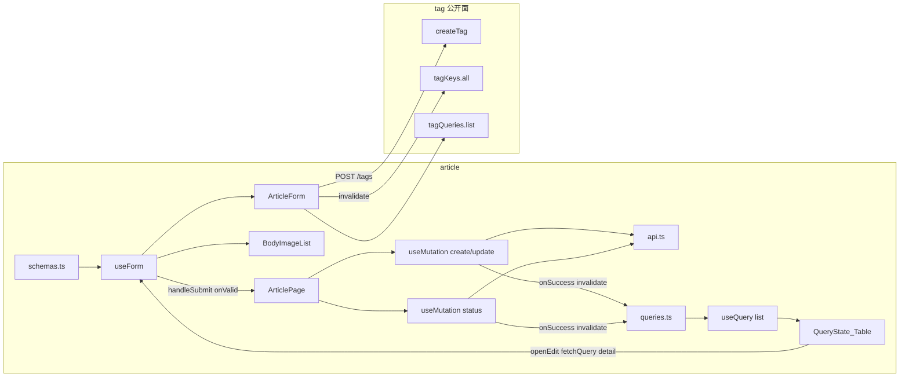

# Step 11 引导式开发：作文专题（OSS + 多图拖拽 + 上架）

> 本文对应 [03-开发计划](./03-开发计划.md) 的 Step 11。  
> 它是一份任务引导，不提供可以整段复制的最终页面。请先自己完成每个检查点，卡住后再展开提示。  
> 质量要求以 [01-工程契约](./01-工程契约.md) 为准。

本步 **没有** 测试检查点。测试策略已于 2026-10-11 改为随域交付（见 [04-验收记录](./04-验收记录.md)）。验收以「手动验证矩阵」+ `pnpm verify` 为准。

Step 6 / 7 已经把「筛选 + Table + Dialog + mutation」跑通。Step 8 有 `OssUploadButton`。Step 9 把按钮接到过 RHF。本步 **不再重讲** `useQuery` / `invalidateQueries` / `Controller` / STS。同样逻辑打开历史文件；本文只写增量：**复合表单、列表省略正文图所以编辑必须拉详情、独立上下架、正文图最多 20 张且用稳定 id 拖拽、内联建标签后失效 tag 缓存**。

## 1. 本步目标

把 `features/article` 的 Empty 占位收成一条自包含 feature。列表范式跟标签页相同，产品规则更宽，写入口也不是「再抄一份 Tag CRUD」。

```text
和 Tag / Taxonomy 相同（不要再发明一套）
  筛选 state → queryKey → useQuery → QueryState + 受控分页 Table
  空值丢掉，不传空串
  写成功只靠 invalidateQueries，没有第二份 list
  一份 useForm + 一个 Dialog；字段组件只吃 control / errors

和 Tag / Taxonomy 不同（整页复制会错）
  列表 GET 省略 bodyImages；编辑必须再 GET /articles/:id
  没有 DELETE；上下架走 PUT /articles/:id/status，不靠写表单改 status
  封面 / 正文图走公开 OSS（covers / body），不是 icons
  正文图最多 20，可拖拽；dnd-kit 的 id 不能用下标
  标签 Select 可内联 POST /tags，然后 invalidateQueries(tagKeys.all)
```

完成后必须满足：

- 列表筛选、创建 / 编辑可用；上 / 下架走独立 status API；源码与 UI **都没有**删除入口。
- 封面可上传；正文图最多 20、可拖拽排序、可预览；行 key / sortable id 用稳定 id，不是下标。
- 标签 select 可内联 `POST /tags`，并 `invalidateQueries({ queryKey: tagKeys.all })`。
- slug 校验与后端 `ValidArticleSlug` 一致（zod）。
- 无 `useEffect` 拉列表；`pnpm verify` 通过。

03 写「与 Vue 业务行为一致」：指同一账号打同一个后端后的数据结果（专题能建出来、上架后小程序能看见、正文图顺序即阅读顺序）。那是可选的黑盒对照。**不是**把另一端的 `load()`、查询按钮、pageSize 切换、`vuedraggable`、封面存 objectKey 的写法搬过来。

## 2. 本步边界

本步只做 `features/article`。路由 `/articles` 已在 [`src/app/router/index.ts`](../src/app/router/index.ts) 挂好，不要改壳。

本步允许：

- 使用已有 `AppFormDialog` / `QueryState` / `PageHeader` / `App.useApp()` / `OssUploadButton`。
- 使用已有 `Article` / `ArticleDetail` / `GRADE_OPTIONS` / `SEMESTER_OPTIONS` / `UNIT_OPTIONS` / `CONTENT_TYPE_OPTIONS` / `ARTICLE_STATUS_OPTIONS` / `VIEW_ACCESS_OPTIONS` / `articleStatusLabel`。
- 对照 Tag 的文件职责和接线，**复制列表范式，改字段和写入口**。
- **跨域只借 tag 的公开面**：`createTag`、`tagKeys`、`tagQueries`。01 点名的例子就是「文章页内联建标签 → `invalidateQueries(tagKeys.all)`」。
- 安装 `@dnd-kit/core` / `@dnd-kit/sortable` / `@dnd-kit/utilities`（本步新技术点，仓库里还没有）。
- 检查点 8 做一次复制量体检；`BodyImageList` 作为本域组件是有理由的拆分；默认 **不抽** `useCrud` / `useArticlePage`。

本步禁止：

- 抽万能 `useCrud` / `useListPage`。
- `useEffect` 拉列表，或 `const [list, setList]`。
- 给文章发明 `DELETE /articles/:id`（后台路由没有）。
- 用写表单的 `status` 字段代替 `PUT /articles/:id/status` 做上下架。
- 把 `viewCount` / `shareCount` / `favoriteCount` / `downloadCount` / `publishedAt` 放进 zod（DTO 禁止客户端改计数）。
- `features/article` import `features/tag` 的 **页面或内部组件**（`TagPage` / `TagForm`）。`api.ts` / `queries.ts` 可以。
- 在 axios 或 Query 全局回调里 `message`。
- 给 essay / download / dashboard 写真页面。
- 安装测试依赖、改 `verify`。
- 修改只读对照项目 `Admin/`，以及 `miniApp/`。
- 把另一端的列表页、`load()`、查询 / 重置、pageSize 切换、`item-key="index"` 翻译进本仓库。
- 用实验包 `@dnd-kit/react`。本步用稳定的 core + sortable。
- 为学拖拽单独做演示路由。

03 里「对照 `Admin/src/views/article`」对本步过宽。业务规则已经写在后端 DTO、handler、slug 正则、`MaxBodyImages` 和小程序详情消费里。

## 3. 开始状态与文件范围

开始前应保持：

- Step 6 已通过：[`TagPage.tsx`](../src/features/tag/pages/TagPage.tsx) 是可对照的完整列表范式。
- Step 8 已通过：`OssUploadButton` 能公开上传；Step 9 的 [`HomeBlockForm.tsx`](../src/features/home-block/components/HomeBlockForm.tsx) 是「按钮接到 RHF」的对照。
- Step 10 建议已通过；本步 **不依赖** 反馈 / 日志源码。
- QueryClient 已挂；登录真调可用；端口 **5174**。
- 后端 `course_server` 已启动（默认账号 `admin / admin123`）。
- `/articles` 目前是 `Empty description="暂无数据"`。

本步预计新增或修改：

```text
src/features/article/
├── api.ts
├── queries.ts
├── schemas.ts
├── pages/
│   ├── ArticlePage.tsx              # 替换 Empty
│   └── ArticlePage.module.css       # 本步直接给出，见检查点 7
└── components/
    ├── ArticleForm.tsx              # 标量字段 + 封面 + 标签；不发请求
    ├── BodyImageList.tsx            # 拖拽 + 上传 + 预览；不发文章请求
    └── BodyImageList.module.css     # 本步直接给出，见检查点 5
```

本步 **不要** 改 `shared/types`（`Article` / `ArticleDetail` 已经在），**不要** 改 `AppFormDialog`，**不要** 把 STS 再包进 Query。

`pnpm add` 只加三个 `@dnd-kit/*`，工作目录必须是 `Admin-React/`。

## 4. 使用方式

每个检查点按下面顺序完成：

1. 只看「任务」和「完成信号」，先自己设计。
2. 卡住时再看「提示一」。
3. 仍无法推进再看「提示二」。
4. 完成后回答「自检问题」。
5. 每个检查点结束都跑最小验证，不要最后一次性排错。

### 同样逻辑去哪看（不要在本文找 API 解释）

| 要做的事 | 打开这个，不要重写一遍 |
|---|---|
| `queryKeys` 三层 + `queryOptions` + `signal` | [`tag/queries.ts`](../src/features/tag/queries.ts) |
| `toListParams` 把 UI 的 `''` 翻译成「不传」 | [`tag/api.ts`](../src/features/tag/api.ts) 的 `toTagListParams` |
| `keywordDraft` + `Input.Search` | [`TagPage.tsx`](../src/features/tag/pages/TagPage.tsx) 的筛选条 |
| 多离散 Select 立刻生效、page 回 1 | [`TaxonomyPage.tsx`](../src/features/taxonomy/pages/TaxonomyPage.tsx) |
| `useForm<Input, unknown, Output>` + `zodResolver` | TagPage 的 `useForm` |
| 打开创建 / 编辑时 `reset` | TagPage 的 `openCreate` / `openEdit`（编辑本步要先拉详情） |
| `onValid` 里 `mutateAsync` + toast + 关窗 | TagPage 的提交函数 |
| 四态派生 + Table 受控分页 + `keepPreviousData` | TagPage 后半 |
| 字段组件只吃 `control` / `errors` | [`TagForm.tsx`](../src/features/tag/components/TagForm.tsx) |
| OSS 按钮 `onSuccess` 写 `result.url` | [`HomeBlockForm.tsx`](../src/features/home-block/components/HomeBlockForm.tsx) |
| `grade` / `unit` 用 `z.literal(GRADES)` | [`taxonomy/schemas.ts`](../src/features/taxonomy/schemas.ts) |
| Dialog 点确定如何接到 `handleSubmit` | TagPage 底部 `AppFormDialog` |
| Query 二维状态、`mutateAsync`、RHF `reset` | [13-疑问点记录.md](./13-疑问点记录.md) §3、§4 |

### 对照源（本步不读 `Admin/src`）

**删掉 `Admin/src` 这份检查点仍能做完。**

Step 11 要对等的是：路由、接口 path、请求 / 响应字段、slug 规则、正文图上限、上下架副作用、小程序按 `bodyImages` 数组顺序渲染。这些都可以从后端契约、DTO、小程序详情页和本仓库已有常量推出。

另一端的 `load()`、`list ref`、拦截器 toast、Element 表单、「查询 / 重置」、`item-key="index"`，落在 01 的禁止照搬清单里。读了只会把实现锁成翻译。

03 里点名的 `Admin/src/views/article` 和 `ImageUrlList.vue` 对本步过宽。下面这张表已经覆盖验收所需事实。

| 要确认的事实 | 去哪看 |
|---|---|
| 路径：`GET/POST /articles`，`GET/PUT /articles/:id`，`PUT /articles/:id/status`；**没有 DELETE** | [api-reference.md](../../course_server/docs/api-reference.md) §3.6；[`router.go`](../../course_server/internal/router/router.go) |
| 列表 query：`grade` / `semester` / `unit` / `contentType` / `status` / `keyword` / `tagId` + 分页 | [`ListArticles`](../../course_server/internal/handler/admin_content.go) |
| 列表 `Omit("body_images")`；详情才带正文长图和 tags | 同上 `ListArticles` / `GetArticle` |
| 写字段与 trim / slug / bodyImages 校验 | [`dto/admin/article.go`](../../course_server/internal/dto/admin/article.go) |
| slug：`^[a-z0-9]+(?:-[a-z0-9]+)*$`；重名 `article slug already exists` | [`ValidArticleSlug`](../../course_server/internal/model/models.go)；[`CheckArticleSlugDuplicate`](../../course_server/internal/model/model_write.go) |
| 正文图最多 `MaxBodyImages = 20`，元素不可空 | [`ValidateBodyImages`](../../course_server/internal/model/model_shared.go) |
| 创建默认草稿；未传 `textbookVersion` → `统编版`；未传 `viewAccessType` → `free` | `ValidateForCreate` |
| 上下架：只接受 0/1；首次上架写 `publishedAt`，再上架保留，下架清空 | `UpdateArticleStatus` |
| `tagIds` 为 `[]` 会清空关联；`null` / 省略则不改关联。本步提交始终带数组 | `replaceArticleTags` |
| 小程序详情按 `bodyImages` 数组顺序展示 | [`miniApp/pages/article-detail/index.wxml`](../../miniApp/pages/article-detail/index.wxml) |
| 筛选项 / 状态文案 | [`shared/constants/options.ts`](../src/shared/constants/options.ts) |
| 实体类型 | [`shared/types`](../src/shared/types/index.ts) 的 `Article` / `ArticleDetail` |
| OSS `subdir`：封面 `covers`、正文 `body`，公开 ACL | [15-step8-oss引导式开发.md](./15-step8-oss引导式开发.md) |
| 分页缺省 | `pageParams`：page 从 1，缺省 pageSize **20**，上限 100。本页 UI 锁 **10**，跟 Tag |
| Query / 表单 / 跨域 / 禁止项 | [01-工程契约.md](./01-工程契约.md) |

本步不要去翻其它端的列表页实现。你要做的是一条更宽的 feature，不是翻译。

---

## 5. 架构主课：复合表单仍然是「Page 编排，字段不发请求」

Step 6 的标签页字段少，编辑用行快照就够。本步容易犯的错是：把 OSS、拖拽、建标签、拉详情全塞进 Page，或者反过来让 `BodyImageList` 自己 `useMutation` 去 `PUT /articles`。

正确理解是：**文章只有一套写模型；拖拽改的是表单数组顺序；上下架是另一条 mutation；标签字典是别人的缓存。**

```text
列表
  GET /articles            PageData<Article>（扁平：文章字段 + tags + downloadSummary）
  没有 bodyImages

编辑
  GET /articles/:id        { article, tags }   ← 唯一能拿到正文图的读口
  用 queryClient.fetchQuery，不要 useEffect 拉

创建 / 更新
  POST /articles
  PUT  /articles/:id       body 是 DTO，bodyImages 是 string[]
  status 不要靠这条做上下架

上下架
  PUT /articles/:id/status  body { status: 0 | 1 }
  列表操作列 Popconfirm，不进 Dialog

内联标签
  POST /tags               复用 features/tag/api.ts 的 createTag
  invalidateQueries(tagKeys.all)
  不要 import TagForm
```



页面上允许的跨界：

| 时机 | 放哪 |
|---|---|
| 改筛选 | `setQuery` 换 key |
| 打开编辑 | `fetchQuery(detail)` → `reset` |
| 点确定 | `handleSubmit` → create / update |
| 上 / 下架 | 行内 `mutateAsync`，不走 Dialog |
| 拖拽正文图 | 只 `onChange` 表单数组，不发请求 |
| 内联建标签 | `createTag` + 把新 id 写入 `tagIds` + 失效 `tagKeys.all` |

多一次就是分层破了。尤其不要：拖拽结束 `updateArticle`；`BodyImageList` 自己读 `useQuery`；用 `useEffect` 把列表行同步进表单。

### 常见跨层错误（本步审查会盯）

- `api.ts` 出现 `del('/articles/${id}')`。
- 上下架写成 `put('/articles/${id}', { status })`（那是全量更新，DTO 还要 title / slug / coverImg）。
- `queryKey: ['articles']` 魔法串，不含筛选 / 分页。
- 编辑只用列表行 `reset`，提交把 `bodyImages: []` 写回去，小程序正文被清空。
- `BodyImageList` 的 `key` / `useSortable({ id })` 用了下标。
- 封面 `onSuccess` 写成 `result.objectKey`（公开图跟 HomeBlock 一样用 `result.url`）。
- 从 `features/tag/components` 或 `pages` import。
- 内联建标签成功后只改本地 options，不 `invalidateQueries(tagKeys.all)`，标签页仍是旧缓存。
- `useEffect(() => { listTags() }, [])` 填下拉。

---

## 检查点 1：先写下产品契约，不急着改 Table

### 当前问题

这是目前最宽的一页。字段写错会 400；漏掉详情 GET 会把正文图覆盖成空数组；给文章加删除，Network 里会出现后端没有的请求。

### 任务

先在纸面或注释里填完下面三张表，再碰文件。数值以**后端**为准。

**1. 列表（`GET /articles`）**

解包 `PageData<Article>`。响应项是嵌入的 Article 字段 + `tags` + `downloadSummary`，**不是** `{ article, tags }`。排序后端做：`sort_order DESC, id DESC`。前端不要本地 sort。

| 参数 | 类型 | 规则 |
|---|---|---|
| `grade` | `'' \| Grade` | 不传 = 全部；选项 `GRADE_OPTIONS` |
| `semester` | `'' \| Semester` | 不传 = 全部 |
| `unit` | `'' \| Unit` | 不传 = 全部 |
| `contentType` | `'' \| ContentType` | 不传 = 全部 |
| `status` | `'' \| ArticlePublishStatus` | 不传 = 全部；`0` 草稿 / `1` 已发布。不要复用 `STATUS_OPTIONS`（那是启用禁用） |
| `tagId` | `number \| ''` | 不传 = 全部；须是正整数再发 |
| `keyword` | string，可选 | 按 **title 或 essayTopic** 模糊搜；空串不要传 |
| `page` / `pageSize` | number | 本页 UI 锁 **10**，`showSizeChanger: false`（跟 Tag，不跟 Vue 的 20） |

列表 **没有** `bodyImages`。封面、标题、教材维度、状态、标签、下载汇总可以展示。

**2. 详情 / 写（`GET/POST/PUT /articles/:id`）**

详情解包 `ArticleDetail`：`{ article, tags }`。`article.bodyImages` 才是正文图。handler 还会 Preload `essays`，本页 **不要**渲染范文（那是 Step 12）。

| 字段 | 列表 | 写表单 | 规则 |
|---|---|---|---|
| `id` | 要 | 不出现 | 路径参数 |
| `title` | 要 | 要 | trim 非空，最长 255 |
| `slug` | 可展示 | 要 | trim 非空；`^[a-z0-9]+(?:-[a-z0-9]+)*$` |
| `textbookVersion` | 可展示 | 可只读展示 | 空则后端填 `统编版`；不要做成自由枚举 |
| `grade` / `semester` / `unit` | 要 | 要 | 用已有 options；`grade > 0`、`unit > 0` |
| `essayTopic` | 可展示 | 要 | trim 非空，最长 255 |
| `contentType` | 可展示 | 要 | `CONTENT_TYPE_OPTIONS` |
| `audience` | 不要强求 | 可选 | 最长 120 |
| `summary` | 不要强求 | 要 | trim 非空，最长 500 |
| `coverImg` | 要（缩略图） | 要 | trim 非空；公开 OSS `subdir: 'covers'` |
| `bodyImages` | **没有** | 要 | `string[]`，最多 20，元素 trim 后非空 |
| `viewAccessType` | 不要强求 | 要，默认 `free` | `VIEW_ACCESS_OPTIONS` |
| `isRecommended` / `isHot` | 可展示 | 要，默认 false | boolean |
| `sortOrder` | 不要强求 | 要，默认 0 | 整数 0–9999 |
| `tagIds` | 列表展示 `tags` | 要，`number[]` | 始终提交数组；`[]` 表示清空 |
| `status` | 要 | **不要当上下架入口** | 创建不传则草稿；上下架走独立 API |
| `publishedAt` / 四条计数 | 可展示发布时间 | **不要** | 服务端维护 |
| `downloadSummary` | 可展示 | **不要** | 列表聚合，只读 |

| 操作 | 接口 | 前端先拦住 | 后端仍可能拒绝 |
|---|---|---|---|
| 创建 | `POST /articles` | zod | `invalid slug format` / `article slug already exists` / `bodyImages exceeds max 20` |
| 更新 | `PUT /articles/:id` | 同左；编辑必须先有详情 | `article not found` |
| 上 / 下架 | `PUT /articles/:id/status` `{ status }` | 只允许 0/1 | `invalid status` |
| 删除 | **不存在** | 不渲染按钮 | — |

已发布仍可编辑内容（标题、图、标签）。下架只清 `publishedAt`，不删行。

**3. 状态分层**

| 数据 | 放哪 |
|---|---|
| 当前页的 `list` / `total` | Query cache（list key） |
| 编辑中的详情 | Query cache（detail key）；打开时 `fetchQuery` |
| 已生效的筛选 / 分页 | 页面 `useState` |
| 关键字输入框 | 页面 `keywordDraft`，回车或点搜索才写入 query |
| 离散 Select | 直接改 query，page 回到 1 |
| 弹窗开关、当前编辑 id | 页面 `useState` |
| 写表单 | RHF |
| 标签下拉选项 | `tagQueries.list`；编辑时把详情 `tags` 并进 options（已禁用的也要能显示） |
| token | Zustand，已有 |

不要加「查询 / 重置」按钮去模仿另一端。Select 即时生效；文本草稿用 `Input.Search`。

### 提示一

`Article` / `ArticleDetail` 已在 `shared/types`。本域不要再定义一份会漂移的接口。列表项虽然 Go 叫 `ArticleListItem`，JSON 是扁平的，用 `Article` 即可（它已有可选 `tags` / `downloadSummary`）。

### 提示二

slug 例子：`grade-3-unit-1`。`Grade-3`、`/grade-3`、`--`、空串都会被后端打回。前端 regex 与 Go 相同，但重名只在提交后出现，toast 原样英文。

### 完成信号

不写组件也能回答：为什么编辑不能只用列表行；上下架为什么不是 `PUT /articles/:id`；正文图上限是哪个常量。

### 自检问题

- 为什么删掉 `Admin/src` 还能做完本步？
  - 要对等的是 path、字段、slug、20 张上限、谁写 `publishedAt`、小程序如何渲染长图。它们已经在 handler / DTO / model / miniApp。另一端的页面是实现，01 要求按 React 重写。
- 为什么后台不能删文章？
  - 路由没有 DELETE。专题是内容主数据，下架即可从公开列表消失。做了也只是 404。
- 为什么列表不是 `{ article, tags }[]`？
  - `ArticleListItem` 嵌入 `model.Article`，JSON 扁平。当成嵌套会读不到 `row.title`。

---

## 检查点 2：画出依赖，先不写页面

### 当前问题

复合页最容易把四套库摊在同一个 600 行文件里，或者让图片列表自己保存文章。本检查点只画边界。

### 任务

在纸上或注释里画出 import 方向，必须满足：

```text
article
  schemas.ts     ──► Page（zodResolver）──► ArticleForm / BodyImageList（类型）
  api.ts         ──► queries.ts（listXxx / getXxx）
  api.ts         ──► Page（create / update / updateStatus）
  queries.ts     ──► Page
  ArticleForm / BodyImageList 只被 Page import

tag（允许的跨域）
  tag/api.ts createTag          ──► ArticleForm 或 Page
  tag/queries.ts tagKeys
                 tagQueries     ──► ArticleForm 或 Page
```

禁止箭头：

- `schemas.ts` → `react-hook-form` / `@tanstack/react-query` / `antd` / `@dnd-kit/*`
- `queries.ts` → `zod` / `react-hook-form` / `antd` / `@dnd-kit/*`
- `ArticleForm` / `BodyImageList` → `article/api.ts` 的 create/update（图片组件尤其不能 PUT 文章）
- `features/article` → `features/tag/pages` 或 `features/tag/components`
- `features/article` → `features/essay` / `download`

本检查点可以还没有能编译的新文件，但你要能指着 Tag 说「列表抄读路径，表单抄写路径，上下架多一条 mutation，图片是第三块 UI」。

### 提示一

对照 Tag 现成拆法：

| 职责 | Tag 文件 | 本步 |
|---|---|---|
| HTTP | [`tag/api.ts`](../src/features/tag/api.ts) | `list` + `get` + `create` + `update` + `updateStatus` |
| 读缓存身份 | [`tag/queries.ts`](../src/features/tag/queries.ts) | `all` / `lists()` / `list(query)` / `details()` / `detail(id)` |
| 写校验 | [`tag/schemas.ts`](../src/features/tag/schemas.ts) | 文章写模型；`bodyImages` 在 output 变成 `string[]` |
| 字段 UI | [`TagForm.tsx`](../src/features/tag/components/TagForm.tsx) | `ArticleForm` + `BodyImageList` |
| 编排 | TagPage | ArticlePage：筛选、两个写 mutation、一个 status mutation、Dialog、`fetchQuery` |

「编排」的意思：筛选 state、`useQuery`、mutation / Dialog / `useForm` 都在 Page。**只有 Page 有权把用到的那几套接起来。** 内联建标签可以放 Form（它需要 `control` 和 tag query），但 toast / invalidate 的 `queryClient` 从 Form props 传入，或提升到 Page。不要让 Form 自己 `useQueryClient` 再去失效 article keys。

### 提示二

`get` / `post` / `put` 从 `@/shared/api` 引。不要为了入口好看去改 `shared/api/index.ts`。本域不要 import `del`。

### 完成信号

能指出：哪几个 Tag 文件还不够；为什么必须多一个 `getArticle`；`BodyImageList` 为什么不算「没必要的抽象」。

### 自检问题

- 为什么允许 import `tagKeys` 却不允许 import `TagForm`？
  - 01：跨 feature 只经 `shared` 或 `invalidateQueries(otherKeys.all)`；禁止页面和内部组件。`queries.ts` / `api.ts` 是该域的公开缓存身份和 HTTP。`TagForm` 是标签页的字段 UI，文章页再依赖就会把两页的校验绑死。
- 详情 key 为什么要独立于 list？
  - 列表故意省略长图。混在同一个 key 里，编辑打开会拿到没有 `bodyImages` 的对象。

---

## 检查点 3：`api.ts` + `queries.ts`

### 当前问题

读路径有两张形状（扁平列表 vs `{ article, tags }`）。写路径有两条（全量 DTO vs 只改 status）。抄 Tag 时最容易漏掉详情，或给 status 复用 update。

### 任务

新建 `features/article/api.ts` 与 `queries.ts`。

`ArticleListQuery` 建议：

```text
keyword?: string
grade: '' | Grade
semester: '' | Semester
unit: '' | Unit
contentType: '' | ContentType
status: '' | ArticlePublishStatus
tagId: number | ''
page: number
pageSize: number
```

`toListParams`：所有 `''` 不传；keyword trim 后空则不传；`tagId` 空则不传。

函数只允许：

- `listArticles(query, signal?)` → `GET /articles` → `PageData<Article>`
- `getArticle(id, signal?)` → `GET /articles/${id}` → `ArticleDetail`
- `createArticle(input)` → `POST /articles` → `ArticleDetail`
- `updateArticle({ id, input })` → `PUT /articles/${id}` → `ArticleDetail`
- `updateArticleStatus({ id, status })` → `PUT /articles/${id}/status`

`input` 类型跟即将出现的 schema output 对齐：DTO 字段 + `tagIds: number[]` + `bodyImages: string[]`。**不要**带 `id` / 计数 / `publishedAt`。

`articleKeys`：

```text
all: ['articles']
lists() / list(query)
details() / detail(id)
```

`queryFn` 把 `signal` 传下去。本检查点 **不要** 写 Page，**不要** 出现 `del(`。

### 提示一

`tagId` 的草稿若你做成输入框，解析放 Page 的 `onSearch`。更省事的产品是 Select（选项来自 tag 列表），值已经是 `number | ''`。不要在 `queryFn` 里 `Number(query.tagId)`。

### 提示二

status 接口的响应是 `{ id, status, publishedAt }`，不是整篇 `Article`。`mutationFn` 按这个解包即可；`onSuccess` 仍然 invalidate article keys，页面靠列表重取。

### 完成信号

- 本域 api 只有 list / get / create / update / updateStatus。
- `list(query)` key 含全部筛选和分页。
- `detail(id)` key 含 id。
- 没有第二份 `Article` interface。

最小验证：这两个文件 type-check 无红线。

### 自检问题

- 为什么 create 的返回值按 `ArticleDetail` 而不是 `Article`？
  - handler `Success` 的 data 是 `{ article, tags }`。当成 `Article` 会把外层对象误当成行。
- 为什么 `updateStatus` 不能复用 `updateArticle`？
  - 全量 PUT 的 DTO `binding:"required"` 一大串。上下架只想改一列。混用要么 400，要么拿列表缺图的行去覆盖正文。

---

## 检查点 4：`schemas.ts`（slug + 正文图 output 是 string[]）

### 当前问题

写模型字段多，仍要 zod 当唯一校验源。把计数、发布时间、下载汇总塞进 schema，就会出现「编辑时还在校验浏览量」这种假规则。拖拽用的稳定 id **不能**提交给后端。

### 任务

`features/article/schemas.ts`：

- 标量：title / slug / essayTopic / summary 均 `trim` + `min(1)` + 与列长一致的 `max`。
- `slug` 额外 `.regex(/^[a-z0-9]+(?:-[a-z0-9]+)*$/, '仅小写字母、数字和连字符，如 grade-3-unit-1')`。
- `grade` / `unit` 抄 taxonomy：`z.literal(GRADES)` / `z.literal(UNITS)`。
- `semester` / `contentType` / `viewAccessType` 用已有字面量联合，不要手写第二份枚举。
- `coverImg`：trim 非空，最长 500。不要 `z.url()`（placeholder 可能手填非 URL 形态，后端两者都收）。
- `audience` 可选（trim 后可空）。
- `isRecommended` / `isHot`：boolean。
- `sortOrder`：整数 0–9999。
- `tagIds`：`z.array(z.number().int().positive())`，默认 `[]`。
- `textbookVersion`：可默认 `'统编版'`；不要做成必填自由文本。
- **不要** `status`（上下架不走这张 schema）。
- **不要** import RHF / Query / antd / dnd-kit。

正文图建议 Input / Output 分开：

```text
表单里每行 { id: string, url: string }   ← id 只给 dnd-kit / React key
提交前变成 string[]                     ← 这才是 DTO
```

例如：数组先 `transform` 成 trim 后的 URL 列表，丢掉空串，再 `max(20)`。空数组合法（正文图非必填）。

导出 `ArticleWriteInput` / `ArticleWriteOutput`（或你命名的等价类型）。`createArticle` / `updateArticle` 吃 **Output**（`bodyImages: string[]`）。

### 提示一

`binding:"required"` 拦不住纯空格。title / slug / summary / coverImg / essayTopic 必须 trim 后再 min(1)。只写 min(1) 不 trim，空格能过 Input，被后端 `title is required` 打回来。

### 提示二

`z.string().url()` 会把 OSS objectKey 或自定义 CDN 形态误杀。公开上传写 `result.url` 即可；校验只要求非空字符串。

### 完成信号

- schema 文件只有 zod 和 `shared/constants`。
- 能在纸面上说出：`Grade-3`、空格 slug、21 张图、空 `bodyImages` 分别被谁拒绝。
- `ArticleWriteOutput.bodyImages` 的类型是 `string[]`，不是带 id 的对象数组。

### 自检问题

- 为什么稳定 id 不进 POST body？
  - 后端 JSON 列是 `[]string`。多一个 `id` 字段要么被忽略，要么让人以为要落库。id 的寿命只在本次表单。
- 为什么 schema 不包含 `status`？
  - 创建默认草稿已经由后端做。把 status 放进表单，运营会以为点确定就是上架，和独立 status API 抢职责。

---

## 检查点 5：安装 dnd-kit + `BodyImageList`（样式直接用）

### 当前问题

`bodyImages` 的顺序就是小程序阅读顺序。用下标当 key，删第 2 张或拖拽时 React / dnd-kit 会认错节点。这是本步真正的新 API，不要躲进「先不做拖拽」。

### 任务

在 **`Admin-React/`** 安装稳定包（不要装 `@dnd-kit/react`）：

```bash
pnpm add @dnd-kit/core @dnd-kit/sortable @dnd-kit/utilities
```

文档入口：[Sortable](https://docs.dndkit.com/presets/sortable)（`DndContext` + `SortableContext` + `useSortable` + `arrayMove`）。本项目是 Vite SPA，**不要**写 `"use client"`。

新建 `BodyImageList.tsx`。建议 props：

```text
value: { id: string; url: string }[]
onChange: (next) => void
disabled?: boolean
```

不要自己 `useForm` / `useMutation` / `createArticle`。Page 用 `Controller` 把它接到 `bodyImages`。

必须：

- `DndContext` + `SortableContext items={value.map(row => row.id)}` + `verticalListSortingStrategy`。
- 每一行 `useSortable({ id: row.id })`；`id` 在新增行时用 `crypto.randomUUID()`，编辑回填时也给每条 URL 新生成一个 id（只在本次表单稳定）。
- 拖拽手柄单独绑定 `listeners`，不要整行可拖，否则点预览 / 输入框会误拖。`PointerSensor` 建议 `activationConstraint: { distance: 8 }`。
- 最多 20 行；到上限隐藏「添加」并提示。空 URL 行可以暂时存在，提交时由 schema 丢掉。
- 每行：顺序号、URL 输入、`OssUploadButton`（`subdir="body"` `access="public"` `accept="image/*"`，`onSuccess` → `result.url`）、可预览、可删。
- React `key` 用 `row.id`，不是 index。

把下面文件存为 `components/BodyImageList.module.css`（本步允许直接用，不要改 token 名）：

```css
.root {
  display: flex;
  flex-direction: column;
  gap: 8px;
}

.hint {
  font-size: 13px;
  color: var(--color-text-secondary);
}

.row {
  display: flex;
  align-items: center;
  gap: 8px;
}

.handle {
  cursor: grab;
  color: var(--color-text-secondary);
  user-select: none;
}

.order {
  width: 24px;
  text-align: right;
  color: var(--color-text-secondary);
}

.url {
  flex: 1;
}

.preview {
  width: 48px;
  height: 48px;
  object-fit: cover;
  border-radius: 4px;
}
```

### 提示一

`onDragEnd` 里用 `arrayMove`。`over` 为空或 `active.id === over.id` 直接 return。改的是当前 `value` 的拷贝，然后 `onChange`。**不要**在这里打文章 API。

以下为可对照的行组件骨架（仍要你接到 `value` / `onChange`；不是完整文件）：

```tsx
import { useSortable } from '@dnd-kit/sortable'
import { CSS } from '@dnd-kit/utilities'

function SortableRow({
  id,
  children,
}: {
  id: string
  children: React.ReactNode
}) {
  const { attributes, listeners, setNodeRef, transform, transition } = useSortable({
    id,
  })
  return (
    <div
      ref={setNodeRef}
      style={{ transform: CSS.Transform.toString(transform), transition }}
      {...attributes}
    >
      <button type="button" {...listeners} aria-label="拖拽排序">
        ≡
      </button>
      {children}
    </div>
  )
}
```

### 提示二

同一 URL 出现两次时，用 URL 当 id 会碰撞。所以 id 必须独立于 url。不要用 `url + index` 冒充稳定：中间插入一行，后面的 id 全变，拖拽会跳。

本组件可以 `useSensors`。不要再包一层 `useBodyImageDnd` 只 return sensors——那是 one-liner 套壳。

### 完成信号

- `package.json` 有三个 `@dnd-kit/*`，没有 `@dnd-kit/react`。
- 组件文件搜不到 `useQuery` / `updateArticle` / `put(`。
- 纸面上能指出：新增、删除、拖拽三种操作都不改 key 的生成策略（只新增时 `randomUUID`）。

### 自检问题

- 为什么 03 写「key 用稳定 id 而非下标」？
  - dnd-kit 用 id 认节点。下标在 `arrayMove` 后指向另一张图，会出现拖 A 动 B、预览错位。React 列表 key 是同一个问题。
- 为什么拖拽不立刻 PUT？
  - 顺序是表单草稿。点取消应丢弃。只有确定才把 `string[]` 写进文章。

---

## 检查点 6：`ArticleForm`（封面 OSS + 内联标签）

### 当前问题

封面是必填公开图。标签是多选，且允许现场建一个不存在的名字。抄 HomeBlock 封面即可；抄 TagForm 整页会把 `sortOrder` 当文章字段。

### 任务

`ArticleForm.tsx`：props 以 `control` / `errors` 为主。需要失效标签缓存时，把 `onTagCreated: (tag: Tag) => void` 交给 Page，或在 Form 内 `useQueryClient` **只** invalidate `tagKeys.all`。不要在 Form 里 invalidate article keys。

必须：

- Ant `Form` 当 layout 外壳，控件全部 `Controller`。不要 `register`，不要 `onFinish`。
- 封面：Input + `OssUploadButton` `subdir="covers"` `access="public"` `accept="image/*"`，`onSuccess={(r) => field.onChange(r.url)}`，有值可 `Image` 预览。对照 HomeBlock 图标，不要对照另一端的 objectKey。
- 正文图：`Controller` 渲染 `BodyImageList`。
- 教材维度用已有 `GRADE_OPTIONS` / `SEMESTER_OPTIONS` / `UNIT_OPTIONS` / `CONTENT_TYPE_OPTIONS`。
- `textbookVersion` 可 disabled 展示「统编版」。
- `tagIds`：`Select mode="multiple"`，options 来自 `tagQueries.list({ status: 1, page: 1, pageSize: 100 })`。编辑时把当前文章已关联、但下拉没有的标签（含已禁用）并进 options，label 对禁用可加「（已禁用）」。
- 内联创建：用户输入一个现有 options 里没有的名字并确认 → `createTag({ name, sortOrder: 0, status: 1 })`（必须走 tag 域已有函数和 schema 形态，不要自己再 `post('/tags')`）→ 把返回的 `id` 推进 `tagIds` → `invalidateQueries({ queryKey: tagKeys.all })`。重名时 toast `ApiError.message`，再靠失效后的列表找回 id。
- 不要在 Form 里渲染「上架」开关。

Ant Design Select **没有** Element 的 `allow-create`。不要为了 API 像而去 `mode="tags"` 把值变成字符串。自己做「搜索无匹配时出现创建项」或输入框 + 按钮都可以，产品结果是 `number[]`。

### 提示一

`createTag` 的入参是 `TagWriteOutput`，不是 `{ name }`。漏 `sortOrder` / `status` 过不了类型。启用中的新标签用 `status: 1`、`sortOrder: 0`。

### 提示二

标签 query 的 `pageSize: 100` 是字典下拉，不是文章列表分页。文章表的 pageSize 仍锁 10。不要把两个 pageSize 合成一个 state。

`useQuery(tagQueries.list(...))` 放 Form 或 Page 都可以。不要 `useEffect` + `listTags`。

### 完成信号

- Form 文件搜不到 `createArticle` / `updateArticle` / `updateArticleStatus`。
- 封面 / 正文上传成功后输入框里是 URL，Network 没有文章 PUT。
- 源码能搜到 `tagKeys.all` 和 `createTag`。

### 自检问题

- 为什么内联创建要失效 `tagKeys.all` 而不是只改本地 `options` 数组？
  - 标签页可能已经缓存了 `lists()`。只改文章页内存，去 `/tags` 仍看不到新标签。01 要求走 `invalidateQueries(otherKeys.all)`。
- 为什么禁用标签还要出现在编辑回填里？
  - 只拉 `status=1` 时，已关联的禁用标签会变成光秃 id。并进详情 `tags` 才能看见名字。

---

## 检查点 7：页面接到筛选 + Dialog + 上下架（样式直接用）

### 当前问题

读、写、详情、上下架要在 Page 接线，且 **没有** 删除。抄 TagPage 时最容易：编辑用行快照、操作列留下 Popconfirm 删除、漏掉 `keepPreviousData`。

### 任务

替换 [`ArticlePage.tsx`](../src/features/article/pages/ArticlePage.tsx)。

必须有：

- 导出仍是 `Component`。
- `keywordDraft` + `Input.Search`；年级 / 册次 / 单元 / 类型 / 状态 / 标签 六个 Select（全部用 `''`）。改筛选 `page: 1`。
- `pageSize: 10`，`showSizeChanger: false`。
- `useQuery({ ...articleQueries.list(query), placeholderData: keepPreviousData })`。
- 四态派生与 Tag 相同（`isPending && !isPlaceholderData` → pending；首次 error；`data.list.length === 0` → empty）。
- **两个**写 mutation（create / update）+ **一个** `updateArticleStatus`。写成功 `invalidateQueries({ queryKey: articleKeys.lists() })`；更新 / 上下架同时失效 `articleKeys.details()`（或 `all`），避免再打开编辑吃到旧图。
- `openCreate`：`reset` 到默认（含空 `bodyImages` 行数组、`tagIds: []`、`viewAccessType: 'free'`），开窗。
- `openEdit(row)`：**`await queryClient.fetchQuery(articleQueries.detail(row.id))`**，再 `reset`（`bodyImages` 从 `article.bodyImages ?? []` 映射成带新 id 的行；`tagIds` 从 `tags.map(t => t.id)`）。不要 `useEffect` 拉详情。
- Dialog 标题如「新增作文专题」/「编辑作文专题」。`width` 可以 720。`onSubmit={() => void handleSubmit(onValid)()}`；`confirmLoading` 看写 mutation 的 `isPending`。
- toast 用 `App.useApp()`。成功关窗。失败展示 `ApiError.message`，窗不关。
- `PageHeader extra` 可以放「新增」。操作列只有「编辑」和「上架 / 下架」（`Popconfirm`）。**没有删除**。
- 状态列用 `articleStatusLabel`，不要 `statusLabel`。
- 封面列可缩略预览。标签列展示 `row.tags`。

把下面文件存为 `pages/ArticlePage.module.css`：

```css
.page {
  display: flex;
  flex-direction: column;
  gap: 16px;
}

.keyword {
  width: 200px;
}

.grade,
.semester,
.unit,
.contentType,
.status,
.tag {
  width: 140px;
}

.tableBlock {
  display: flex;
  flex-direction: column;
  gap: 12px;
}

.rowActions {
  display: flex;
  flex-wrap: wrap;
  align-items: center;
  gap: 8px;
}

.cover {
  width: 40px;
  height: 40px;
  object-fit: cover;
  border-radius: 4px;
}
```

`useForm` 放在 Page，不要放进随 `destroyOnHidden` 卸载的 Dialog 子树。Tag 已经这么放了。

上下架文案：当前 `status === 1` 显示「下架」并提交 `0`；否则「上架」并提交 `1`。确认里带标题。不要静默切换。

### 提示一

`confirmLoading` 只看 create/update。上下架是行内 mutation，用 `Popconfirm` + 按钮 `disabled={statusMutation.isPending}`。不要再手写一份 `saving`。

翻页 loading 用 Table `loading={{ spinning: listQuery.isFetching, delay: 200 }}`，不要把 `queryStatus` 打回 pending。

### 提示二

空态文案用「暂无作文专题」。slug 冲突 toast 原样 `article slug already exists`。

`fetchQuery` 失败（404）toast 后不要开窗。

### 完成信号

- `/articles` 有筛选、表、创建 / 编辑弹窗、上 / 下架；没有删除。
- Network：列表 GET；打开编辑有 `GET /articles/:id`；提交 POST 或 PUT 全量；上下架只有 `PUT /articles/:id/status`。
- 编辑打开后正文图不是空的（库里本来有图的情况下）。
- 校验失败落在 Form.Item；点遮罩不关窗。
- 无 `useEffect` 拉数；无 `any`；无 `del(`。

### 自检问题

- 为什么编辑必须 `fetchQuery` 而不能 `reset(row)`？
  - 列表省略 `body_images`。用行快照更新等于把正文图写成空 / omit，详情页会变成「暂无正文图片」。
- 为什么 invalidate `lists()` 而不是当前 `list(query)`？
  - 改年级、改状态、改标题都会让这条在某些筛选下离开当前页。只失效当前 key 会留下过期行。Tag 删除同理。
- `keepPreviousData` 为什么需要？
  - 有分页。换 key 时 v5 会把新 key 标成 pending。Step 9 数组列表没有分页，才默认不用。

---

## 检查点 8：Rule of Three 体检（默认不抽 Page hook）

### 当前问题

现在已经有 Tag、Taxonomy、运营三页、反馈、日志。01 禁止 11 页复制 200 行，也禁止第一页就 `useCrud`。本步看起来像「又一张 PageData 表」，写入口已经明显更宽。

### 任务

把 `TagPage`、`FeedbackPage`、`ArticlePage` 并排，只回答：

1. 重复的是不是 **只** 有「`useQuery` + 四态 if/else + 受控分页」？
2. 写入口（CRUD vs 单 reply vs 创建/编辑 + 独立 status + 拖拽 + 内联标签）是否已经明显不同？
3. 若抽 hook，调用方是否仍能从函数名看出「这不管表单、不管 OSS、不管 dnd」？

默认结论：**不抽 `useArticlePage` / `useCrud`。** `BodyImageList` 留下——它包的是非平凡的传感器与 id。把体检结果写在验收备注里一句即可。

仅当第 1 题为「是」，才允许极薄 `usePagedListQuery(options)`：

- 入参：已经绑好的 `queryOptions`。
- 出参：`query` 对象 + `queryStatus` + `showFetchError`。
- **禁止** 装进：`useForm`、OSS、dnd、`createTag`、columns、toast、筛选 draft。

这个 hook 若出现，先放在某一个 feature 里观察，不要一上来进 `shared/`。

### 提示一

不要抽 `AdminTable`。本页 columns 闭包了封面、标签、上下架。抽完还要把回调传回去。

### 提示二

若你抽了 hook，审查会看它的 import。出现 `zodResolver` / `OssUploadButton` / `useSortable` / `message.success` 就说明越界了，拆掉比改名更省事。

### 完成信号

- 要么：Page 里仍能指着四态 if/else，备注写「未抽 Page hook；BodyImageList 因拖拽保留」。
- 要么：存在一个不超过几十行、只包 Query 读路径的 hook，文章 Page 仍拥有 Form、dnd、status mutation。

### 自检问题

- 为什么「又一张 PageData」仍可能不够抽 `useListPage` 的「三」？
  - Rule of Three 数的是**相同结构**。带详情 GET + 独立 status + 拖拽的页，和 Tag 不是同一份。硬抽只会把「有没有正文图」藏进 options。
- `BodyImageList` 为什么不是违规抽象？
  - 审查条：自定义拆分要包非平凡逻辑。传感器、稳定 id、20 张上限、OSS 行内上传，离开组件就会在 Page 里再写一遍。

---

## 检查点 9：完整验收

### 自动验证

在 `Admin-React/` 目录执行：

```bash
pnpm verify
pnpm build
```

预期：Oxlint 通过；TypeScript 严格检查通过；Vite 生产构建完成。本步不要求 `pnpm test`。

### 手动验证矩阵

前置：后端已启动；前端 `pnpm dev` 在 **5174**；用 `admin / admin123` 登录。OSS 若是 placeholder，封面 / 正文图用手填 URL。

**列表 `/articles`**

- 首次 pending，随后是表或空态；无 `useEffect` 拉列表。
- 年级 / 册次 / 单元 / 类型 / 状态 / 标签 会打 query；keyword 回车才写入 query。
- 无删除。有新增、编辑、上架 / 下架。
- 状态列是「草稿 / 已发布」，不是「启用 / 禁用」。

**创建**

- 空标题 / 空封面 / 非法 slug（`Grade-3`、`/a`）被 zod 拦住，窗不关。
- 合法创建后列表出现，默认草稿。
- 重名 slug toast `article slug already exists`，窗不关。
- Network：`POST /articles`，body 含 `tagIds` 数组、`bodyImages` 为 string[]（没有行 id）。

**编辑**

- 打开时有 `GET /articles/:id`。原先有正文图则表单里能看见，顺序与详情一致。
- 改标题保存后列表变；再进详情图还在。
- Dialog 点遮罩不关；提交中确定按钮不可点。

**正文图**

- 最多 20；第 21 次添加有明确拦截。
- 拖拽后顺序变，点取消再打开（重新 fetch）应回到服务器顺序。
- 确定后小程序详情（或 `GET /articles/:id`）按新顺序返回。
- 预览能打开。行 key 不是 index。

**标签**

- 多选已有标签可保存。
- 输入新名能 `POST /tags`，文章 `tagIds` 含新 id。
- 打开 `/tags` 能看见新标签（缓存已失效）。

**上下架**

- 草稿点上架 → `PUT /articles/:id/status` `{ "status": 1 }`，列变成已发布。
- 再下架 → `{ "status": 0 }`。
- 没有 `DELETE /articles/...`。

**OSS**

- 封面 `covers/` + 公开 URL；正文 `body/` + 公开 URL。
- placeholder 模式可手填，同一 `onSuccess`。

**共性**

- 每域 `queryKeys` 工厂；页面没有 `queryKey: ['articles']`。
- toast 来自 `App.useApp()`。
- 无 `any`、无 `useCrud`、不 import `TagForm`。
- 文章状态没有复用 `STATUS_OPTIONS`。

### 代码审查时自搜

```text
useEffect
setList
queryKey: ['articles'
del('/articles'
DELETE /articles
useCrud
STATUS_OPTIONS
from 'antd' 的静态 message
register(
load(
item-key
useSortable({ id: index
key={index}
@dnd-kit/react
features/tag/pages
features/tag/components
```

预期：`useEffect` 不为拉数出现；`queryKey` 只来自本域 keys；没有文章 DELETE；`STATUS_OPTIONS` 不出现在文章筛选；`register` 不应出现在 Ant 控件上；`message` 只来自 `App.useApp()`；sortable id / React key 不是下标；`keepPreviousData` 应该出现。`createTag` 与 `tagKeys.all` 应该出现。

按 [03 验收协议](./03-开发计划.md) 发审查时，把本矩阵勾过去。备注写清：未读 `Admin/src`；业务对等以后端 + 小程序消费为准；Rule of Three 是否抽了 hook。

---

## 6. 失败时的最短排查路径

### 进入页面仍是「暂无数据」Empty，且没有任何筛选

占位页没替换，或懒加载的 `Component` 没导出。

### 表格空白但 Network 200、响应有 list

把 `PageData` 当成了 `T[]`，或把扁平列表当成 `row.article.title`。改成 `dataSource={data.list}`，字段直接 `row.title`。

### 编辑保存后小程序正文图没了

打开编辑时没用详情 GET，把列表里缺的 `bodyImages` 当 `[]` 提交了。`openEdit` 必须 `fetchQuery(detail)`。

### 上下架 400 且提示缺 title / slug

打成了 `PUT /articles/:id`。改成 `PUT /articles/:id/status`。

### 创建 400 `invalid slug format`

前端 regex 没写，或 Input 没有 trim。与 Go `^[a-z0-9]+(?:-[a-z0-9]+)*$` 对齐。

### 创建 400 `article slug already exists`

不是前端 bug。换 slug。toast 原样即可。

### 400 `bodyImages exceeds max 20` / `bodyImages[i] is empty`

提交前没丢掉空行，或 UI 没卡 20。schema 的 transform 应先 filter 再 max。

### 拖拽时预览错乱 / 拖 A 动 B

key 或 `useSortable({ id })` 用了下标或 URL。改成每行独立 uuid。

### 每个关键字都打 GET

把 `keywordDraft` 直接写进了 `query`。应和 Tag 一样：输入改 draft，搜索才 `setQuery`。

### 内联标签成功了，标签页没有

只 push 进了本地 options，没 `invalidateQueries({ queryKey: tagKeys.all })`。

### 封面上传成功但校验仍说必填

`onSuccess` 没 `field.onChange`。对照 HomeBlock：写 `result.url`，不要只 set 本地 preview state。

### 工作目录不对

所有 pnpm 命令在 `Admin-React/`。在仓库根 `pnpm add @dnd-kit/core` 会污染根目录。

---

## 7. 完成后应能口头回答

1. 为什么本步不读 `Admin/src` 也能做完验收？
2. 为什么列表省略 `bodyImages`？编辑为什么必须再 GET 详情？
3. 为什么没有删除文章？公开侧如何让一篇「消失」？
4. 上下架为什么是独立 API，而不是写表单里的 status？
5. slug 的字符集是什么？和「重名」分别在哪一层拦？
6. 正文图的稳定 id 存在哪、为什么不能用下标、为什么不提交给后端？
7. 封面 / 正文的 `subdir` 和 ACL 是什么？为什么用 `result.url` 而不是 objectKey？
8. 内联建标签为什么必须 `invalidateQueries(tagKeys.all)`？为什么不能 import `TagForm`？
9. `keepPreviousData` 在本步为什么需要？
10. 为什么默认仍不抽 `useArticlePage`，却保留 `BodyImageList`？

---

## 8. 快速上手总结

### 必须掌握

- **对照源在后端 + 小程序消费**：path、字段、slug、20 张上限、`publishedAt` 规则、长图顺序。不需要 `Admin/src`。
- **列表和详情不是同一份数据**：列表无正文图；编辑用 `fetchQuery(detail)`，禁止 `reset(row)`。
- **独立 status API**：上 / 下架只打 `/status`；不要发明 DELETE，也不要用全量 PUT 改发布态。
- **拖拽改的是表单草稿**：稳定 id 只活在本次 Dialog；提交输出 `string[]`。
- **跨域只借 tag 的公开面**：`createTag` + `tagKeys.all`；禁止借页面和 `TagForm`。

### 按需了解

- handler Preload 的 `essays` 留给 Step 12，本页不展示。
- 一期 `viewAccessType` 实际只用 `free`；枚举预留会员 / 付费，不要删掉 Select。
- 另一端封面曾写入 objectKey；本仓库公开图与 HomeBlock 一致，写 CDN `url`。后端 `NormalizeObjectRefs` 两种都能吃。
- Vue 的查询 / 重置 / pageSize 切换 / `allow-create` 混用 string：不搬。
- schema 单测：Step 16。
- `@dnd-kit/react` 实验包、`"use client"`：Next/RSC 才需要，本 SPA 不用。

### 下一步

Step 11 验收通过后再进入 Step 12：

- 优秀作文（双 TipTap + 空 HTML 拦截 + 关联文章）。
- 本步不要提前写 essay / download 的真页面。

## 9. 未验证项

- 本文没有替你实现页面源码，因此不能声称「按本文复制即可运行」。
- CSS 已给出完整小文件；`SortableRow` 只是骨架，表格列、mutation 接线、schema transform、内联标签 UI 需你按检查点自己写。
- 未在隔离空目录复现本步（本步是累计项目，依赖 Step 1–9 的仓库状态）。
- 未实际执行 `pnpm add @dnd-kit/*`；安装后的精确版本以锁文件为准。
- 真传 OSS、小程序详情看图顺序，依赖本机 5174 / 后端 / 小程序环境。placeholder 模式可先用手填 URL 验表单。
- 完成实现后，请以 `pnpm verify`、`pnpm build` 和「手动验证矩阵」为最终验收依据。
