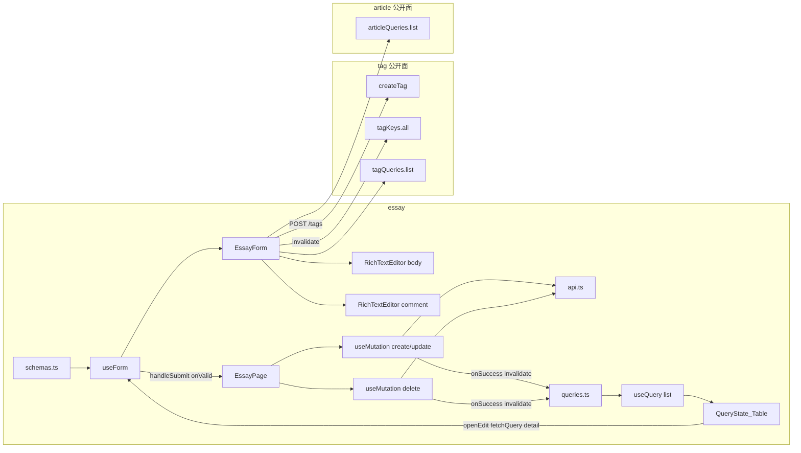

# Step 12 引导式开发：优秀作文（双 TipTap + 空 HTML + 删除）

> 本文对应 [03-开发计划](./03-开发计划.md) 的 Step 12。  
> 它是一份任务引导，不提供可以整段复制的最终页面。请先自己完成每个检查点，卡住后再展开提示。  
> 质量要求以 [01-工程契约](./01-工程契约.md) 为准。

本步 **没有** 测试检查点。测试策略已于 2026-10-11 改为随域交付（见 [04-验收记录](./04-验收记录.md)）。验收以「手动验证矩阵」+ `pnpm verify` 为准。

Step 6 已经把「筛选 + Table + Dialog + 删除」跑通。Step 11 已经把「详情 GET、内联建标签、跨域只借 tag 公开面」跑通。本步 **不再重讲** `useQuery` / `invalidateQueries` / `Controller` / `createTag`。同样逻辑打开历史文件；本文只写增量：**第三方编辑器与 RHF 的受控边界、双实例卸载、空 HTML 拦截、可选关联专题、status 走写表单（没有独立上下架 API）**。

## 1. 本步目标

把 `features/essay` 的 Empty 占位收成一条自包含 feature。列表范式跟标签页相同，写入口的新东西是两台富文本，不是「再抄一份 Article CRUD」。

```text
和 Tag 相同（不要再发明一套）
  筛选 state → queryKey → useQuery → QueryState + 受控分页 Table
  空值丢掉，不传空串
  写成功只靠 invalidateQueries，没有第二份 list
  一份 useForm + 一个 Dialog；字段组件只吃 control / errors
  有 DELETE；Popconfirm 后 del，没有 Step 13 的 confirm=true

和 Article 相同（直接复用，不要重写）
  标签 Select 可内联 POST /tags，然后 invalidateQueries(tagKeys.all)
  跨域只借 tag / article 的 api.ts + queries.ts，不借页面和 Form

和 Article 不同（整页复制会错）
  有 DELETE /essay-examples/:id；没有 PUT /:id/status
  status 是启用 / 禁用（STATUS_OPTIONS），不是草稿 / 已发布
  正文 / 点评是 HTML 字符串，不是图片数组
  点评可空；空 HTML（<p></p>、<p><br></p>）正文拦、点评收成 ''
  wordCount 服务端从正文纯文本统计，禁止提交
  articleId 可选；0 / null / 不传 = 不关联
```

完成后必须满足：

- 列表筛选、创建 / 编辑 / 删除可用。
- 正文 + 点评两台编辑器接到 RHF 字段；空正文拦在提交前；空点评按空串提交。
- 可关联已有专题；标签可内联新建并失效 tag 缓存。
- 卸载编辑器无泄漏（不模块单例、不把 editor 塞进 store）。
- 无 `useEffect` 拉列表；`pnpm verify` 通过。

03 写「与 Vue 业务行为一致」：指同一账号打同一个后端后的数据结果（范文能建出来、启用后小程序详情能看见正文 / 点评 / 所属专题）。那是可选的黑盒对照。**不是**把另一端的 wangEditor、`load()`、查询按钮翻译进来。

## 2. 本步边界

本步只做 `features/essay`。路由 `/essays` 已在 [`src/app/router/index.ts`](../src/app/router/index.ts) 挂好，不要改壳。

本步允许：

- 使用已有 `AppFormDialog` / `QueryState` / `PageHeader` / `App.useApp()`。
- 使用已有 `EssayExample` / `EssayExampleDetail` / `GRADE_OPTIONS` / `STATUS_OPTIONS` / `statusLabel`。
- 对照 Tag 的列表 + 删除，对照 ArticleForm 的内联标签。
- **跨域只借公开面**：`createTag`、`tagKeys`、`tagQueries`；`articleQueries.list`（专题下拉）。01 允许 `invalidateQueries(otherKeys.all)`，禁止借页面和内部组件。
- 安装 TipTap 稳定包（见检查点 5）。仓库里还没有。
- 检查点 8 做一次复制量体检；`RichTextEditor` 作为本域组件是有理由的拆分；默认 **不抽** `useCrud` / `useEssayPage`。

本步禁止：

- 抽万能 `useCrud` / `useListPage`。
- `useEffect` 拉列表，或 `const [list, setList]`。
- 给范文发明 `PUT /essay-examples/:id/status`（后台路由没有）。
- 用 `ARTICLE_STATUS_OPTIONS` / `articleStatusLabel` 当范文状态。
- 把 `wordCount` / `viewCount` / `favoriteCount` 放进 zod。
- `features/essay` import `features/tag` 或 `features/article` 的 **页面或内部组件**（`TagPage` / `TagForm` / `ArticlePage` / `ArticleForm`）。`api.ts` / `queries.ts` 可以。
- 在 axios 或 Query 全局回调里 `message`。
- 给 download / dashboard 写真页面。
- 安装测试依赖、改 `verify`。
- 修改只读对照项目 `Admin/`，以及 `miniApp/`。
- 把另一端的 wangEditor、`load()`、查询 / 重置、pageSize 切换翻译进本仓库。
- 为学 TipTap 单独做演示路由。
- 照抄 Next 文档的 `"use client"` / `immediatelyRender: false`（本仓是 Vite SPA，不是 RSC）。
- 把 `StarterKit` 全开（heading / 列表 / code / 图片不在后端白名单里）。

03 里「对照 `Admin/src/views/essay`」和 `RichTextEditor.vue` 对本步过宽。业务规则已经写在后端 DTO、`htmlsanitize`、handler 和小程序详情消费里。

## 3. 开始状态与文件范围

开始前应保持：

- Step 6 已通过：[`TagPage.tsx`](../src/features/tag/pages/TagPage.tsx) 是可对照的完整列表 + 删除。
- Step 11 已通过：[`ArticleForm.tsx`](../src/features/article/components/ArticleForm.tsx) 是内联建标签的对照。本步 **不依赖** 反馈 / 日志源码。
- QueryClient 已挂；登录真调可用；端口 **5174**。
- 后端 `course_server` 已启动（默认账号 `admin / admin123`）。
- `/essays` 目前是 `Empty description="暂无数据"`。

本步预计新增或修改：

```text
src/features/essay/
├── api.ts
├── queries.ts
├── schemas.ts
├── pages/
│   ├── EssayPage.tsx                 # 替换 Empty
│   └── EssayPage.module.css          # 本步直接给出，见检查点 7
└── components/
    ├── EssayForm.tsx                 # 标量 + 双编辑器 + 标签；不发范文请求
    ├── RichTextEditor.tsx            # TipTap 外壳；不发请求、不碰 RHF
    └── RichTextEditor.module.css     # 本步直接给出，见检查点 5
```

本步 **不要** 改 `shared/types`（`EssayExample` / `EssayExampleDetail` 已经在），**不要** 改 `AppFormDialog`，**不要** 把编辑器抬进 `shared/ui`（只有本页用）。

`pnpm add` 只加 TipTap 相关包，工作目录必须是 `Admin-React/`。

## 4. 使用方式

每个检查点按下面顺序完成：

1. 只看「任务」和「完成信号」，先自己设计。
2. 卡住时再看「提示一」。
3. 仍无法推进再看「提示二」。
4. 完成后回答「自检问题」。
5. 每个检查点结束都跑最小验证，不要最后一次性排错。

### 同样逻辑去哪看（不要在本文找 API 解释）

| 要做的事 | 打开这个，不要重写一遍 |
|---|---|
| `queryKeys` 三层 + `queryOptions` + `signal` | [`tag/queries.ts`](../src/features/tag/queries.ts)；详情层抄 [`article/queries.ts`](../src/features/article/queries.ts) |
| `toListParams` 把 UI 的 `''` 翻译成「不传」 | [`tag/api.ts`](../src/features/tag/api.ts) 的 `toTagListParams` |
| `keywordDraft` + `Input.Search` | [`TagPage.tsx`](../src/features/tag/pages/TagPage.tsx) 的筛选条 |
| 离散 Select 立刻生效、page 回 1 | [`TaxonomyPage.tsx`](../src/features/taxonomy/pages/TaxonomyPage.tsx) |
| `useForm<Input, unknown, Output>` + `zodResolver` | TagPage 的 `useForm` |
| 打开创建 / 编辑时 `reset` | TagPage 的 `openCreate` / `openEdit`（编辑本步仍建议先拉详情） |
| `onValid` 里 `mutateAsync` + toast + 关窗 | TagPage 的提交函数 |
| 删除 `Popconfirm` + `deleteXxx` | TagPage 操作列（**不要**抄「必须先禁用」——范文没有这条） |
| 四态派生 + Table 受控分页 + `keepPreviousData` | TagPage 后半 |
| 字段组件只吃 `control` / `errors` | [`TagForm.tsx`](../src/features/tag/components/TagForm.tsx) |
| 内联建标签 | [`ArticleForm.tsx`](../src/features/article/components/ArticleForm.tsx) |
| `grade` 用 `z.literal(GRADES)` | [`taxonomy/schemas.ts`](../src/features/taxonomy/schemas.ts) |
| Dialog 点确定如何接到 `handleSubmit` | TagPage 底部 `AppFormDialog` |
| Query 二维状态、`mutateAsync`、RHF `reset` | [13-疑问点记录.md](./13-疑问点记录.md) §3、§4 |

### 对照源（本步不读 `Admin/src`）

**删掉 `Admin/src` 这份检查点仍能做完。**

Step 12 要对等的是：路由、接口 path、请求 / 响应字段、空 HTML 规则、字数谁算、关联专题是否存在、小程序如何渲染 `body` / `comment` / 所属专题。这些都可以从后端契约、DTO、`htmlsanitize`、小程序详情页和本仓库已有常量推出。

另一端的 `load()`、`list ref`、拦截器 toast、wangEditor、`v-model` HTML，落在 01 的禁止照搬清单里。读了只会把实现锁成翻译。

03 里点名的 `Admin/src/views/essay` 和 `RichTextEditor.vue` 对本步过宽。下面这张表已经覆盖验收所需事实。

| 要确认的事实 | 去哪看 |
|---|---|
| 路径：`GET/POST /essay-examples`，`GET/PUT/DELETE /essay-examples/:id`；**没有** `/:id/status` | [api-reference.md](../../course_server/docs/api-reference.md) §3.7；[`router.go`](../../course_server/internal/router/router.go) |
| 列表 query：`grade` / `articleId` / `tagId` / `keyword` / `status` + 分页 | [`essayFilters`](../../course_server/internal/handler/essay_query.go)；status 在 [`ListEssayExamples`](../../course_server/internal/handler/admin_essay.go) 另加 |
| 列表项扁平：嵌入范文字段 + `tags`；**没有 Omit body** | [`EssayListItem`](../../course_server/internal/handler/admin_tag_relation.go) |
| 详情形状 `{ essay, tags }` | `GetEssayExample` / Create / Update 的 `Success` |
| 写字段与空 HTML / 字数 | [`dto/admin/essay_example.go`](../../course_server/internal/dto/admin/essay_example.go) |
| `<p></p>` / `<p><br></p>` / 纯空格算空；正文必填，点评可空并落 `''` | [`IsEffectivelyEmpty`](../../course_server/internal/pkg/htmlsanitize/sanitize.go)；[`essay_example_test.go`](../../course_server/test/dto/admin/essay_example_test.go) |
| HTML 白名单：`p br strong b em i u mark span`；`p` 可 `text-align` / `text-indent`；`span` 可颜色 | 同上 `newEssayPolicy` |
| `wordCount`：strip 标签后计**非空白字符**（「你好 世界」= 4） | `countEssayWordCount` |
| 创建未传 status → 启用；更新未传 → 保留原值 | `ValidateForCreate` / `ValidateForUpdate` |
| `articleId` 未传 / null / 0 = 不关联；非 0 必须存在，否则 `article not found` | [`CheckEssayArticleExists`](../../course_server/internal/model/model_write.go) |
| `tagIds` 为 `[]` 会清空关联；`null` / 省略则不改。本步提交始终带数组 | `replaceEssayTags` |
| 小程序详情：`rich-text` 渲染 `body`；`comment` 有内容才出「范文点评」；有关联才出「所属专题」 | [`miniApp/pages/essay-detail/index.wxml`](../../miniApp/pages/essay-detail/index.wxml) |
| 筛选项 / 启用文案 | [`STATUS_OPTIONS`](../src/shared/constants/options.ts) / `GRADE_OPTIONS` |
| 实体类型 | [`shared/types`](../src/shared/types/index.ts) 的 `EssayExample` / `EssayExampleDetail` |
| 分页缺省 | `pageParams`：page 从 1，缺省 pageSize **20**，上限 100。本页 UI 锁 **10**，跟 Tag |
| Query / 表单 / 跨域 / 禁止项 | [01-工程契约.md](./01-工程契约.md) |
| TipTap React 安装与 `useEditor` | 官方 [Install with React](https://tiptap.dev/docs/editor/getting-started/install/react)（核对你装到的主版本） |

本步不要去翻其它端的列表页实现。你要做的是一条带双编辑器的 feature，不是翻译 wangEditor。

---

## 5. 架构主课：编辑器拥有文档，RHF 拥有字符串

Step 11 的坑是「列表省略长图，编辑必须再 GET」。本步列表**没有** Omit `body` / `comment`，用行快照 `reset` 不会把正文写成空。真正容易翻车的是第三套状态：

```text
RHF          拥有 string：body / comment
TipTap       拥有 ProseMirror 文档
Ant Form.Item 只负责红框和 help，不拥有值
```

正确方向：

```text
播种（少）     RHF value → editor     只在 mount / Dialog 重开 / reset
按键（多）     editor.getHTML() → RHF  走 Controller field.onChange
禁止          每个 value 变化都 setContent / 把 content={value} 当受控
```

把 `field.value` 每轮塞回编辑器，光标会跳到文首。这就是 03 说的「受控 / 非受控边界」。

```text
列表
  GET /essay-examples     PageData<EssayExample>（扁平 + tags，含 HTML）
  表格不要渲染完整 HTML，只展示标题 / 年级 / 字数 / 状态 / 标签

编辑
  GET /essay-examples/:id  { essay, tags }
  仍建议 fetchQuery：拿到最新 HTML，和文章页同一套 openEdit
  不要用「列表碰巧带了 longtext」当长期契约

创建 / 更新
  POST /essay-examples
  PUT  /essay-examples/:id
  body 必填（空 HTML 也不行）；comment 可空
  status 走这条，不要发明 /status
  wordCount 不要出现在 body 里

删除
  DELETE /essay-examples/:id
  不要求先禁用；没有 ?confirm=true

内联标签
  POST /tags               复用 features/tag/api.ts 的 createTag
  invalidateQueries(tagKeys.all)

关联专题
  GET /articles            复用 articleQueries.list 做下拉
  提交 articleId: number | null
```



页面上允许的跨界：

| 时机 | 放哪 |
|---|---|
| 改筛选 | `setQuery` 换 key |
| 打开编辑 | `fetchQuery(detail)` → `reset` |
| 点确定 | `handleSubmit` → create / update |
| 删除 | 行内 `mutateAsync`，不走 Dialog |
| 编辑器按键 | 只 `onChange` HTML 字符串，不发请求 |
| 内联建标签 | `createTag` + 把新 id 写入 `tagIds` + 失效 `tagKeys.all` |

多一次就是分层破了。尤其不要：`RichTextEditor` 自己 `useForm` / `createEssay`；两个字段共用一个 `useEditor`；`useEffect(() => editor.commands.setContent(value), [value])`。

### 常见跨层错误（本步审查会盯）

- `queryKey: ['essays']` 魔法串，不含筛选 / 分页。
- 用 `ARTICLE_STATUS_OPTIONS` 筛启用禁用。
- 发明 `put('/essay-examples/${id}/status')`。
- schema 带 `wordCount`，编辑时还在校验字数。
- 正文空 HTML 只靠 `z.string().min(1)`：`<p></p>` 能过，被后端 `body is required` 打回。
- 点评空 HTML 原样提交成 `<p></p>`，小程序 `wx:if="{{essay.comment}}"` 仍显示空卡片。
- 两个字段共用一个 editor，切 Dialog 时点评串到正文。
- 模块顶层 `const editor = new Editor(...)`，路由切走不 destroy。
- 从 `features/tag/components`、`features/article/pages` import。
- 内联建标签成功后只改本地 options，不 `invalidateQueries(tagKeys.all)`。
- `register('body')` 硬套编辑器。
- 工具栏开放 heading / 列表 / 图片：保存后被 `Sanitize` 剥掉，用户以为丢了。

---

## 检查点 1：先写下产品契约，不急着改 Table

### 当前问题

这是本仓第一页双富文本。字段写错会 400；空 HTML 只 trim 字符串会漏过；把范文 status 当成文章上下架，Network 里会出现后端没有的请求。

### 任务

先在纸面或注释里填完下面三张表，再碰文件。数值以**后端**为准。

**1. 列表（`GET /essay-examples`）**

解包 `PageData<EssayExample>`。响应项是嵌入的范文字段 + `tags`，**不是** `{ essay, tags }`。排序后端做：`sort_order DESC, id DESC`。前端不要本地 sort。

| 参数 | 类型 | 规则 |
|---|---|---|
| `grade` | `'' \| Grade` | 不传 = 全部；选项 `GRADE_OPTIONS` |
| `articleId` | `number \| ''` | 不传 = 全部；须是正整数再发 |
| `tagId` | `number \| ''` | 不传 = 全部 |
| `status` | `'' \| EnableStatus` | 不传 = 全部；`0` 禁用 / `1` 启用。**用 `STATUS_OPTIONS`** |
| `keyword` | string，可选 | 按 **title 或 body** 模糊搜；空串不要传 |
| `page` / `pageSize` | number | 本页 UI 锁 **10**，`showSizeChanger: false`（跟 Tag） |

列表**带** `body` / `comment` / `wordCount`。表格只展示标题、年级、字数、状态、标签、是否关联专题。**不要**把 HTML 塞进单元格。

**2. 详情 / 写（`GET/POST/PUT /essay-examples/:id`）**

详情解包 `EssayExampleDetail`：`{ essay, tags }`。

| 字段 | 列表 | 写表单 | 规则 |
|---|---|---|---|
| `id` | 要 | 不出现 | 路径参数 |
| `title` | 要 | 要 | trim 非空，最长 255 |
| `grade` | 要 | 要 | `GRADE_OPTIONS`；`grade > 0` |
| `body` | 不要渲染 | 要 | HTML；实质内容必填 |
| `comment` | 不要渲染 | 要，可空 | HTML；空则存 `''` |
| `articleId` | 可展示 | 要，可空 | `number \| null`；0 / 空 = 不关联 |
| `sortOrder` | 不要强求 | 要，默认 0 | 整数 0–9999 |
| `status` | 要 | **要，在写表单里** | `0 \| 1`；创建默认 1 |
| `tagIds` | 列表展示 `tags` | 要，`number[]` | 始终提交数组；`[]` 表示清空 |
| `wordCount` | 要（只读列） | **不要** | 服务端从正文纯文本算 |
| 两条计数 / 时间 | 可展示 | **不要** | 服务端维护 |

| 操作 | 接口 | 前端先拦住 | 后端仍可能拒绝 |
|---|---|---|---|
| 创建 | `POST /essay-examples` | zod（含空 HTML） | `body is required` / `title is required` / `article not found` |
| 更新 | `PUT /essay-examples/:id` | 同左 | `essay example not found` |
| 删除 | `DELETE /essay-examples/:id` | Popconfirm | `essay example not found` |
| 独立上下架 | **不存在** | 不渲染「上架」 | — |

启用后小程序公开列表才看得到。禁用不等于删除。已启用仍可编辑正文。

空 HTML 与 03 验收对齐，并覆盖后端测试用例：

| 输入 | 正文 `body` | 点评 `comment` |
|---|---|---|
| `''` / 纯空格 | 拦 | 收成 `''` |
| `<p></p>` | 拦 | 收成 `''` |
| `<p><br></p>` | 拦 | 收成 `''` |
| `<p> </p>` | 拦 | 收成 `''` |
| `<p>有内容</p>` | 通过 | 原样（后端还会 Sanitize） |

前端不必复刻 bluemonday。提交 TipTap 的 `getHTML()` 即可；script / heading 后端会剥。工具栏对准白名单，避免「保存后格式消失」。

**3. 状态分层**

| 数据 | 放哪 |
|---|---|
| 当前页的 `list` / `total` | Query cache（list key） |
| 编辑中的详情 | Query cache（detail key）；打开时 `fetchQuery` |
| 已生效的筛选 / 分页 | 页面 `useState` |
| 关键字输入框 | 页面 `keywordDraft` |
| 离散 Select | 直接改 query，page 回到 1 |
| 弹窗开关、当前编辑 id | 页面 `useState` |
| 写表单（含两段 HTML） | RHF |
| 编辑器内部文档 | TipTap 实例，活在 `RichTextEditor` 里 |
| 标签下拉 | `tagQueries.list` |
| 专题下拉 | `articleQueries.list`（字典，pageSize 100） |
| token | Zustand，已有 |

不要加「查询 / 重置」按钮。Select 即时生效；文本草稿用 `Input.Search`。

### 提示一

`EssayExample` / `EssayExampleDetail` 已在 `shared/types`。本域不要再定义一份会漂移的接口。列表项 Go 叫 `EssayListItem`，JSON 扁平，用 `EssayExample` 即可（它已有可选 `tags`）。

### 提示二

关联专题不校验年级是否一致。不要自己加「只能选同年级文章」。不存在的 `articleId` toast 原样 `article not found`。

### 完成信号

不写组件也能回答：为什么没有 `/status`；空 `<p></p>` 为什么能过 `min(1)`；`wordCount` 谁算；点评空了小程序还出不出「范文点评」。

### 自检问题

- 为什么删掉 `Admin/src` 还能做完本步？
  - 要对等的是 path、字段、空 HTML、字数、关联是否存在、小程序如何渲染。它们已经在 handler / DTO / htmlsanitize / miniApp。另一端的 wangEditor 是实现，01 要求按 React 重写。
- 为什么范文能删、文章不能删？
  - 路由不一样。文章只有 `PUT /articles/:id/status`；范文有 `DELETE /essay-examples/:id`。不要两边各发明一套。
- 为什么列表不是 `{ essay, tags }[]`？
  - `EssayListItem` 嵌入 `model.EssayExample`，JSON 扁平。当成嵌套会读不到 `row.title`。

---

## 检查点 2：画出依赖，先不写页面

### 当前问题

双编辑器最容易和 Page、schema、RHF 缠成一个 600 行文件，或者让编辑器自己保存范文。本检查点只画边界。

### 任务

在纸上或注释里画出 import 方向，必须满足：

```text
essay
  schemas.ts     ──► Page（zodResolver）──► EssayForm / RichTextEditor（类型）
  api.ts         ──► queries.ts（listXxx / getXxx）
  api.ts         ──► Page（create / update / delete）
  queries.ts     ──► Page
  EssayForm / RichTextEditor 只被本域 import
  RichTextEditor 不 import RHF / Query / essay/api

tag（允许的跨域）
  tag/api.ts createTag          ──► EssayForm 或 Page
  tag/queries.ts tagKeys
                 tagQueries     ──► EssayForm 或 Page

article（允许的跨域）
  article/queries.ts articleQueries.list ──► EssayForm 或 Page
```

禁止箭头：

- `schemas.ts` → `react-hook-form` / `@tanstack/react-query` / `antd` / `@tiptap/*`
- `queries.ts` → `zod` / `react-hook-form` / `antd` / `@tiptap/*`
- `RichTextEditor` → `essay/api.ts` / `useForm` / `useQuery`
- `features/essay` → `features/tag/pages` 或 `components`；`features/article/pages` 或 `components`
- `features/essay` → `features/download`

本检查点可以还没有能编译的新文件，但你要能指着 Tag 说「列表抄读路径，删除抄 Tag，表单抄写路径，编辑器是第三块 UI」。

### 提示一

对照现成拆法：

| 职责 | 对照文件 | 本步 |
|---|---|---|
| HTTP | [`tag/api.ts`](../src/features/tag/api.ts) | `list` + `get` + `create` + `update` + `delete` |
| 读缓存身份 | [`article/queries.ts`](../src/features/article/queries.ts) | `all` / `lists()` / `list(query)` / `details()` / `detail(id)` |
| 写校验 | [`tag/schemas.ts`](../src/features/tag/schemas.ts) | 范文写模型；空 HTML 在 schema 里 refine / transform |
| 字段 UI | [`TagForm.tsx`](../src/features/tag/components/TagForm.tsx) | `EssayForm` + `RichTextEditor` |
| 编排 | TagPage | EssayPage：筛选、两个写 mutation、一个 delete、Dialog、`fetchQuery` |

「编排」的意思：筛选 state、`useQuery`、mutation / Dialog / `useForm` 都在 Page。**只有 Page 有权把用到的那几套接起来。** 内联建标签可以放 Form，但不要让 Form 去失效 essay keys。

### 提示二

`get` / `post` / `put` / `del` 从 `@/shared/api` 引。范文 **要** import `del`。不要为了入口好看去改 `shared/api/index.ts`。

### 完成信号

能指出：哪几个 Tag 文件还不够；为什么必须多一个 `getEssay`；`RichTextEditor` 为什么不算「没必要的抽象」。

### 自检问题

- 为什么允许 import `articleQueries` 却不允许 import `ArticleForm`？
  - 01：跨 feature 只经 `shared` 或公开 `api` / `queries`。`ArticleForm` 带着文章自己的 schema、OSS、正文图，范文再依赖会把两页校验绑死。
- 两台编辑器为什么必须是两个实例？
  - 一个 `useEditor` 只有一份文档。共用会在「打开编辑 / 清空点评」时把两段 HTML 写串。

---

## 检查点 3：`api.ts` + `queries.ts`

### 当前问题

读路径有两张形状（扁平列表 vs `{ essay, tags }`）。写路径只有全量 DTO，另加 DELETE。抄 Article 时最容易顺手做一个 `updateStatus`。

### 任务

新建 `features/essay/api.ts` 与 `queries.ts`。

`EssayListQuery` 建议：

```text
keyword?: string
grade: '' | Grade
articleId: number | ''
tagId: number | ''
status: '' | EnableStatus
page: number
pageSize: number
```

`toListParams`：所有 `''` 不传；keyword trim 后空则不传。

函数只允许：

- `listEssays(query, signal?)` → `GET /essay-examples` → `PageData<EssayExample>`
- `getEssay(id, signal?)` → `GET /essay-examples/${id}` → `EssayExampleDetail`
- `createEssay(input)` → `POST /essay-examples` → `EssayExampleDetail`
- `updateEssay({ id, input })` → `PUT /essay-examples/${id}` → `EssayExampleDetail`
- `deleteEssay(id)` → `DELETE /essay-examples/${id}` → `{ id: number }`

`input` 类型跟即将出现的 schema output 对齐。**不要**带 `id` / `wordCount` / 计数。

`essayKeys`：

```text
all: ['essays']
lists() / list(query)
details() / detail(id)
```

`queryFn` 把 `signal` 传下去。本检查点 **不要** 写 Page，**不要** 出现 `updateEssayStatus`。

### 提示一

路径是 `/essay-examples`，不是 `/essays`。`/essays` 是小程序公开接口。后台客户端已经带了 `/admin/api/v1` 前缀，这里只写资源 path。

### 提示二

create / update 的解包是 `{ essay, tags }`。当成 `EssayExample` 会把外层对象误当成行。delete 对照 [`deleteTag`](../src/features/tag/api.ts)。

### 完成信号

- 本域 api 只有 list / get / create / update / delete。
- `list(query)` key 含全部筛选和分页。
- `detail(id)` key 含 id。
- 没有第二份 `EssayExample` interface。
- 没有 `/status`。

最小验证：这两个文件 type-check 无红线。

### 自检问题

- 为什么 create 的返回值按 `EssayExampleDetail` 而不是 `EssayExample`？
  - handler `Success` 的 data 是 `{ essay, tags }`。
- 为什么不能复用 `updateArticleStatus` 那套？
  - 范文没有独立 status 路由。启用禁用是写 DTO 里的 `status` 字段。

---

## 检查点 4：`schemas.ts`（空 HTML 是本步的 refine）

### 当前问题

`z.string().trim().min(1)` 拦不住 `<p></p>`。03 验收写明「`<p></p>` 算空」。这是本步真正要写进 schema 的新规则，不要留到页面 `if (!body) return`。

### 任务

`features/essay/schemas.ts`：

- `title`：`trim` + `min(1)` + `max(255)`。
- `grade`：`z.literal(GRADES)`。
- `sortOrder`：整数 0–9999。
- `status`：`z.literal(0)` / `z.literal(1)`（或等价联合）。创建默认 `1`。
- `tagIds`：`z.array(z.number().int().positive())`，默认 `[]`。
- `articleId`：提交前变成 `number | null`。`''` / `null` / 缺省 → `null`；正整数保留。
- `body`：string，**refine 实质非空**。
- `comment`：string，**transform** 空 HTML → `''`，不要 refine 失败。
- **不要** `wordCount` / 计数 / `id`。
- **不要** import RHF / Query / antd / TipTap。

空 HTML 判定与后端 `IsEffectivelyEmpty` 对齐即可，不必引入 DOM 解析库：

```text
去掉标签，把 &nbsp; 当空格，trim
剩下来没有任何非空白字符 → 空
```

覆盖：`''`、`<p></p>`、`<p><br></p>`、`<p> </p>`、`&nbsp;`。不要用 `editor.isEmpty` 代替 schema——提交时校验走的是字符串，不是实例。

导出 `EssayWriteInput` / `EssayWriteOutput`。`createEssay` / `updateEssay` 吃 **Output**。

### 提示一

`binding:"required"` 拦不住纯空格，也拦不住 `<p></p>`（它不是空串）。title 必须 trim 后再 min(1)；body 必须走空 HTML refine。只写 min(1)，空编辑器能过 Input，被后端 `body is required` 打回来。

### 提示二

点评不要 `min(1)`。后端 `normalizeOptionalEssayHTML` 把空内容收成 `''`。前端先 transform，Network 里就不要出现 `<p></p>`。小程序 `wx:if="{{essay.comment}}"` 对空串为假，卡片不会空挂着。

### 完成信号

- schema 文件只有 zod 和 `shared/constants`。
- 能在纸面上说出：`<p></p>`、`<p>有内容</p>`、空点评、`articleId: ''` 分别变成什么。
- `EssayWriteOutput.articleId` 的类型是 `number | null`，不是 `''`。

### 自检问题

- 为什么空判定写在 schema 而不是 `RichTextEditor` 里？
  - 编辑器可以换。规则属于写模型。Page / 测试（Step 16）只对 schema。
- 为什么前端不必算 `wordCount`？
  - DTO 禁止客户端改计数。空白规则是「非空白字符」，自己算还可能和 Go 的 unicode 空白不一致。

---

## 检查点 5：安装 TipTap + `RichTextEditor`（样式直接用）

### 当前问题

这是本步真正的新 API。不要躲进 `Input.TextArea`「先能提交」。03 技术点就是第三方编辑器与 RHF 桥接、双实例、卸载 cleanup。

### 任务

在 **`Admin-React/`** 安装官方 React 入口（版本以锁文件为准，先读你装到的包的 README）：

```bash
pnpm add @tiptap/react @tiptap/pm @tiptap/starter-kit @tiptap/extension-underline @tiptap/extension-highlight @tiptap/extension-text-align @tiptap/extension-placeholder
```

文档入口：[Install with React](https://tiptap.dev/docs/editor/getting-started/install/react)（`useEditor` + `EditorContent`）。本项目是 Vite SPA，**不要**写 `"use client"`，**不要**抄 SSR 的 `immediatelyRender: false`，**不要**上 Composable `<Tiptap>`（本步用 hook 更直观）。

新建 `RichTextEditor.tsx`。建议 props：

```text
value: string
onChange: (html: string) => void
disabled?: boolean
placeholder?: string
```

不要 `useForm` / `useMutation` / `createEssay`。EssayForm 用 `Controller` 把它接到 `body` / `comment`。

必须：

- 每个组件实例一次 `useEditor`。正文和点评是 **两次** 挂载，不是一个 editor 切 content。
- `content: value` **只作为初始文档**。之后只通过 `onUpdate` → `onChange(editor.getHTML())` 回写。
- 父级在 Dialog 打开 / 切换创建与编辑时用 `key` 强制重挂（例如 `key={\`body-${editingId ?? 'new'}-${open}\`}`），完成「播种」。不要 `useEffect([value])` + `setContent`。
- 卸载走 `useEditor` 自带的 destroy。不要模块级 `new Editor`，不要把实例放进 Zustand。
- `StarterKit` **关掉** heading / bulletList / orderedList / listItem / blockquote / codeBlock / code / horizontalRule / strike。再加 Underline、Highlight（`<mark>`）、TextAlign（`types: ['paragraph']`）。
- 工具栏只给白名单能活下来的：加粗、斜体、下划线、高亮、左 / 中 / 右对齐。不要图片、链接、heading、列表。
- `if (!editor) return null`。工具栏按钮用 `editor.isActive(...)` 即可；不要为了工具栏上 `useEditorState`（本步编辑器不重）。
- React `key` 由父级控制；组件内部不要按 value 重建。

把下面文件存为 `components/RichTextEditor.module.css`（本步允许直接用，不要改 token 名）：

```css
.root {
  border: 1px solid var(--color-border);
  border-radius: 6px;
  overflow: hidden;
  background: #fff;
}

.toolbar {
  display: flex;
  flex-wrap: wrap;
  gap: 4px;
  padding: 6px 8px;
  border-bottom: 1px solid var(--color-border);
  background: var(--color-fill-secondary, #fafafa);
}

.toolbar button {
  height: 28px;
  padding: 0 8px;
  border: 1px solid transparent;
  border-radius: 4px;
  background: transparent;
  cursor: pointer;
}

.toolbar button[data-active='true'] {
  background: var(--color-fill, #e6f4ff);
  border-color: var(--color-border);
}

.surface :global(.ProseMirror) {
  min-height: 160px;
  padding: 12px;
  outline: none;
}

.surface :global(.ProseMirror p.is-editor-empty:first-child::before) {
  color: var(--color-text-secondary);
  content: attr(data-placeholder);
  float: left;
  height: 0;
  pointer-events: none;
}
```

正文编辑器可以把 `min-height` 在模块里再开一个 `.surfaceLarge`（例如 240px）。点评用默认 160px。

### 提示一

`register('body')` 接不住 contenteditable。和 Ant Input 一样，走 `Controller` 的 `field.value` / `field.onChange`。`onBlur` 可以接到 `editor.on('blur')`，不是必须。

Placeholder 用 `@tiptap/extension-placeholder`。官方空段落 class 是 `is-editor-empty`，上面 CSS 已经对上。

### 提示二

审查会搜 `setContent` 和 `content: field.value`。播种用 `key` 重挂；运行期只 `onUpdate`。双编辑器文件里应出现两次 `<RichTextEditor`，或两次 `useEditor`（若你把 hook 写在 Form 里——不推荐，拆不干净）。

### 完成信号

- 本域能搜到 `@tiptap/react` 的 `useEditor` / `EditorContent`。
- `RichTextEditor` 文件搜不到 `createEssay` / `useForm` / `useQuery`。
- 组件卸载后（关 Dialog / 切路由）没有模块级 editor 还活着。
- 工具栏没有 heading / 列表 / 图片按钮。

最小验证：单独把组件挂进 EssayForm 之前，先能 type-check。

### 自检问题

- 为什么 `content={value}` 每轮更新会坏？
  - TipTap 把 `content` 当初始文档。受控回写等于每敲一个字重建文档，选区丢失。
- `useEditor` 为什么已经够 cleanup？
  - hook 在卸载时 `destroy()`。再手写一份 Effect 去 destroy，StrictMode 下容易 double-destroy。缺的是「不要在 hook 外面 new」。

---

## 检查点 6：`EssayForm`（双编辑器 + 专题 + 标签）

### 当前问题

字段 UI 可以抄 ArticleForm 的标签块，但不要把封面、slug、正文图、上下架开关一起抄过来。

### 任务

新建 `EssayForm.tsx`。只吃 `control` / `errors`（如需把详情里已禁用的标签并进 options，再加一个 `extraTags?: Tag[]`）。

必须有：

- 标题、年级、排序、状态（`STATUS_OPTIONS` 或 Switch 0/1）。
- `articleId`：`Select allowClear`，options 来自 `articleQueries.list`（`page: 1`，`pageSize: 100`，其余筛选项 `''`）。label 用 `title`，可附带年级。清空写入 `null`。
- `body` / `comment` 各包一层 `Controller` + `RichTextEditor`。Form.Item 的 `validateStatus` / `help` 看 `errors.body` / `errors.comment`。
- `tagIds`：照抄 ArticleForm 的多选 + 内联 `createTag` + `invalidateQueries({ queryKey: tagKeys.all })`。不要自己再 `post('/tags')`。
- 编辑时把当前范文已关联、但下拉没有的标签（含已禁用）并进 options。
- 源码搜不到 `createEssay` / `updateEssay` / `deleteEssay`。

专题下拉 100 条是字典天花板。超过 100 篇时加本地 keyword 再打 `articleQueries.list` 也可以；**不要**为此改 article 的 Page。默认 100 够用就写一句 ponytail。

### 提示一

`createTag` 的入参是 `TagWriteOutput`。启用中的新标签用 `status: 1`、`sortOrder: 0`。对照 [`ArticleForm.tsx`](../src/features/article/components/ArticleForm.tsx) 的 `addTag`。

### 提示二

两个 `RichTextEditor` 的 `key` 必须不同（`body` / `comment`），并且包含「当前编辑身份」。只写 `key={open}` 会在「关窗再开同一篇」时复用旧文档。

Dialog `width` 建议 800。`useForm` 仍放 Page，不要放进 `destroyOnHidden` 的子树才创建——Tag / Article 已经这么放了。编辑器靠 `key` 重挂，不靠把整个 `useForm` 卸载。

### 完成信号

- Form 文件搜不到范文的 create / update / delete。
- 能看到两次 `RichTextEditor` 和一次 `createTag`。
- 专题 Select 的 import 来自 `@/features/article/queries`，不是 `ArticlePage`。

### 自检问题

- 为什么专题下拉走 `articleQueries.list` 而不是再写一份 `GET /articles`？
  - 列表契约、`toListParams`、queryKey 已经在 article 域。再包一层只是换名字。
- 禁用标签为什么还要并进编辑回填？
  - 只拉 `status=1` 时，已关联的禁用标签会变成光秃 id。并进详情 `tags` 才能看见名字。

---

## 检查点 7：页面接到筛选 + Dialog + 删除（样式直接用）

### 当前问题

读、写、详情、删除要在 Page 接线。抄 ArticlePage 时最容易留下「上架 / 下架」、漏掉删除；抄 TagPage 时最容易加上「必须先禁用再删」。

### 任务

替换 [`EssayPage.tsx`](../src/features/essay/pages/EssayPage.tsx)。

必须有：

- 导出仍是 `Component`。
- `keywordDraft` + `Input.Search`；年级 / 专题 / 标签 / 状态 四个 Select（全部用 `''`）。改筛选 `page: 1`。
- `pageSize: 10`，`showSizeChanger: false`。
- `useQuery({ ...essayQueries.list(query), placeholderData: keepPreviousData })`。
- 四态派生与 Tag 相同（`isPending && !isPlaceholderData` → pending；首次 error；`data.list.length === 0` → empty）。
- **两个**写 mutation（create / update）+ **一个** `deleteEssay`。写成功 `invalidateQueries({ queryKey: essayKeys.lists() })`；更新 / 删除同时失效 `essayKeys.details()`（或 `all`）。
- `openCreate`：`reset` 到默认（`body: ''`、`comment: ''`、`tagIds: []`、`articleId: null`、`status: 1`、`sortOrder: 0`），开窗。
- `openEdit(row)`：**`await queryClient.fetchQuery(essayQueries.detail(row.id))`**，再 `reset`（`tagIds` 从 `tags.map(t => t.id)`；`articleId` 从 `essay.articleId`）。不要 `useEffect` 拉详情。
- Dialog 标题如「新增优秀作文」/「编辑优秀作文」。`onSubmit={() => void handleSubmit(onValid)()}`；`confirmLoading` 看写 mutation 的 `isPending`。
- toast 用 `App.useApp()`。成功关窗。失败展示 `ApiError.message`，窗不关。
- `PageHeader extra` 可以放「新增」。操作列「编辑」+「删除」（`Popconfirm`，确认里带标题）。**没有**上架 / 下架。**不要**要求先禁用才能删。
- 状态列用 `statusLabel`，不要 `articleStatusLabel`。
- 字数列展示 `row.wordCount`。标签列展示 `row.tags`。关联专题可从文章字典 map 出 title，没有就显示「—」。

把下面文件存为 `pages/EssayPage.module.css`：

```css
.page {
  display: flex;
  flex-direction: column;
  gap: 16px;
}

.keyword {
  width: 200px;
}

.grade,
.article,
.tag,
.status {
  width: 160px;
}

.tableBlock {
  display: flex;
  flex-direction: column;
  gap: 12px;
}

.rowActions {
  display: flex;
  flex-wrap: wrap;
  align-items: center;
  gap: 8px;
}
```

`useForm` 放在 Page。

### 提示一

`confirmLoading` 只看 create/update。删除是行内 mutation，用 `Popconfirm` + 按钮 `disabled={deleteMutation.isPending}`。不要再手写一份 `saving`。

翻页 loading 用 Table `loading={{ spinning: listQuery.isFetching, delay: 200 }}`，不要把 `queryStatus` 打回 pending。

### 提示二

空态文案用「暂无优秀作文」。关联不存在 toast 原样 `article not found`。空正文 toast / Form.Item 用你在 schema 里写的中文，不要等后端 `body is required` 才第一次出现（后端仍是第二道门）。

`fetchQuery` 失败（404）toast 后不要开窗。

### 完成信号

- `/essays` 有筛选、表、创建 / 编辑弹窗、删除；没有上架按钮。
- Network：列表 GET；打开编辑有 `GET /essay-examples/:id`；提交 POST 或 PUT；删除是 `DELETE /essay-examples/:id`。
- 打开编辑后两台编辑器能看到已有 HTML（库里本来有内容的情况下）。
- 空正文点确定，窗不关，错误落在正文 Form.Item。
- 无 `useEffect` 拉数；无 `any`；无 `/status`。

### 自检问题

- 列表已经带了 `body`，为什么编辑还要 `fetchQuery`？
  - 列表带 HTML 是当前实现，不是契约承诺（文章列表已经 Omit 过长字段）。`fetchQuery` 拿最新详情，和文章页同一套 `openEdit`。用行快照也能填上，但会把「列表以后省略 HTML」变成静默丢正文。
- 为什么 invalidate `lists()` 而不是当前 `list(query)`？
  - 改年级、改状态、改标题都会让这条在某些筛选下离开当前页。只失效当前 key 会留下过期行。
- 为什么不必先禁用再删？
  - 标签有引用拦截，所以 UI 先禁用。范文 DELETE 没有这条。抄 Tag 的禁用门槛会做出后端没有的产品规则。

---

## 检查点 8：Rule of Three 体检（默认不抽 Page hook）

### 当前问题

现在已经有 Tag、Taxonomy、运营、文章。01 禁止 11 页复制 200 行，也禁止第一页就 `useCrud`。本步看起来又像「PageData 表」，写入口已经是双编辑器。

### 任务

把 `TagPage`、`ArticlePage`、`EssayPage` 并排，只回答：

1. 重复的是不是 **只** 有「`useQuery` + 四态 if/else + 受控分页」？
2. 写入口（Tag CRUD vs 文章「无删除 + 独立 status + 拖拽」vs 范文「双编辑器 + 可删」）是否已经明显不同？
3. 若抽 hook，调用方是否仍能从函数名看出「这不管表单、不管 TipTap」？

默认结论：**不抽 `useEssayPage` / `useCrud`。** `RichTextEditor` 留下——它包的是非平凡的实例生命周期。把体检结果写在验收备注里一句即可。

仅当第 1 题为「是」，才允许极薄 `usePagedListQuery(options)`（与 Step 11 同一条）：只包 Query 读路径，禁止装进 `useForm` / TipTap / `createTag`。

### 提示一

不要抽 `AdminTable`。本页 columns 闭包了字数、标签、删除。

### 提示二

若你抽了 hook，审查会看它的 import。出现 `zodResolver` / `useEditor` / `message.success` 就说明越界了。

### 完成信号

- 要么：Page 里仍能指着四态 if/else，备注写「未抽 Page hook；RichTextEditor 因实例生命周期保留」。
- 要么：存在一个不超过几十行、只包 Query 读路径的 hook，范文 Page 仍拥有 Form、双编辑器、delete mutation。

### 自检问题

- `RichTextEditor` 为什么不是违规抽象？
  - 审查条：自定义拆分要包非平凡逻辑。播种 / onUpdate / destroy / 白名单 extensions，离开组件就会在 Form 里写两遍。
- 为什么现在还不能把它抬到 `shared/ui`？
  - 只有本页用。Step 13 下载页也不用富文本。YAGNI。

---

## 检查点 9：完整验收

### 自动验证

在 `Admin-React/` 目录执行：

```bash
pnpm verify
pnpm build
```

预期：Oxlint 通过；TypeScript 严格检查通过；Vite 生产构建完成。本步不要求 `pnpm test`。

### 手动验证矩阵

前置：后端已启动；前端 `pnpm dev` 在 **5174**；用 `admin / admin123` 登录。至少先有一篇作文专题，方便测关联。

**列表 `/essays`**

- 首次 pending，随后是表或空态；无 `useEffect` 拉列表。
- 年级 / 专题 / 标签 / 状态 会打 query；keyword 回车才写入 query。
- 有新增、编辑、删除。没有上架 / 下架。
- 状态列是「启用 / 禁用」，不是「草稿 / 已发布」。
- 单元格没有整段 HTML。

**创建**

- 空标题、空正文（编辑器不输入、或只回车留下 `<p></p>`）被 zod 拦住，窗不关。
- 只写点评、不写正文：仍拦正文。
- 合法创建后列表出现，默认启用；`wordCount` 与正文纯文本一致（空格不计）。
- Network：`POST /essay-examples`，body 含 `tagIds` 数组、`articleId` 为数字或 `null`，**没有** `wordCount`。
- 响应后小程序详情（或再 `GET /essay-examples/:id`）能看到正文 HTML。

**空 HTML / 点评**

- 正文 `<p></p>` / `<p><br></p>`：Form.Item 报错。
- 点评留空：提交 `comment` 为 `''`（或省略后后端存空），小程序不出现「范文点评」卡片。
- 点评有字：小程序出现「范文点评」。

**编辑**

- 打开时有 `GET /essay-examples/:id`。两台编辑器能看到原 HTML。
- 改标题保存后列表变；再进详情正文还在。
- Dialog 点遮罩不关；提交中确定按钮不可点。
- 关窗再开另一篇，正文 / 点评不会串台。

**关联专题**

- 不选专题可保存，`articleId` 为 `null`。
- 选一篇已有专题可保存；小程序详情出现「所属专题」。
- 填不存在的 id（若你的 Select 拦不住，可用临时改 Network）toast `article not found`。

**标签**

- 多选已有标签可保存。
- 输入新名能 `POST /tags`，范文 `tagIds` 含新 id。
- 打开 `/tags` 能看见新标签（缓存已失效）。

**删除**

- 确认后 `DELETE /essay-examples/:id`，行消失。
- 启用态也能删，不必先禁用。
- 没有 `?confirm=true`。

**卸载**

- 关 Dialog、切到 `/articles` 再回来，控制台无 TipTap / ProseMirror 报错。
- 源码没有模块级 `Editor` 单例。

**共性**

- 每域 `queryKeys` 工厂；页面没有 `queryKey: ['essays']`。
- toast 来自 `App.useApp()`。
- 无 `any`、无 `useCrud`、不 import `TagForm` / `ArticleForm`。
- 范文状态没有复用 `ARTICLE_STATUS_OPTIONS`。

### 代码审查时自搜

```text
useEffect
setList
queryKey: ['essays'
/status
updateEssayStatus
ARTICLE_STATUS_OPTIONS
articleStatusLabel
wordCount:
useCrud
from 'antd' 的静态 message
register(
load(
"use client"
immediatelyRender
new Editor
setContent
features/tag/pages
features/tag/components
features/article/pages
features/article/components
```

预期：`useEffect` 不为拉数出现；`queryKey` 只来自本域 keys；没有范文 `/status`；`ARTICLE_STATUS_OPTIONS` 不出现在范文筛选；`register` 不应出现在编辑器上；`message` 只来自 `App.useApp()`；`keepPreviousData` 应该出现。`createTag` 与 `tagKeys.all` 应该出现。`useEditor` 出现在 `RichTextEditor`。`setContent` 若出现，必须能解释它不是「每个 value 都同步」。

按 [03 验收协议](./03-开发计划.md) 发审查时，把本矩阵勾过去。备注写清：未读 `Admin/src`；业务对等以后端 + 小程序消费为准；Rule of Three 是否抽了 hook。

---

## 6. 失败时的最短排查路径

### 进入页面仍是「暂无数据」Empty，且没有任何筛选

占位页没替换，或懒加载的 `Component` 没导出。

### 表格空白但 Network 200、响应有 list

把 `PageData` 当成了 `T[]`，或把扁平列表当成 `row.essay.title`。改成 `dataSource={data.list}`，字段直接 `row.title`。

### 创建 400 `body is required`，表单却是绿的

schema 只写了 `min(1)`。`<p></p>` 不是空串。补空 HTML refine。

### 点评留空，小程序仍出现「范文点评」空卡片

提交了 `<p></p>` 或 `<p><br></p>`。schema 要把空 HTML transform 成 `''`。

### 保存后小程序正文少了标题 / 列表 / 图片

工具栏开放了白名单外的节点，后端 `Sanitize` 剥掉了。关掉 heading / 列表 / image。

### 敲字时光标跳回文首

`content={field.value}` 或 `useEffect(() => setContent(value), [value])`。改成 `key` 重挂播种 + `onUpdate` 回写。

### 两台编辑器内容互串

共用了一个 `useEditor`，或两个组件 `key` 相同。必须两个实例、两套 key。

### 切路由后控制台报 editor 已销毁还在 dispatch

模块单例，或手动 `new Editor` 没有在 cleanup 里 `destroy`。回到 `useEditor`。

### 上下架按钮 404

抄了 ArticlePage。范文没有 `/status`。启用禁用放进写表单。

### 删除按钮灰色，提示先禁用

抄了 TagPage 的引用保护。范文后端没有这条。Popconfirm 后直接 `deleteEssay`。

### 关联专题 400 `article not found`

id 不存在，或把 `''` 当成 0 以外的脏值发出去。`toListParams` / schema 要把空收成 `null`。

### 内联标签成功了，标签页没有

只 push 进了本地 options，没 `invalidateQueries({ queryKey: tagKeys.all })`。

### 工作目录不对

所有 pnpm 命令在 `Admin-React/`。在仓库根 `pnpm add @tiptap/react` 会污染根目录。

---

## 7. 完成后应能口头回答

1. 为什么本步不读 `Admin/src` 也能做完验收？
2. 为什么范文有 DELETE、没有独立 `/status`，文章刚好相反？
3. 为什么 `<p></p>` 能过 `z.string().min(1)`？空判定写在哪一层？
4. 点评为空时前端 / 后端 / 小程序各落成什么？
5. `wordCount` 怎么算、为什么不准前端提交？
6. TipTap 和 RHF 谁拥有文档、谁拥有字符串？播种发生在什么时机？
7. 为什么两个字段不能共用一个 `useEditor`？卸载时谁负责 `destroy`？
8. 工具栏为什么不能直接上 `StarterKit` 全家桶？
9. 内联建标签为什么必须 `invalidateQueries(tagKeys.all)`？专题下拉为什么只借 `articleQueries`？
10. 为什么默认仍不抽 `useEssayPage`，却保留 `RichTextEditor`？

---

## 8. 快速上手总结

### 必须掌握

- **对照源在后端 + 小程序消费**：path、字段、空 HTML、字数、关联校验、`rich-text` 怎么渲染。不需要 `Admin/src`。
- **空 HTML 是写模型规则**：`<p></p>` / `<p><br></p>` 正文 refine 失败，点评 transform 成 `''`。
- **受控边界**：RHF 存 HTML 字符串；TipTap 存文档；只在 mount / `key` 重挂时播种，按键只 `onUpdate`。
- **双实例 + hook cleanup**：两台编辑器两次 `useEditor`；不要模块单例。
- **跨域只借公开面**：`createTag` + `tagKeys.all` + `articleQueries.list`；禁止借 `TagForm` / `ArticleForm`。

### 按需了解

- 列表当前**没有** Omit `body`，但表格仍不要渲染 HTML。编辑继续 `fetchQuery`。
- 后端还会 Sanitize：剥 script、给普通段落补 `text-indent:2em`。前端不必复刻。
- 视频号的 `essayId` 不建 DB 外键，本步删除不必拦引用。
- `editor.isEmpty` 只适合工具栏 / 占位，不能替代 zod。
- `"use client"`、`immediatelyRender: false`、Composable `<Tiptap>`：Next / SSR / 复杂工具栏才需要。
- schema 单测：Step 16。
- 把 `RichTextEditor` 抬到 `shared/ui`：等第二页真的要用。

### 下一步

Step 12 验收通过后再进入 Step 13：

- 下载资料（private OSS + 免费标签 + 删失败后再 `?confirm=true`）。
- 本步不要提前写 download / dashboard 的真页面。

## 9. 未验证项

- 本文没有替你实现页面源码，因此不能声称「按本文复制即可运行」。
- CSS 已给出完整小文件；`RichTextEditor` 只规定边界和工具栏范围，具体按钮 JSX、schema refine 文案、表格列需你按检查点自己写。
- 未在隔离空目录复现本步（本步是累计项目，依赖 Step 1–11 的仓库状态）。
- 未实际执行 `pnpm add @tiptap/*`；安装后的精确版本与导出以锁文件和该版本官方文档为准。若主版本 API 与本文 `useEditor` / `EditorContent` 不一致，以你装到的版本文档为准，并在验收备注写明版本。
- 小程序详情看正文 / 点评 / 所属专题，依赖本机 5174 / 后端 / 小程序环境。
- 完成实现后，请以 `pnpm verify`、`pnpm build` 和「手动验证矩阵」为最终验收依据。
