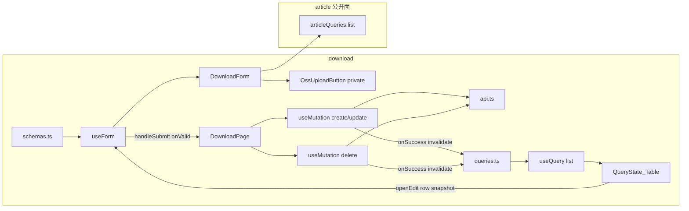

# Step 13 引导式开发：下载资料（private OSS + 免费标签 + 强制删）

> 本文对应 [03-开发计划](./03-开发计划.md) 的 Step 13。  
> 它是一份任务引导，不提供可以整段复制的最终页面。请先自己完成每个检查点，卡住后再展开提示。  
> 质量要求以 [01-工程契约](./01-工程契约.md) 为准。

本步 **没有** 测试检查点。Vitest 仍延后到 Step 16。验收以「手动验证矩阵」+ `pnpm verify`（lint + type-check）为准。

Step 6 已经把「筛选 + Table + Dialog + 删除」跑通。Step 8 已经有 `OssUploadButton`。Step 9 / 11 把按钮接到过 RHF，但写的是**公开 URL**。Step 12 的删除是普通 `DELETE`，没有 query。本步 **不再重讲** `useQuery` / `invalidateQueries` / `Controller` / STS 怎么拿。同样逻辑打开历史文件；本文只写增量：**private 上传入库 `objectKey`、`tags` 字符串里的「免费」软开关、有下载记录后再带 `?confirm=true`。**

## 1. 本步目标

把 `features/download` 的 Empty 占位收成一条自包含 feature。列表范式跟标签页相同，写入口的新东西是私有文件和两段删除，不是「再抄一份 Article CRUD」。

```text
和 Tag 相同（不要再发明一套）
  筛选 state → queryKey → useQuery → QueryState + 受控分页 Table
  空值丢掉，不传空串
  写成功只靠 invalidateQueries，没有第二份 list
  一份 useForm + 一个 Dialog；字段组件只吃 control / errors
  有 DELETE；普通删除用 Popconfirm

和 Article / HomeBlock 相同（直接复用，不要重写）
  OssUploadButton 接到 Controller
  跨域只借 article 的 queries.ts 做归属下拉，不借页面和 Form

和 Article / Essay 不同（整页复制会错）
  后台没有 GET /download-files/:id，编辑用列表行快照
  没有 PUT /:id/status；status 走写表单（STATUS_OPTIONS）
  fileUrl 存 private objectKey，不是封面那种可预览 CDN
  tags 是逗号分隔字符串 + FREE_TAG，不是 tagIds[]，也不 POST /tags
  列表没有 keyword；不要发明客户端搜文件名
  有下载记录时，第一次 DELETE 会被拒，确认后再 DELETE ?confirm=true
  downloadCount 服务端维护，禁止提交
```

完成后必须满足：

- 列表筛选、创建 / 编辑 / 删除可用；归属必须是已有作文专题。
- private 上传把 `objectKey` 写入 `fileUrl`；手填降级也是 objectKey，不要把公开直链当唯一结果。
- 「免费」标签与 `accessType=free`、`status=1` 三条件决定小程序能不能下；去掉「免费」即可软下架下载。
- 无下载记录：Popconfirm 后直接删掉。有记录：toast / 二次确认后带 `confirm=true` 再删。
- 无 `useEffect` 拉列表；`pnpm verify` 通过。

03 写「免费标签逻辑与 Vue 一致」：指同一账号打同一个后端后的数据结果（资料能建出来、三条件满足时小程序 `sign-url` 能下、去掉「免费」后 403）。那是可选的黑盒对照。**不是**把另一端的 `load()`、`MessageBox` 全 catch、pageSize 切换翻译进来。

## 2. 本步边界

本步只做 `features/download`。路由 `/downloads` 已在 [`src/app/router/index.ts`](../src/app/router/index.ts) 挂好，不要改壳。

本步允许：

- 使用已有 `AppFormDialog` / `QueryState` / `PageHeader` / `App.useApp()` / `OssUploadButton`。
- 使用已有 `DownloadFile` / `ACCESS_TYPE_OPTIONS` / `OWNER_TYPE_OPTIONS` / `STATUS_OPTIONS` / `FREE_TAG` / `statusLabel`。
- 对照 Tag 的列表 + 删除，对照 HomeBlockForm / ArticleForm 的 OSS 接线（**改成 private + objectKey**）。
- **跨域只借公开面**：`articleQueries.list`（归属文章下拉）。01 允许借 `api.ts` / `queries.ts`，禁止借页面和内部组件。
- 检查点 5 如需真实字节数，允许给 `UploadObjectResult` **加** `fileSize` / `fileType`（Step 8 漏了，本步是第一位 private 文件消费者）。默认也可以不改 shared，`fileSize` 用 0。
- 检查点 7 做一次复制量体检；默认 **不抽** `useCrud` / `useDownloadPage`。

本步禁止：

- 抽万能 `useCrud` / `useListPage`。
- `useEffect` 拉列表，或 `const [list, setList]`。
- 发明 `GET /download-files/:id` 或 `PUT /download-files/:id/status`（后台路由没有）。
- 把 `tags` 做成文章那套 `tagIds: number[]`，或在本页 `POST /tags`。
- 把 `downloadCount` 放进 zod。
- 用 `result.url` 覆盖 `fileUrl`（封面 / 图标才写 url）。
- 把 `fileUrl` 渲染成可点击的公开链接，或用 `Image` 预览 PDF。
- `features/download` import `features/article` 的 **页面或内部组件**（`ArticlePage` / `ArticleForm`）。`queries.ts` 可以。
- 在 axios 或 Query 全局回调里 `message`。
- 给 dashboard 写真页面；实现小程序 `sign-url` / 激励视频。
- 安装测试依赖、改 `verify`。
- 修改只读对照项目 `Admin/`，以及 `miniApp/`。
- 把另一端的 `load()`、查询 / 重置、pageSize 切换、`catch` 任意错误就弹强制删，翻译进本仓库。
- 为学 OSS 再做演示路由。
- 一期 `ownerType` 写成 `essay` 或其它值。

03 里「对照 `Admin/src/views/download`」对本步过宽。业务规则已经写在后端 DTO、`CheckDownloadFileDeletable`、`IsPublicFreeDownload` 和小程序 `sign-url` 里。

## 3. 开始状态与文件范围

开始前应保持：

- Step 6 已通过：[`TagPage.tsx`](../src/features/tag/pages/TagPage.tsx) 是可对照的完整列表 + 删除。
- Step 8 已通过：`OssUploadButton` 能 `access: 'private'`、`subdir: 'downloads'`。
- Step 11 已通过：[`articleQueries.list`](../src/features/article/queries.ts) 可做字典下拉。本步 **不依赖** 反馈 / 日志源码，也不依赖 Step 12 的 TipTap。
- QueryClient 已挂；登录真调可用；端口 **5174**。
- 后端 `course_server` 已启动（默认账号 `admin / admin123`）。
- 至少有一篇作文专题，否则归属校验会 `article not found`。
- `/downloads` 目前是 `Empty description="暂无数据"`。

本步预计新增或修改：

```text
src/features/download/
├── api.ts
├── queries.ts
├── schemas.ts
├── pages/
│   ├── DownloadPage.tsx              # 替换 Empty
│   └── DownloadPage.module.css       # 本步直接给出，见检查点 6
└── components/
    └── DownloadForm.tsx              # 标量 + private OSS + 免费开关；不发资料请求
```

可选（检查点 5）：

```text
src/shared/oss/type.ts
src/shared/oss/upload.ts              # 仅当要把 file.size / 扩展名带回表单
```

本步 **不要** 改 `shared/types`（`DownloadFile` 已经在，含可选 `ownerTitle`），**不要** 改 `AppFormDialog`，**不要** 把上传按钮再包进 Query。

本步 **不要** `pnpm add`。工作目录必须是 `Admin-React/`。

## 4. 使用方式

每个检查点按下面顺序完成：

1. 只看「任务」和「完成信号」，先自己设计。
2. 卡住时再看「提示一」。
3. 仍无法推进再看「提示二」。
4. 完成后回答「自检问题」。
5. 每个检查点结束都跑最小验证，不要最后一次性排错。

### 同样逻辑去哪看（不要在本文找 API 解释）

| 要做的事 | 打开这个，不要重写一遍 |
|---|---|
| `queryKeys` 两层（无 detail）+ `queryOptions` + `signal` | [`tag/queries.ts`](../src/features/tag/queries.ts) |
| `toListParams` 把 UI 的 `''` 翻译成「不传」 | [`tag/api.ts`](../src/features/tag/api.ts) 的 `toTagListParams` |
| 离散 Select 立刻生效、page 回 1 | [`TaxonomyPage.tsx`](../src/features/taxonomy/pages/TaxonomyPage.tsx) |
| `useForm<Input, unknown, Output>` + `zodResolver` | TagPage 的 `useForm` |
| 打开创建 / 编辑时 `reset` | TagPage 的 `openCreate` / `openEdit`（本步编辑 **不用** `fetchQuery`） |
| `onValid` 里 `mutateAsync` + toast + 关窗 | TagPage 的提交函数 |
| 普通删除 `Popconfirm` | TagPage 操作列（**不要**抄「必须先禁用」） |
| 四态派生 + Table 受控分页 + `keepPreviousData` | TagPage 后半 |
| 字段组件只吃 `control` / `errors` | [`TagForm.tsx`](../src/features/tag/components/TagForm.tsx) |
| OSS 按钮接到 RHF | [`HomeBlockForm.tsx`](../src/features/home-block/components/HomeBlockForm.tsx)（本步改 `objectKey`） |
| 专题下拉字典 | [`EssayForm.tsx`](../src/features/essay/components/EssayForm.tsx) 的 `articleQueries.list` |
| `del(url, { params })` | [`shared/api/http.ts`](../src/shared/api/http.ts) |
| Query 二维状态、`mutateAsync`、RHF `reset` | [13-疑问点记录.md](./13-疑问点记录.md) §3、§4 |

### 对照源（本步不读 `Admin/src`）

**删掉 `Admin/src` 这份检查点仍能做完。**

Step 13 要对等的是：路由、接口 path、请求 / 响应字段、objectKey 入库、三条件免费下载、有记录时的 `confirm=true`、归属文章必须存在。这些都可以从后端契约、DTO、model 和小程序 `sign-url` 推出。

另一端的 `load()`、`list ref`、拦截器 toast、Element 表单、「查询 / 重置」，落在 01 的禁止照搬清单里。读了只会把实现锁成翻译。

03 里点名的 `Admin/src/views/download` 对本步过宽。下面这张表已经覆盖验收所需事实。

| 要确认的事实 | 去哪看 |
|---|---|
| 路径：`GET/POST /download-files`，`PUT/DELETE /download-files/:id`；**没有** `GET /:id`，**没有** `/:id/status` | [api-reference.md](../../course_server/docs/api-reference.md) §3.8；[`router.go`](../../course_server/internal/router/router.go) |
| 列表 query：`ownerType` / `ownerId` / `accessType` + 分页；**没有 keyword** | [`ListDownloadFiles`](../../course_server/internal/handler/download.go) |
| 列表项扁平：嵌入资料字段 + `ownerTitle` | [`DownloadFileListItem`](../../course_server/internal/handler/download_list.go) |
| 创建 / 更新 `Success` 直接是 `DownloadFile`，不是 `{ file, tags }` | [`CreateDownloadFile`](../../course_server/internal/handler/download.go) / `UpdateDownloadFile` |
| 写字段 | [`dto/admin/download_file.go`](../../course_server/internal/dto/admin/download_file.go) |
| 一期 `ownerType` 只允许 `article`；`ownerId` 必须存在 | `validOwnerType`；[`CheckDownloadOwnerExists`](../../course_server/internal/model/model_write.go) |
| `accessType`：`free` / `purchase_required` / `member_only` / `internal` | 同上 `validAccessType` |
| 写时 `fileUrl` 会 `NormalizeObjectRef`；私有资料存 objectKey | [`applyDownloadFileWriteMedia`](../../course_server/internal/handler/oss_media.go) |
| 免费三条件：`status=1` + `accessType=free` + `tags` 含「免费」 | [`IsPublicFreeDownload`](../../course_server/internal/model/model_shared.go)；[download-permission-boundary.md](../../course_server/docs/download-permission-boundary.md) |
| `tags` 含「免费」只作用于 `free`：运营软开关，不是第二套权限枚举 | 同上；`FREE_TAG` 在 [`options.ts`](../src/shared/constants/options.ts) |
| 有 `downloadCount>0` 或存在 `download_logs` 时，无 `confirm=true` 拒绝删除 | [`CheckDownloadFileDeletable`](../../course_server/internal/model/model_write.go) |
| 文案：`download file has download history, set status to disabled or pass confirm=true` | 同上 |
| 小程序：`GET /api/v1/download-files/:id/sign-url`；不满足三条件 403 | [`SignDownloadURL`](../../course_server/internal/handler/download.go) |
| 筛选项 / 启用文案 | `ACCESS_TYPE_OPTIONS` / `OWNER_TYPE_OPTIONS` / `STATUS_OPTIONS` |
| 实体类型 | [`shared/types`](../src/shared/types/index.ts) 的 `DownloadFile`（含可选 `ownerTitle`） |
| private OSS | [15-step8-oss引导式开发.md](./15-step8-oss引导式开发.md)；`UploadObjectResult.objectKey` |
| 分页缺省 | `pageParams`：page 从 1，缺省 pageSize **20**，上限 100。本页 UI 锁 **10**，跟 Tag |
| Query / 表单 / 跨域 / 禁止项 | [01-工程契约.md](./01-工程契约.md) |

本步不要去翻其它端的列表页实现。你要做的是一条带私有文件和两段删除的 feature，不是翻译 Element。

---

## 5. 架构主课：objectKey、软开关、两段删除

Step 11 的坑是「列表省略长图，编辑必须再 GET」。本步列表**没有**省略 `fileUrl`，后台也**没有**详情接口。用行快照 `reset` 是对的，不要为了「和文章页同一套」去发明 `getDownloadFile`。

真正容易翻车的是三套口径：

```text
RHF            拥有写模型：fileUrl 是 string（objectKey）
OssUploadButton 拥有一次 put 的两种结果：url 和 objectKey
小程序 sign-url  运行时才换可下载的短时 URL；后台不存、不展示这根链
```

正确方向：

```text
公开封面 / 图标     onSuccess → field.onChange(result.url)
私有资料            onSuccess → field.onChange(result.objectKey)
禁止                把 result.url 当 fileUrl（私有对象直链 403，小程序也不走这根）
禁止                表格把 fileUrl 做成 <a href>
```

`tags` 不是标签域。资料表自己有一列逗号串。`FREE_TAG === '免费'` 只是这串里的运营开关：

```text
accessType     权限主判据（结构化枚举）。二期付费 / 会员只看它，不看 tags
tags 含「免费」 仅当 accessType=free 时生效：拿掉即可拦 sign-url，不必改枚举或 status
status         启用 / 禁用。禁用不等于删除
```

三条件必须同时成立，小程序才下得了。后台仍允许保存「free 但没免费标签」或「purchase_required 且带着免费」——那是数据，不是前端替后端改写。不要在 `accessType` 变化时自动增删 `FREE_TAG`。

删除是两段，不是一个带 checkbox 的 Dialog：

```text
1. Popconfirm → DELETE /download-files/:id
2. 成功：toast + invalidate lists()
3. ApiError 且 message 含 confirm=true / download history
     → App.useApp().modal.confirm（危险按钮）
     → DELETE /download-files/:id?confirm=true
4. 其它错误（404、网络）：只 toast，不提供强制删
```

不要 `catch` 一切失败都弹强制删。网络抖一下会被你物理删掉有统计的行。

```text
列表
  GET /download-files          PageData<DownloadFile>（扁平 + ownerTitle，含 fileUrl）
  表格展示文件名 / 归属 / 权限 / 标签 / 大小 / 次数 / 状态 / 是否可下载
  不要把 objectKey 当超链接

编辑
  没有 GET /:id
  openEdit(row) → reset(行字段)
  不要 fetchQuery 一个不存在的 detail key

创建 / 更新
  POST /download-files
  PUT  /download-files/:id
  ownerType 锁 article；ownerId 必填且文章必须存在
  fileUrl 必填（objectKey 或手填）
  status 走这条，不要发明 /status
  downloadCount 不要出现在 body 里
  needLogin 每次都要带（Go 的 bool 省略 = false）

删除
  DELETE /download-files/:id
  有记录且未 confirm → 400，文案含 confirm=true
  强制：同一 path + query confirm=true
  不要求先禁用

归属下拉
  GET /articles                复用 articleQueries.list
  提交 ownerId: number
```



页面上允许的跨界：

| 时机 | 放哪 |
|---|---|
| 改筛选 | `setQuery` 换 key |
| 打开创建 | `reset` 默认值 |
| 打开编辑 | 行快照 `reset`，不打详情 |
| 点确定 | `handleSubmit` → create / update |
| 普通删除 | 行内 `mutateAsync({ id })` |
| 强制删除 | 同一 mutation，`{ id, confirm: true }` |
| 上传 | 只改 RHF 的 `fileUrl` / `fileName` 等，不发资料 CRUD |
| 归属下拉 | `articleQueries.list` |

多一次就是分层破了。尤其不要：`DownloadForm` 自己 `createDownloadFile`；`OssUploadButton` 里写 download 的 schema；第一次 DELETE 失败不管什么错都带 `confirm=true` 重打。

### 常见跨层错误（本步审查会盯）

- `queryKey: ['downloads']` 魔法串，不含筛选 / 分页。
- 发明 `getDownloadFile` / `downloadQueries.detail`。
- 发明 `put('/download-files/${id}/status')`。
- schema 带 `downloadCount`，编辑时还在校验次数。
- `onSuccess` 写 `result.url`，Network 里 `fileUrl` 是 `https://...` 假直链。
- `tags: z.array(z.number())`，或本页 `createTag`。
- 列表加 `Input.Search` 打一个后端没有的 `keyword`。
- 从 `features/article/pages`、`features/article/components` import。
- `catch { forceDelete() }` 不区分 `ApiError` 文案。
- `register('fileUrl')` 硬套上传按钮。
- 表格 `<a href={row.fileUrl}>`。

---

## 检查点 1：先写下产品契约，不急着改 Table

### 当前问题

这是本仓第一页私有文件。`fileUrl` 写错会让小程序永远签不出能下的对象；`tags` 做成 `tagIds` 会 400；第一次删除失败就放弃，03 的「强制删 UX」过不了。

### 任务

先在纸面或注释里填完下面三张表，再碰文件。数值以**后端**为准。

**1. 列表（`GET /download-files`）**

解包 `PageData<DownloadFile>`。响应项是嵌入的资料字段 + `ownerTitle`，**不是** `{ file, owner }`。排序后端做：`sort_order DESC, id DESC`。前端不要本地 sort。

| 参数 | 类型 | 规则 |
|---|---|---|
| `ownerType` | `'' \| 'article'` | 不传 = 全部；一期选项只有 `OWNER_TYPE_OPTIONS`。UI 可以默认 `'article'` |
| `ownerId` | `number \| ''` | 不传 = 全部；须是正整数再发 |
| `accessType` | `'' \| AccessType` | 不传 = 全部；选项 `ACCESS_TYPE_OPTIONS` |
| `page` / `pageSize` | number | 本页 UI 锁 **10**，`showSizeChanger: false`（跟 Tag） |

**没有 `keyword`。** 不要加搜索框假装能搜文件名。

列表**带** `fileUrl` / `fileSize` / `downloadCount` / `tags`。表格不要把 `fileUrl` 做成链接。可加一列「可下载」：`status === 1 && accessType === 'free' && tags.includes(FREE_TAG)`。判定与 `IsPublicFreeDownload` 对齐即可（Go 是 `strings.Contains(tags, "免费")`）。

**2. 写（`POST/PUT /download-files/:id`）**

没有详情接口。编辑的输入就是列表行。

| 字段 | 列表 | 写表单 | 规则 |
|---|---|---|---|
| `id` | 要 | 不出现 | 路径参数 |
| `ownerType` | 可展示 | 锁 `'article'` | 一期只有文章 |
| `ownerId` | 要 | 要 | 正整数；文章必须存在 |
| `fileName` | 要 | 要 | trim 非空，最长 255 |
| `fileUrl` | 不要当链接 | 要 | objectKey；trim 非空，最长 1000 |
| `fileType` | 可展示 | 要，可空 | 最长 40，如 `pdf` |
| `fileSize` | 要 | 要，默认 0 | 字节，整数 ≥ 0 |
| `accessType` | 要 | 要 | `ACCESS_TYPE_OPTIONS` 四值之一 |
| `tags` | 要 | 要 | 字符串，最长 500；默认可带 `FREE_TAG` |
| `needLogin` | 不要强求 | 要，默认 `true` | 每次提交都带；省略会落成 `false` |
| `sortOrder` | 不要强求 | 要，默认 0 | 整数 0–9999 |
| `status` | 要 | **要，在写表单里** | `0 \| 1`；创建默认 1。用 `STATUS_OPTIONS`，文案是启用 / 禁用 |
| `downloadCount` | 要（只读列） | **不要** | 服务端从下载日志维护 |
| 时间 | 可展示 | **不要** | 服务端维护 |
| `ownerTitle` | 要（只读） | **不要** | 列表 JOIN 出来的 |

| 操作 | 接口 | 前端先拦住 | 后端仍可能拒绝 |
|---|---|---|---|
| 创建 | `POST /download-files` | zod（归属、文件名、fileUrl） | `article not found` / `ownerType is required` / `fileUrl is required` |
| 更新 | `PUT /download-files/:id` | 同左 | `download file not found` / `article not found` |
| 普通删除 | `DELETE /download-files/:id` | Popconfirm | 有记录 → 400，文案含 `confirm=true` |
| 强制删除 | `DELETE /download-files/:id?confirm=true` | 第二次 `modal.confirm` | `download file not found` |
| 独立上下架 | **不存在** | 不渲染「上架」按钮 | — |

启用 + free + 「免费」之后，小程序 `sign-url` 才可能 200。禁用不等于删除。已启用仍可改文件名 / 换 objectKey。

「免费」开关与 03 验收对齐：

| 输入 | 后台能否保存 | 小程序 `sign-url`（gate 关闭时） |
|---|---|---|
| `status=1` + `free` + tags 含「免费」 | 能 | 200 |
| `status=1` + `free` + 去掉「免费」 | 能 | 403 `not free` |
| `status=0` + `free` + 「免费」 | 能 | 403 |
| `status=1` + `purchase_required` + 「免费」 | 能 | 403 |
| `ownerId` 不存在 | 不能 | — |

前端不必复刻激励视频 gate。本步只保证三条件被正确写进库。

**3. 状态分层**

| 数据 | 放哪 |
|---|---|
| 当前页的 `list` / `total` | Query cache（list key） |
| 已生效的筛选 / 分页 | 页面 `useState` |
| 离散 Select | 直接改 query，page 回到 1 |
| 弹窗开关、当前编辑 id | 页面 `useState` |
| 写表单（含 objectKey） | RHF |
| 上传忙碌 | `OssUploadButton` 内部 |
| 文章下拉 | `articleQueries.list`（字典，pageSize 100） |
| token | Zustand，已有 |

不要加「查询 / 重置」按钮。没有文本草稿，也就没有 `Input.Search`。

### 提示一

`DownloadFile` 已在 `shared/types`。本域不要再定义一份会漂移的接口。列表项 Go 嵌入 `model.DownloadFile`，JSON 扁平，用 `DownloadFile` 即可（它已有可选 `ownerTitle`）。

### 提示二

归属不校验文章是否已发布。不要自己加「只能选已上架专题」。不存在的 `ownerId` toast 原样 `article not found`。

### 完成信号

不写组件也能回答：为什么没有 `GET /:id`；为什么 `fileUrl` 不能存封面那种 URL；`FREE_TAG` 为什么不是 `accessType` 的别名；第一次删除 400 之后该做什么。

### 自检问题

- 为什么删掉 `Admin/src` 还能做完本步？
  - 要对等的是 path、字段、objectKey、三条件、`confirm=true`、归属是否存在。它们已经在 handler / DTO / model / 权限文档。另一端的 Element 表单是实现，01 要求按 React 重写。
- 为什么资料能删、文章不能删？
  - 路由不一样。文章只有 `PUT /articles/:id/status`；资料有 `DELETE /download-files/:id`，但有统计时要二次确认。不要两边各发明一套。
- 为什么「可下载」不是 `accessType === 'free'` 这一列就够？
  - 一期底线是三条件。只看枚举会把「free 但拿掉免费标签」的软下架资料标成可下。

---

## 检查点 2：画出依赖，先不写页面

### 当前问题

私有上传、免费开关、两段删除最容易和 Page、schema 缠成一个 500 行文件，或者让上传按钮自己 `POST /download-files`。本检查点只画边界。

### 任务

在纸上或注释里画出 import 方向，必须满足：

```text
download
  schemas.ts     ──► Page（zodResolver）──► DownloadForm（类型）
  api.ts         ──► queries.ts（listDownloadFiles）
  api.ts         ──► Page（create / update / delete）
  queries.ts     ──► Page
  DownloadForm 只被本域 import
  DownloadForm 不 import download/api 的写函数

article（允许的跨域）
  article/queries.ts articleQueries.list ──► DownloadForm 或 Page

shared/oss
  OssUploadButton ──► DownloadForm
```

禁止箭头：

- `schemas.ts` → `react-hook-form` / `@tanstack/react-query` / `antd` / `ali-oss`
- `queries.ts` → `zod` / `react-hook-form` / `antd`
- `DownloadForm` → `download/api.ts` 的 create / update / delete
- `features/download` → `features/article/pages` 或 `components`
- `features/download` → `features/essay` / `features/tag/pages`
- `OssUploadButton` → `features/download`

本检查点可以还没有能编译的新文件，但你要能指着 Tag 说「列表抄读路径，普通删除抄 Tag，强制删是 Page 里多的一段；上传是第三块 UI」。

### 提示一

对照现成拆法：

| 职责 | 对照文件 | 本步 |
|---|---|---|
| HTTP | [`tag/api.ts`](../src/features/tag/api.ts) | `list` + `create` + `update` + `delete`（delete 能带 confirm） |
| 读缓存身份 | [`tag/queries.ts`](../src/features/tag/queries.ts) | `all` / `lists()` / `list(query)`。**不要** `details()` |
| 写校验 | [`tag/schemas.ts`](../src/features/tag/schemas.ts) | 资料写模型；`FREE_TAG` 只是 tags 字符串的一部分 |
| 字段 UI | [`TagForm.tsx`](../src/features/tag/components/TagForm.tsx) | `DownloadForm` + private `OssUploadButton` |
| 编排 | TagPage | DownloadPage：筛选、两个写 mutation、一个 delete、Dialog、两段删除 |

「编排」的意思：筛选 state、`useQuery`、mutation / Dialog / `useForm` 都在 Page。**只有 Page 有权把用到的那几套接起来。** 上传可以放 Form，但不要让 Form 去失效 download keys。

### 提示二

`get` / `post` / `put` / `del` 从 `@/shared/api` 引。资料 **要** import `del`。`del` 的第二参是 axios config，query 走 `params`，不要手拼 `?confirm=true` 进 path（能跑，但和现有 `get` 的 params 风格不一致）。不要为了入口好看去改 `shared/api/index.ts`。

### 完成信号

能指出：哪几个 Tag 文件已经够；为什么**不必**多一个 `getDownload`；`DownloadForm` 为什么还要单独拆（OSS + 免费开关，不是 one-liner）。

### 自检问题

- 为什么允许 import `articleQueries` 却不允许 import `ArticleForm`？
  - 01：跨 feature 只经 `shared` 或公开 `api` / `queries`。`ArticleForm` 带着文章自己的 schema、公开封面、正文图，资料再依赖会把两页校验绑死。
- 为什么本步不建 `detail` query？
  - 没有对应 GET。建了 key 就会有人在 `openEdit` 里 `fetchQuery`，Network 404。

---

## 检查点 3：`api.ts` + `queries.ts`

### 当前问题

读路径只有一张扁平列表。写路径只有全量 DTO，另加带 query 的 DELETE。抄 Article 时最容易顺手做一个 `getDownload` / `updateStatus`。抄 Tag 时最容易让 `deleteXxx(id)` 没有第二参。

### 任务

新建 `features/download/api.ts` 与 `queries.ts`。

`DownloadListQuery` 建议：

```text
ownerType: '' | 'article'
ownerId: number | ''
accessType: '' | AccessType
page: number
pageSize: number
```

`toListParams`：所有 `''` 不传；`ownerId` 不是正整数则不传。

函数只允许：

- `listDownloadFiles(query, signal?)` → `GET /download-files` → `PageData<DownloadFile>`
- `createDownloadFile(input)` → `POST /download-files` → `DownloadFile`
- `updateDownloadFile({ id, input })` → `PUT /download-files/${id}` → `DownloadFile`
- `deleteDownloadFile({ id, confirm?: boolean })` → `DELETE /download-files/${id}` → `{ id: number }`

`confirm === true` 时 `params: { confirm: 'true' }`。不要传 `confirm: false`（后端只认字符串 `"true"`）。

`input` 类型跟即将出现的 schema output 对齐。**不要**带 `id` / `downloadCount` / `ownerTitle` / 时间。

`downloadKeys`：

```text
all: ['downloads']
lists() / list(query)
```

`queryFn` 把 `signal` 传下去。本检查点 **不要** 写 Page，**不要** 出现 `getDownloadFile` / `updateDownloadStatus`。

### 提示一

路径是 `/download-files`，不是 `/downloads`。`/downloads` 是小程序「我的下载」记录。后台客户端已经带了 `/admin/api/v1` 前缀，这里只写资源 path。

### 提示二

create / update 的解包就是 `DownloadFile`。当成 `{ file }` 会读空。delete 对照 [`deleteTag`](../src/features/tag/api.ts)，多一个可选 confirm。

### 完成信号

- 本域 api 只有 list / create / update / delete。
- `list(query)` key 含全部筛选和分页。
- 没有 `detail`。
- 没有第二份 `DownloadFile` interface。
- 没有 `/status`。

最小验证：这两个文件 type-check 无红线。

### 自检问题

- 为什么 create 的返回值按 `DownloadFile` 而不是某种 Detail 包一层？
  - handler `Success` 的 data 就是刚写入的 model，没有 `{ file, tags }`。
- 为什么不能复用 `updateArticleStatus` 那套？
  - 资料没有独立 status 路由。启用禁用是写 DTO 里的 `status` 字段。

---

## 检查点 4：`schemas.ts`（objectKey 与 tags 字符串）

### 当前问题

`z.string().url()` 会把合法 objectKey 拒掉。`tagIds` 会把后端当非法 JSON。`downloadCount` 进 schema 就会在编辑时被提交。这是本步真正要写进 schema 的新规则，不要留到页面 `if (!fileUrl) return`。

### 任务

`features/download/schemas.ts`：

- `ownerType`：`z.literal('article')`（或与 `OWNER_TYPE_OPTIONS` 对齐的单一字面量）。
- `ownerId`：正整数。`''` / `0` / `null` 不能当提交值。
- `fileName`：`trim` + `min(1)` + `max(255)`。
- `fileUrl`：`trim` + `min(1)` + `max(1000)`。**不要** `.url()`。
- `fileType`：string，trim，最长 40，默认 `''`。
- `fileSize`：整数 ≥ 0，默认 `0`。
- `accessType`：`ACCESS_TYPE_OPTIONS` 四值之一。
- `tags`：string，最长 500，默认 `FREE_TAG`（创建体验：默认带免费开关）。
- `needLogin`：boolean，默认 `true`。
- `sortOrder`：整数 0–9999，默认 0。
- `status`：`z.literal(0)` / `z.literal(1)`。创建默认 `1`。
- **不要** `downloadCount` / `ownerTitle` / `id` / 时间。
- **不要** import RHF / Query / antd / `ali-oss`。

`FREE_TAG` 的增删是 UI 对 `tags` 字符串的变换，**不是** schema 里的独立 boolean 字段。提交仍是一条 `tags`。

导出 `DownloadWriteInput` / `DownloadWriteOutput`。`createDownloadFile` / `updateDownloadFile` 吃 **Output**。

### 提示一

`binding:"required"` 拦不住纯空格。`fileName` / `fileUrl` 必须 trim 后再 min(1)。只写 min(1)，空格能过 Input，被后端 `fileName is required` / `fileUrl is required` 打回来。

`ownerId` 用 Select。清空时不要提交 `0`——后端 `ownerId is required`（uint 零值）。Select 空着应让 zod 失败，窗不关。

### 提示二

不要为「可下载」写 refine 去拦「free 但没免费标签」。那是合法的软下架数据。schema 只保证类型和必填；三条件是展示列和运营开关的事。

### 完成信号

- schema 文件只有 zod 和 `shared/constants`。
- 能在纸面上说出：`fileUrl: 'essay-mvp/20260919/downloads/x.pdf'`、`ownerId: ''`、`tags: ''`、漏掉 `needLogin` 分别会怎样。
- `DownloadWriteOutput` 没有 `downloadCount`。

### 自检问题

- 为什么 `fileUrl` 不能 `z.string().url()`？
  - 入库的是 objectKey。`.url()` 会逼你改回公开 HTTPS，和 Step 8 的 private 口径对着干。
- 为什么 `needLogin` 必须出现在 output 里？
  - Go 字段是 `bool` 不是 `*bool`。JSON 省略会解成 `false`，更新一次等于悄悄关掉登录门槛。

---

## 检查点 5：`DownloadForm`（private OSS + 免费开关）

### 当前问题

字段 UI 可以抄 HomeBlockForm 的 OSS 块，但 `onSuccess` 必须改口径。抄 ArticleForm 时最容易把 `createTag`、封面预览一起抄过来。

### 任务

新建 `DownloadForm.tsx`。只吃 `control` / `errors`。

必须有：

- 归属文章：`Select`，options 来自 `articleQueries.list`（`page: 1`，`pageSize: 100`，其余筛选项 `''`）。label 用 `title`，可附带年级。必选。`ownerType` 锁 `article`：隐藏字段或禁用 Select 都可以，不要让用户选不存在的类型。
- `fileName`、`fileUrl`（可手填）、`fileType`、`fileSize`（只读展示或数字输入，上传后回填）。
- `OssUploadButton`：`access="private"`，`subdir="downloads"`，`accept` 给文档而不是 `image/*`（例如 `.pdf,.doc,.docx,.zip,.rar,.7z,application/pdf`）。
- `onSuccess`：**`field.onChange(result.objectKey)`**（或 `setValue('fileUrl', result.objectKey)`）。同时可回填 `fileName`。不要 `result.url`。
- `accessType`：`ACCESS_TYPE_OPTIONS`。
- `tags`：文本框（逗号分隔）+ 一个 Switch，Switch 只负责在字符串里插入 / 去掉 `FREE_TAG`。不要把 Switch 做成独立提交字段。
- 开关旁用一句话说明：仅 `accessType=free` 且启用时，含「免费」才允许前台下载。
- `needLogin`：Switch，默认开。
- `sortOrder`、`status`（`STATUS_OPTIONS` 或 Radio 0/1）。
- 源码搜不到 `createDownloadFile` / `updateDownloadFile` / `deleteDownloadFile`。
- **不要** `Image` 预览 `fileUrl`。**不要** `createTag`。

`fileSize` / `fileType` 两条路，选一条写在验收备注里：

1. **ponytail：** 不改 `shared/oss`。上传后只写 objectKey + fileName；`fileType` 从文件名后缀取；`fileSize` 保持 0。
2. **小扩展：** `UploadObjectResult` 增加 `fileSize: file.size`，`fileType` 用已有 `fileExt` 去掉点。`upload.ts` 两行。这是有理由的，因为 Step 8 的结果类型只服务了公开图。

专题下拉 100 条是字典天花板。超过 100 篇时加本地 keyword 再打 `articleQueries.list` 也可以；**不要**为此改 article 的 Page。默认 100 够用就写一句 ponytail。

placeholder STS 时按钮会让你手填。这里填 **objectKey**，不要填一个打不开的 CDN。按钮文案仍可能写「粘贴 URL」，以实际填进 `fileUrl` 的值是否像 `essay-mvp/.../downloads/...` 为准。

### 提示一

`OssUploadButton` 的 props 在 [`OssUploadButton.tsx`](../src/shared/oss/OssUploadButton.tsx)。HomeBlock / Article 写的是 `result.url`。本步对着同一按钮改回调，不要复制一个 `DownloadOssButton`。

`fileSize` 展示用页内 5 行函数即可（B / KB / MB），不要新建 `shared/utils/formatSize.ts`。

### 提示二

免费 Switch 的 get / set：

```text
get: (tags ?? '').includes(FREE_TAG)
set: 按逗号拆、trim、去掉空段和已有 FREE_TAG；true 则 unshift FREE_TAG；再 join(',')
```

不要 `split` 完不 trim，否则 `'免费 ,word'` 去不掉开关。不要在 `accessType !== 'free'` 时禁用 Switch——运营可能先打标签再改枚举；后端保存两种脏组合都合法。

Dialog `width` 建议 680～720。`useForm` 仍放 Page。

### 完成信号

- Form 文件搜不到资料的 create / update / delete。
- 能看到 `access="private"`、`subdir="downloads"`、`result.objectKey`。
- 能看到 `FREE_TAG`，看不到 `createTag` / `tagIds`。
- 专题 Select 的 import 来自 `@/features/article/queries`，不是 `ArticlePage`。

### 自检问题

- 为什么封面写 `url`、资料写 `objectKey`，按钮却是同一个？
  - `UploadObjectResult` 两种口径都返回。调用方按资源是否私有决定入库存哪一个。按钮不管业务表。
- 为什么免费开关不进 schema？
  - 它只是 `tags` 的编辑器。提交形状必须继续是字符串，和 DTO `Tags string` 一致。

---

## 检查点 6：页面接到筛选 + Dialog + 两段删除（样式直接用）

### 当前问题

读、写、两段删除要在 Page 接线。抄 ArticlePage 时最容易留下「上架 / 下架」、漏掉删除、再 `fetchQuery` 详情；抄 TagPage 时最容易加上「必须先禁用再删」，并做成一次 `deleteXxx(id)` 完事。

### 任务

替换 [`DownloadPage.tsx`](../src/features/download/pages/DownloadPage.tsx)。

必须有：

- 导出仍是 `Component`。
- 筛选：归属文章 / 访问权限（全部用 `''` 表示不限）。改筛选 `page: 1`。`ownerType` 可默认 `'article'` 或提供一个 Select。**没有** keyword 搜索。
- `pageSize: 10`，`showSizeChanger: false`。
- `useQuery({ ...downloadQueries.list(query), placeholderData: keepPreviousData })`。
- 四态派生与 Tag 相同（`isPending && !isPlaceholderData` → pending；首次 error；`data.list.length === 0` → empty）。
- **两个**写 mutation（create / update）+ **一个** `deleteDownloadFile`。写成功 `invalidateQueries({ queryKey: downloadKeys.lists() })`。
- `openCreate`：`reset` 到默认（`ownerType: 'article'`、`fileUrl: ''`、`tags: FREE_TAG`、`accessType: 'free'`、`needLogin: true`、`status: 1`、`sortOrder: 0`、`fileSize: 0`），开窗。
- `openEdit(row)`：用行字段 `reset`。`ownerId` 用 `row.ownerId`。**不要** `fetchQuery`。**不要** `useEffect` 拉详情。
- Dialog 标题如「新增下载资料」/「编辑下载资料」。`onSubmit={() => void handleSubmit(onValid)()}`；`confirmLoading` 看写 mutation 的 `isPending`。
- toast 用 `App.useApp()`。成功关窗。失败展示 `ApiError.message`，窗不关。
- `PageHeader extra` 可以放「新增」。操作列「编辑」+「删除」。
- 删除：
  1. `Popconfirm`，确认里带 `fileName`。
  2. `mutateAsync({ id: row.id })`（无 confirm）。
  3. 成功 toast「删除成功」，走已有 `onSuccess` invalidate。
  4. 若 `error instanceof ApiError` 且 `message` 含 `confirm=true`（或 `download history`）：`modal.confirm`，`okType: 'danger'`，文案写明会丢掉下载统计；确定后再 `mutateAsync({ id: row.id, confirm: true })`。
  5. 其它错误只 `message.error`。
- **没有**上架 / 下架独立按钮。**不要**要求先禁用才能删。
- 状态列用 `statusLabel`。权限列用 `ACCESS_TYPE_OPTIONS` 的 label。
- 次数列展示 `row.downloadCount`。归属列优先 `row.ownerTitle`，没有再从文章字典 map，再没有就 `—`。
- 「可下载」列按三条件，不要只看 `accessType`。

把下面文件存为 `pages/DownloadPage.module.css`：

```css
.page {
  display: flex;
  flex-direction: column;
  gap: 16px;
}

.owner,
.access {
  width: 200px;
}

.tableBlock {
  display: flex;
  flex-direction: column;
  gap: 12px;
}

.rowActions {
  display: flex;
  flex-wrap: wrap;
  align-items: center;
  gap: 8px;
}

.hint {
  color: var(--color-text-secondary);
  font-size: 12px;
}
```

`useForm` 放在 Page。`const { message, modal } = App.useApp()`。不要用 `antd` 的静态 `Modal.confirm`（没有 App context 时样式 / 层级会飘）。

### 提示一

`confirmLoading` 只看 create/update。删除是行内 mutation，用 `Popconfirm` + 按钮 `disabled={deleteMutation.isPending}`。不要再手写一份 `saving`。

翻页 loading 用 Table `loading={{ spinning: listQuery.isFetching, delay: 200 }}`，不要把 `queryStatus` 打回 pending。

强制删的 `onOk` 要 `return` 那个 Promise（`modal.confirm` 才会在请求期卡住确定按钮）。不要 fire-and-forget。

### 提示二

空态文案用「暂无下载资料」。归属不存在 toast 原样 `article not found`。空 `fileUrl` 用 schema 中文，不要等后端 `fileUrl is required` 才第一次出现（后端仍是第二道门）。

判断历史错误时看 `ApiError.message`，不要看 HTTP status  alone——创建校验失败也是 400。

### 完成信号

- `/downloads` 有筛选、表、创建 / 编辑弹窗、删除；没有独立上架按钮；没有搜索框。
- Network：列表 GET；打开编辑 **没有** `GET /download-files/:id`；提交 POST 或 PUT；普通删除是不带 query 的 DELETE；强制删能看到 `confirm=true`。
- 打开编辑后 `fileUrl` 仍是 objectKey。
- 空归属 / 空文件路径点确定，窗不关，错误落在对应 Form.Item。
- 无 `useEffect` 拉数；无 `any`；无 `/status`；无 `getDownload`。

### 自检问题

- 列表已经带了 `fileUrl`，为什么这回**不必** `fetchQuery`？
  - 后台没有详情接口。列表也没有 Omit 文件字段。发明 GET 会 404。文章页拉详情是因为列表 Omit 了 `bodyImages`。
- 为什么 invalidate `lists()` 而不是当前 `list(query)`？
  - 改归属、改权限都会让这条在某些筛选下离开当前页。只失效当前 key 会留下过期行。
- 为什么不必先禁用再删？
  - 标签有引用拦截，所以 UI 先禁用。资料的拦截是「有下载记录」，用的是 `confirm=true`，不是 status。
- 为什么第二次确认不能复用同一个 Popconfirm？
  - 两段的风险不同。第一段是「删这条」；第二段是「统计会丢」。混在一次文案里，没记录的资料会被吓一跳，有记录的资料会在没读清时被干掉。

---

## 检查点 7：Rule of Three 体检（默认不抽 Page hook）

### 当前问题

现在已经有 Tag、Taxonomy、运营、文章、范文。01 禁止 11 页复制 200 行，也禁止第一页就 `useCrud`。本步看起来又像「PageData 表」，写入口已经是 private OSS + 两段删除。

### 任务

把 `TagPage`、`ArticlePage`、`DownloadPage` 并排，只回答：

1. 重复的是不是 **只** 有「`useQuery` + 四态 if/else + 受控分页」？
2. 写入口（Tag CRUD vs 文章「无删除 + 独立 status + 拖拽」vs 资料「objectKey + 免费串 + confirm」）是否已经明显不同？
3. 若抽 hook，调用方是否仍能从函数名看出「这不管表单、不管 OSS、不管强制删」？

默认结论：**不抽 `useDownloadPage` / `useCrud`。** `DownloadForm` 留下——它包的是 private 口径和 `FREE_TAG` 变换。把体检结果写在验收备注里一句即可。

仅当第 1 题为「是」，才允许极薄 `usePagedListQuery(options)`（与 Step 11 / 12 同一条）：只包 Query 读路径，禁止装进 `useForm` / OSS / `confirm=true`。

### 提示一

不要抽 `AdminTable`。本页 columns 闭包了次数、可下载、两段删除。

### 提示二

若你抽了 hook，审查会看它的 import。出现 `zodResolver` / `OssUploadButton` / `modal.confirm` 就说明越界了。

### 完成信号

- 要么：Page 里仍能指着四态 if/else，备注写「未抽 Page hook；DownloadForm 因 private OSS + 免费开关保留」。
- 要么：存在一个不超过几十行、只包 Query 读路径的 hook，资料 Page 仍拥有 Form、上传、两段删除。

### 自检问题

- `DownloadForm` 为什么不是违规抽象？
  - 审查条：自定义拆分要包非平凡逻辑。objectKey 回填、`FREE_TAG` 拆串、归属字典，离开组件就会在 Page 里再堆一遍。
- 为什么现在还不能把「免费 Switch」抬到 `shared/ui`？
  - 只有本页的 `tags` 字符串用。文章标签是 `number[]`。YAGNI。

---

## 检查点 8：完整验收

### 自动验证

在 `Admin-React/` 目录执行：

```bash
pnpm verify
pnpm build
```

预期：Oxlint 通过；TypeScript 严格检查通过；Vite 生产构建完成。本步不要求 `pnpm test`。

### 手动验证矩阵

前置：后端已启动；前端 `pnpm dev` 在 **5174**；用 `admin / admin123` 登录。至少先有一篇作文专题。

**列表 `/downloads`**

- 首次 pending，随后是表或空态；无 `useEffect` 拉列表。
- 归属文章 / 访问权限会打 query；没有 keyword 框。
- 有新增、编辑、删除。没有独立上架 / 下架。
- 状态列是「启用 / 禁用」。
- 单元格没有把 `fileUrl` 做成可打开的链接。

**创建**

- 空归属、空文件名、空 `fileUrl` 被 zod 拦住，窗不关。
- 合法创建后列表出现，默认启用、默认 tags 含「免费」、`accessType=free` 时「可下载」为是。
- Network：`POST /download-files`，body 含 `ownerType: "article"`、`ownerId` 为正整数、`fileUrl` 为 objectKey（或手填 key）、`tags` 为字符串、`needLogin` 为 boolean，**没有** `downloadCount`。
- 响应后列表行能看到 `ownerTitle` 或文章标题。

**private OSS**

- STS `mode=oss`：选一个 PDF / zip，Network 里提交的 `fileUrl` 形如 `essay-mvp/.../downloads/...`，**不是** `https://` 直链。
- STS `placeholder`：手填一段 objectKey 能保存。
- 封面页（文章 / 首页入口）仍写 `result.url`，不要被本步改坏。

**免费标签**

- 默认创建：`accessType=free` + tags 含「免费」+ 启用 → 可下载列为是。
- 关掉「免费」开关保存：tags 不再含「免费」；可下载列为否；资料行还在。
- 改 `accessType` 为 `purchase_required` 且 tags 仍含「免费」：能保存；可下载列为否。
- 小程序或直接打 `GET /api/v1/download-files/:id/sign-url`（可选）：三条件满足才 200，拿掉「免费」后 403。

**编辑**

- 打开时 **没有** `GET /download-files/:id`。表单能看到原 objectKey / 文件名 / 标签。
- 改文件名保存后列表变；再打开路径还在。
- Dialog 点遮罩不关；提交中确定按钮不可点。

**归属**

- 必须选一篇已有专题才能保存。
- 不选 toast / Form.Item 拦在前端。
- 填不存在的 id（若 Select 拦不住，可用临时改 Network）toast `article not found`。

**删除（无记录）**

- 新创建、从未被签过名的资料：Popconfirm 后 `DELETE /download-files/:id`（无 query），行消失。
- 没有第二次危险弹窗。

**删除（有记录）**

- 对 `downloadCount > 0` 或已有 `download_logs` 的行：第一次 DELETE 400，文案含 `confirm=true`。
- 出现危险确认；取消则行还在。
- 确定后 Network 为 `DELETE /download-files/:id?confirm=true`，行消失。
- 404 / 其它 400 **不**走强制删。

**共性**

- 每域 `queryKeys` 工厂；页面没有 `queryKey: ['downloads']`。
- toast / 第二次确认来自 `App.useApp()`。
- 无 `any`、无 `useCrud`、不 import `ArticleForm` / `TagForm`。
- 没有复用 `ARTICLE_STATUS_OPTIONS`。

### 代码审查时自搜

```text
useEffect
setList
queryKey: ['downloads'
/status
getDownload
updateDownloadStatus
downloadCount:
tagIds
createTag
useCrud
from 'antd' 的静态 message
from 'antd' 的静态 Modal
register(
load(
result.url
confirm: false
features/article/pages
features/article/components
features/tag/pages
features/tag/components
```

预期：`useEffect` 不为拉数出现；`queryKey` 只来自本域 keys；没有资料 `/status` 和 `getDownload`；`result.objectKey` 应出现在 Form；`result.url` 若出现在本域必须能解释它不是 `fileUrl`；`params: { confirm: 'true' }` 应出现在 api；`message` / `modal` 只来自 `App.useApp()`；`keepPreviousData` 应该出现。`FREE_TAG` 应该出现。`createTag` **不应**出现。

按 [03 验收协议](./03-开发计划.md) 发审查时，把本矩阵勾过去。备注写清：未读 `Admin/src`；业务对等以后端 + 小程序 `sign-url` 为准；`fileSize` 是否扩展了 `UploadObjectResult`；Rule of Three 是否抽了 hook。

---

## 6. 失败时的最短排查路径

### 进入页面仍是「暂无数据」Empty，且没有任何筛选

占位页没替换，或懒加载的 `Component` 没导出。

### 表格空白但 Network 200、响应有 list

把 `PageData` 当成了 `T[]`，或把扁平列表当成 `row.file.fileName`。改成 `dataSource={data.list}`，字段直接 `row.fileName`。

### 创建 400 `fileUrl is required`，表单却是绿的

schema 没 trim，或上传成功写进了别的字段。看 Network body 的 `fileUrl` 是不是空串。

### 创建成功但小程序 403 `not free`

缺三条件之一。看库里的 `status` / `access_type` / `tags`。常见：Switch 没把「免费」写进字符串，或 `accessType` 不是 `free`。

### 上传后 Network 里 `fileUrl` 是 `https://...`

`onSuccess` 抄了封面的 `result.url`。改成 `result.objectKey`。

### 表格点文件名 403 或乱跳

把 objectKey 或私有直链当成了 `<a href>`。这一列只展示文本。

### 打开编辑出现 `GET /download-files/:id` 404

抄了 Article / Essay 的 `fetchQuery(detail)`。删掉 detail key，改用行快照。

### 更新一次 `needLogin` 变成 false

output 没带这个字段。Go 的 `bool` 省略就是 false。

### 上下架按钮 404

抄了 ArticlePage。资料没有 `/status`。启用禁用放进写表单。

### 删除按钮灰色，提示先禁用

抄了 TagPage 的引用保护。资料后端没有这条。Popconfirm 后直接普通 DELETE。

### 第一次删除 400 后没有任何第二次弹窗

只 toast 了 `ApiError.message`，没有判断 `confirm=true`。补 `modal.confirm`。

### 网络错误也被强制删除

`catch` 太宽。只在 `ApiError.message` 含历史记录 / `confirm=true` 时进入第二段。

### 强制删的确定按钮转圈结束但请求没发出

`modal.confirm` 的 `onOk` 没有 `return mutateAsync(...)`。

### 归属 400 `article not found`

id 不存在，或把 `''` / `0` 发出去。schema 要把空拦在前端。

### 工作目录不对

所有 pnpm 命令在 `Admin-React/`。在仓库根跑 `pnpm verify` 会找不到脚本。

---

## 7. 完成后应能口头回答

1. 为什么本步不读 `Admin/src` 也能做完验收？
2. 为什么资料有 DELETE、没有独立 `/status`，文章刚好相反？
3. 为什么没有 `GET /download-files/:id`，编辑却还能回填？
4. 封面和资料共用一个 `OssUploadButton`，入库字段为什么不同？
5. `accessType` 和 `FREE_TAG` 各管什么？去掉「免费」为什么不必改枚举？
6. 三条件缺哪一条，小程序 `sign-url` 会怎样？
7. `downloadCount` 为什么不准前端提交？
8. 第一次 DELETE 和 `?confirm=true` 分别在什么时候打？什么错误不能走强制删？
9. 归属下拉为什么只借 `articleQueries`，为什么不借 `ArticleForm`？
10. 为什么默认仍不抽 `useDownloadPage`，却保留 `DownloadForm`？

---

## 8. 快速上手总结

### 必须掌握

- **对照源在后端 + 小程序消费**：path、字段、objectKey、三条件、`confirm=true`、归属校验。不需要 `Admin/src`。
- **private 口径**：`fileUrl` 存 `objectKey`；`sign-url` 才换短时下载链。不要把 `result.url` 写进资料表。
- **免费是 tags 软开关**：`accessType` 是权限主判据；`FREE_TAG` 只在 `free` 模式上生效。
- **两段删除**：无记录直接删；有记录只在历史类 `ApiError` 后二次确认并带 `confirm=true`。
- **没有详情 GET**：编辑用列表行。跨域只借 `articleQueries.list`。

### 按需了解

- 列表当前**没有** Omit `fileUrl`，表格仍不要渲染成链接。
- `needLogin` 一期怎么用，以小程序 `sign-url` 为准；后台必须原样提交，避免 bool 零值。
- `purchase_required` / `member_only` / `internal` 一期保存合法，下载一律 403。不要为了「可下载」列在前端改写枚举。
- 激励视频 gate（`download_rewarded_video`）不是本步 UI。
- `UploadObjectResult` 补 `fileSize`：可选，不是验收门槛。
- schema 单测：Step 16。
- 把免费 Switch 抬到 `shared/ui`：等第二页真的要用同一套逗号串。

### 下一步

Step 13 验收通过后再进入 Step 14：

- Dashboard（五块并行 Query，不上图表库）。
- 本步不要提前写 dashboard 的真页面。

## 9. 未验证项

- 本文没有替你实现页面源码，因此不能声称「按本文复制即可运行」。
- CSS 已给出完整小文件；Form / Page / schema 文案、表格列需你按检查点自己写。
- 未在隔离空目录复现本步（本步是累计项目，依赖 Step 1–11 的仓库状态；不依赖 Step 10 / 12 源码）。
- 未实际执行 `pnpm verify` / `pnpm build`（文档交付，无新业务代码）。
- 真传 private 文件、有下载记录后的强制删、小程序 `sign-url` 三条件，依赖本机 5174 / 后端 / OSS / 小程序环境。5174 不可达时不要假装已跑手工矩阵。
- 完成实现后，请以 `pnpm verify`、`pnpm build` 和「手动验证矩阵」为最终验收依据。
